# Отчёт по лабораторной работе №2. Облачные вычислительные сервисы. Amazon EC2

| Поле | Значение |
| --- | --- |
| Версия отчёта | 1.0 |
| Дата | 2026-11-23 |
| ФИО | Raetski Danila |
| Группа | I2402 |
| Специальность | Informatică |
| Уровень | продвинутый (Часть 1 и Часть 2, задания 1-14) |
| Приложение | TimeCapsule, `open_capsules_php_functional` (PHP, nginx, PHP-FPM, PostgreSQL) |
| Вариант деплоя | B: скрипт `deploy.sh` |
| Репозиторий | https://github.com/raetskijr-cloud/timecapsule |
| Регион | `eu-central-1` (Frankfurt) |
| Экземпляр | `webserver`, `i-0b1ccc04e749e0f13`, `t3.micro`, Amazon Linux 2023 |

## Оглавление

0. Сводка
1. Матрица трассируемости и таблица рисунков
2. Часть 1. Базовый уровень (задания 1-6)
3. Часть 2. Продвинутый уровень (задания 7-14)
4. Архитектура и ADR
5. Ответы на контрольные вопросы
- Приложение A. Журнал команд
- Приложение B. Термины
- Приложение C. Остановка и запуск (runbook)

## 0. Сводка

| Показатель | Значение |
| --- | --- |
| Построено | один экземпляр EC2 с nginx, PHP-FPM 8.4 и PostgreSQL 16; приложение TimeCapsule из публичного репозитория |
| Экземпляр | `i-0b1ccc04e749e0f13`, зона `eu-central-1c`, том `vol-0a07c63d5caf89f6f` (gp3, 8 GiB) |
| Сеть | default VPC `vpc-056abbeb28f86dee0` (`172.31.0.0/16`), подсеть `subnet-061afaf4c34569a04` (`172.31.0.0/20`) |
| Security Group | `webserver-sg`, `sg-07eebee57e9c9055d`: SSH с `My IP`, HTTP с `0.0.0.0/0` |
| Ключевая пара | `danilaraetchi-keypair`, ED25519, файл `~/.ssh/danilaraetchi-keypair.pem`, права `400` |
| Теги | `Name`, `Project=timecapsule`, `Environment=dev`, `Owner=danilaraetchi`, `Lab=lab2`, `Purpose=coursework` (экземпляр, том, SG, ключ) |
| Способ деплоя | `deploy.sh` (вариант B), решение зафиксировано в ADR-0001 |
| Бюджет | `ZeroSpend` (шаблон `Zero spend budget`) |
| Состояние на конец работы | экземпляр остановлен, не удалён |

## 1. Матрица трассируемости и таблица рисунков

### 1.1 Матрица "требование - доказательство"

| Требование задания | Задание | Рисунок | Раздел отчёта |
| --- | --- | --- | --- |
| Пользователь IAM в группе `Admins`, вход не под root | 1 | Рис. 1.2 | 2.1 |
| Бюджет `ZeroSpend` | 1 | Рис. 1.1 | 2.1 |
| Экземпляр `Running`, проверки пройдены | 2 | Рис. 2.1 | 2.2 |
| Страница nginx по публичному IP | 2 | Рис. 2.2 | 2.2 |
| Key pair, правила SG, User data | 2 | Рис. 2.3, 2.4, 2.5 | 2.2 |
| `Monitoring`, `System log` | 3 | Рис. 3.2, 3.3 (также 3.1, 3.4) | 2.3 |
| SSH и `systemctl status nginx` | 4 | Рис. 4.1 | 2.4 |
| Сайт и `ls -l /usr/share/nginx/html` | 5 | Рис. 5.1-5.5 | 2.5 |
| `aws ec2 stop-instances` | 6 | Рис. 6.1 (CloudShell), 6.2 (ноутбук) | 2.6 |
| Организация и репозиторий GitHub | 7 | Рис. 7.1 | 3.1 |
| Пакеты, `php -v`, `pdo_pgsql` | 8 | Рис. 8.1 | 3.2 |
| PostgreSQL, `SELECT 1` | 9 | Рис. 9.1, 9.2 | 3.3 |
| Код на сервере, `.env`, `init-db.php` | 10 | Рис. 10.1-10.4 | 3.4 |
| `nginx -t`, приложение, `/health` | 11 | Рис. 11.1-11.4 | 3.5 |
| `deploy.sh`, запуск с ноутбука | 12 | Рис. 12.1-12.3 | 3.6 |
| Новая версия, поломка, откат | 13 | Рис. 13.1-13.9 | 3.7 |
| Схема и ADR | 14 | Рис. 14.1 | 4 |

### 1.2 Таблица рисунков

| Рис. | Что показано | Файл | Источник |
| --- | --- | --- | --- |
| 1.1 | Бюджет `ZeroSpend` в списке `Budgets` | `figures/fig-L2-01-1.jpg` | консоль |
| 1.2 | Пользователь IAM в группе `Admins` с политикой `AdministratorAccess` | `figures/fig-L2-01-2.jpg` | консоль |
| 2.1 | `webserver` в состоянии `Running`, проверки `3/3` | `figures/fig-L2-02-1.jpg` | консоль |
| 2.2 | Заводская страница nginx по публичному IP | `figures/fig-L2-02-2.jpg` | браузер |
| 2.3 | Ключевая пара `danilaraetchi-keypair`, ED25519 | `figures/fig-L2-02-3.jpg` | консоль |
| 2.4 | Входящие правила `webserver-sg` | `figures/fig-L2-02-4.jpg` | консоль |
| 2.5 | User data экземпляра | `figures/fig-L2-02-5.jpg` | консоль |
| 3.1 | Вкладка `Status and alarms` | `figures/fig-L2-03-1.jpg` | консоль |
| 3.2 | Вкладка `Monitoring` | `figures/fig-L2-03-2.jpg` | консоль |
| 3.3 | `System log`, строки установки nginx | `figures/fig-L2-03-3.jpg` | консоль |
| 3.4 | `Get instance screenshot` | `figures/fig-L2-03-4.jpg` | консоль |
| 4.1 | SSH-подключение и `systemctl status nginx` | `figures/fig-L2-04-1.png` | терминал |
| 5.1 | `scp` трёх файлов | `figures/fig-L2-05-1.png` | терминал |
| 5.2 | `ls -l /usr/share/nginx/html` | `figures/fig-L2-05-2.png` | терминал |
| 5.3-5.5 | Страницы сайта `index`, `about`, `contact` | `figures/fig-L2-05-3.jpg` ... `05-5.jpg` | браузер |
| 6.1 | `aws ec2 stop-instances` в CloudShell | `figures/fig-L2-06-1.jpg` | консоль |
| 6.2 | `aws ec2 stop-instances` на ноутбуке (первая остановка) | `figures/fig-L2-06-2.png` | терминал |
| 7.1 | Репозиторий `raetskijr-cloud/timecapsule` на GitHub | `figures/fig-L2-07-1.jpg` | браузер |
| 8.1 | Установка пакетов, `php -v`, `pdo_pgsql` | `figures/fig-L2-08-1.png` | терминал |
| 9.1 | `postgresql-setup --initdb`, `pg_hba.conf` до и после `sed` | `figures/fig-L2-09-1.png` | терминал |
| 9.2 | `psql ... SELECT 1;` | `figures/fig-L2-09-2.png` | терминал |
| 10.1-10.4 | `git clone`, права, `composer install`, `init-db.php` | `figures/fig-L2-10-1.png` ... `10-4.png` | терминал |
| 11.1 | `sudo nginx -t` | `figures/fig-L2-11-1.png` | терминал |
| 11.2 | Страница входа TimeCapsule | `figures/fig-L2-11-2.jpg` | браузер |
| 11.3, 11.4 | Ответ `/health` | `figures/fig-L2-11-3.png`, `11-4.jpg` | терминал, браузер |
| 12.1-12.3 | `deploy.sh --dry-run`, запуск на сервере, запуск через `ssh` | `figures/fig-L2-12-1.png` ... `12-3.png` | терминал |
| 13.1-13.9 | Капсула, версия 2, поломка, откат | `figures/fig-L2-13-1.jpg` ... | терминал, браузер |
| 14.1 | Схема архитектуры | `figures/fig-L2-14-1.png` | `diagrams` |

## 2. Часть 1. Базовый уровень

### 2.1 Задание 1. Подготовка аккаунта

**Цель.** Подтвердить регион, вход под пользователем IAM и настроить бюджет с нулевым порогом.

**Выполненные действия.** Регион `Europe (Frankfurt)`. Пользователь IAM `danilaraetchi_student` состоит в группе `Admins` с политикой `AdministratorAccess` (проверено `aws iam list-groups-for-user`). Бюджет создан по шаблону `Zero spend budget` под именем `ZeroSpend`.

**Результат.** Пользователь IAM и бюджет существуют; работа выполняется не под root.

**Доказательство.**

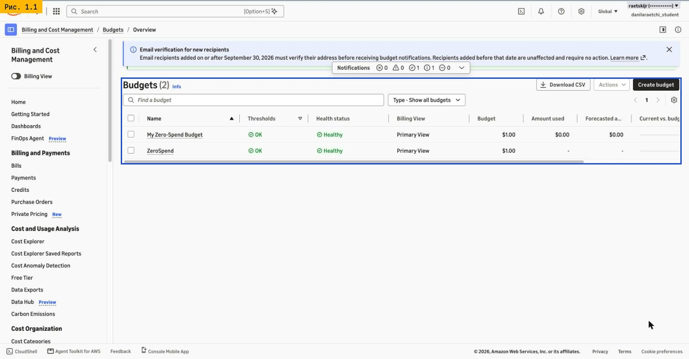

Рис. 1.1. Список `Budgets`: бюджет `ZeroSpend`.

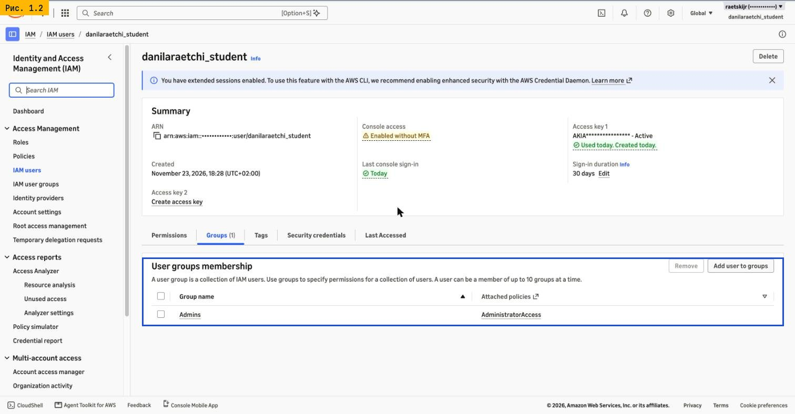

Рис. 1.2. `IAM` → `Users`: пользователь в группе `Admins`.

**Вопросы и ответы.** См. раздел 5, Q01.

### 2.2 Задание 2. Запуск экземпляра EC2

**Цель.** Запустить `webserver` с nginx, установленным через User data.

**Выполненные действия.** Ключевая пара `danilaraetchi-keypair` (ED25519, `.pem`) сохранена в `~/.ssh` с правами `400`. Создана Security Group `webserver-sg` с двумя правилами: SSH (22/tcp) с `My IP`, HTTP (80/tcp) с `0.0.0.0/0`. Экземпляр: Amazon Linux 2023, `t3.micro`, default VPC, подсеть в `eu-central-1c`, публичный IP включён, хранилище по умолчанию, User data ровно из задания (текст ниже). Теги на экземпляре, томе, SG и ключе заданы при создании. Ресурсы создавались средствами AWS CLI; их состояние проверено в консоли (рисунки 2.1, 2.3-2.5).

User data:

```bash
#!/bin/bash
dnf -y update
dnf -y install htop nginx
systemctl enable --now nginx
```

**Результат.** Экземпляр `Running`, `System status check` и `Instance status check` пройдены; nginx отвечает на порту 80.

**Доказательство.**

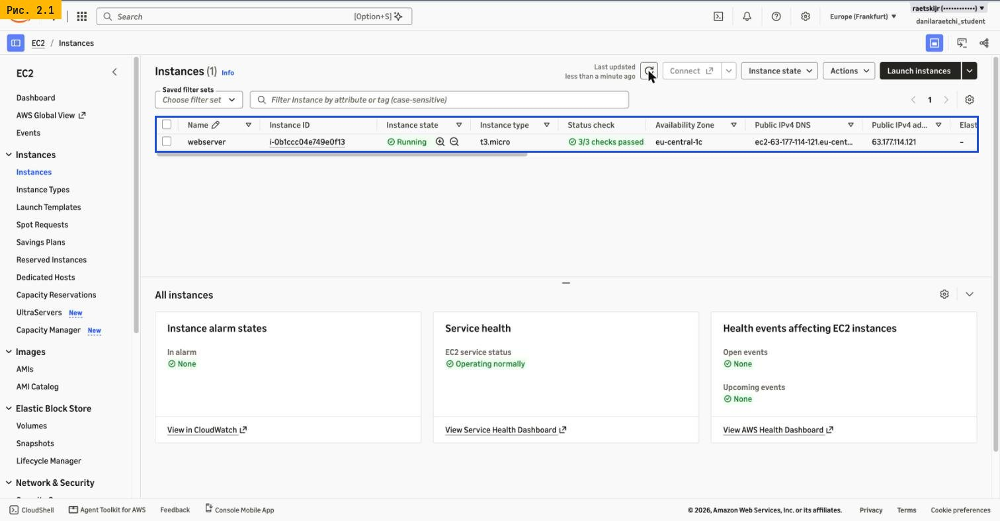

Рис. 2.1. `webserver` в состоянии `Running`, проверки `3/3`, виден ID `i-0b1ccc04e749e0f13`.

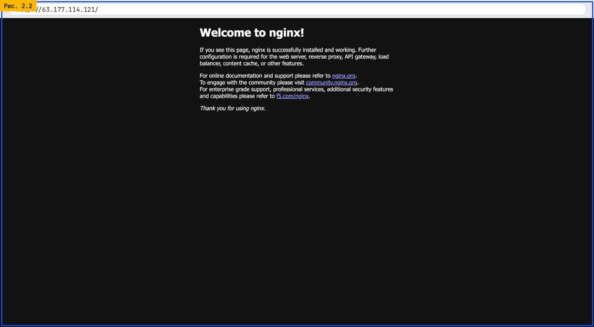

Рис. 2.2. Заводская страница nginx по публичному IP экземпляра.

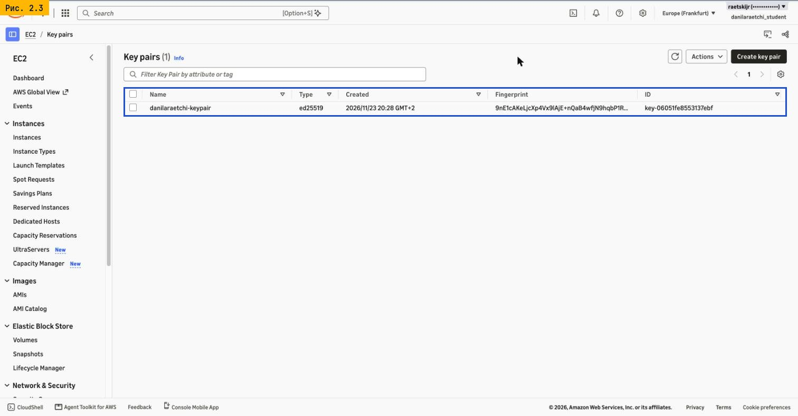

Рис. 2.3. Ключевая пара `danilaraetchi-keypair`, тип `ED25519`.

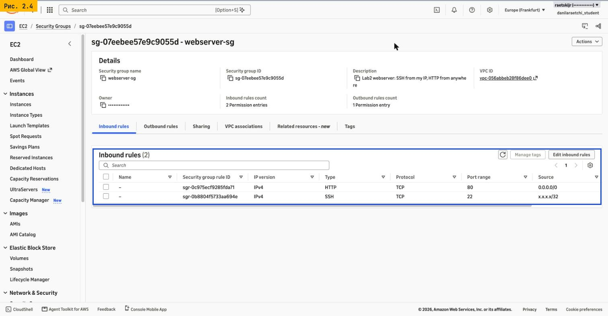

Рис. 2.4. Входящие правила `webserver-sg`: SSH с адреса `/32`, HTTP с `0.0.0.0/0`.

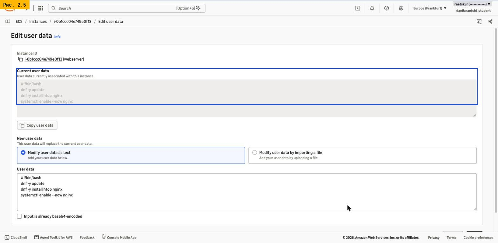

Рис. 2.5. User data экземпляра `webserver`.

**Вопросы и ответы.** См. раздел 5, Q02.

### 2.3 Задание 3. Мониторинг и диагностика

**Цель.** Ознакомиться с проверками состояния, метриками CloudWatch, системным журналом и снимком экрана.

**Выполненные действия.** Просмотрены вкладки `Status and alarms` и `Monitoring`, получены `System log` и `Instance screenshot`. Журнал консоли получен также командой `aws ec2 get-console-output` (файл `docs/lab2/logs/03-system-log.txt`); в нём зафиксирована установка пакетов `htop` и `nginx` скриптом User data.

**Результат.** Обе проверки статуса `ok`; в журнале есть строки установки nginx (`nginx-1.30.7`, `htop-3.2.1`).

**Доказательство.**

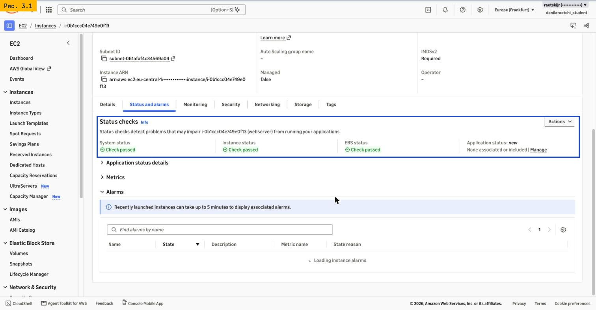

Рис. 3.1. `Status and alarms`: проверки пройдены.

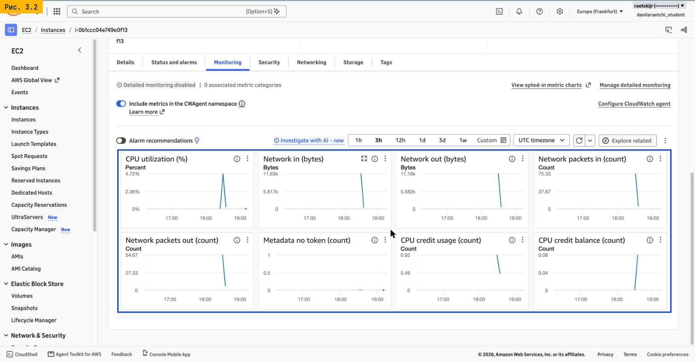

Рис. 3.2. `Monitoring`: графики CPU, сети, кредитов CPU и обращений к метаданным, базовый мониторинг (5 минут).

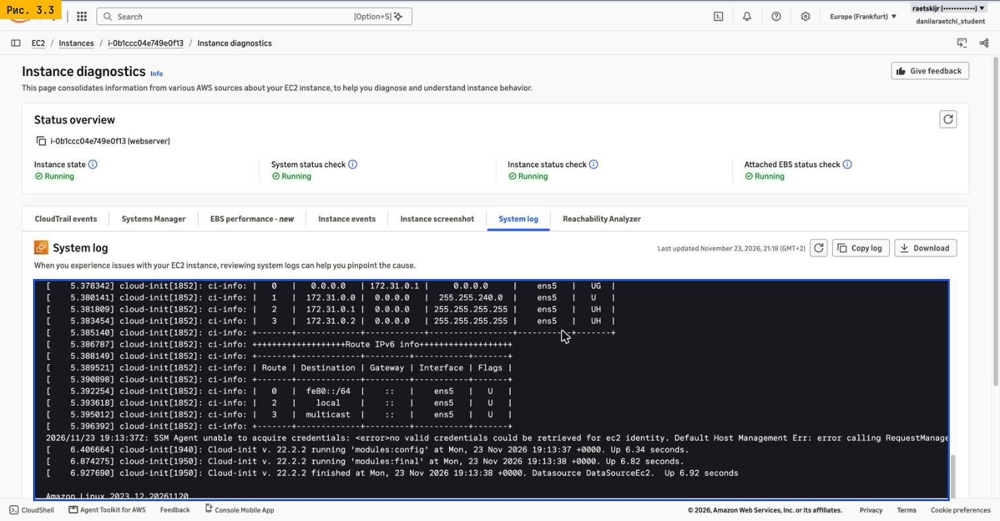

Рис. 3.3. `System log`: конец журнала текущей загрузки, cloud-init завершил работу (установка пакетов при первой загрузке в этот журнал не попала).

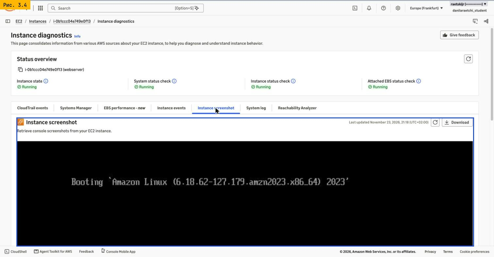

Рис. 3.4. `Get instance screenshot`: консоль загруженной системы.

**Вопросы и ответы.** См. раздел 5, Q03, Q04.

### 2.4 Задание 4. Подключение по SSH

**Цель.** Войти на экземпляр с ноутбука и проверить nginx.

**Выполненные действия.** Выполнено `chmod 400 ~/.ssh/danilaraetchi-keypair.pem` и `ssh -i ~/.ssh/danilaraetchi-keypair.pem ec2-user@<Public-IP>`. Отпечаток сервера принят при первом подключении (опция `StrictHostKeyChecking=accept-new` равнозначна ответу `yes`). Выполнено `systemctl status nginx`.

**Результат.** Служба `nginx.service` в состоянии `active (running)`.

**Доказательство.**

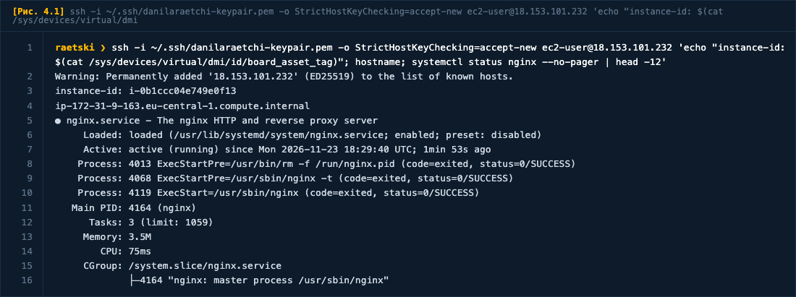

Рис. 4.1. SSH-подключение к `i-0b1ccc04e749e0f13` и вывод `systemctl status nginx`.

**Вопросы и ответы.** См. раздел 5, Q05.

### 2.5 Задание 5. Статический сайт

**Цель.** Опубликовать три HTML-страницы через `scp`.

**Выполненные действия.** На ноутбуке созданы `index.html`, `about.html`, `contact.html` (тема "Документация проекта": тёмный фон, меню слева, нумерованные разделы), страницы ссылаются друг на друга. Файлы скопированы командой `scp` в `~`, затем на сервере выполнено `sudo cp ~/*.html /usr/share/nginx/html/` и `ls -l /usr/share/nginx/html`. Исходники: каталог `site/` в рабочей папке автора.

**Результат.** Сайт открывается по публичному IP, ссылки работают.

**Доказательство.**

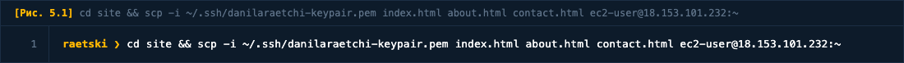

Рис. 5.1. `scp` трёх файлов на сервер (выполняется на ноутбуке).

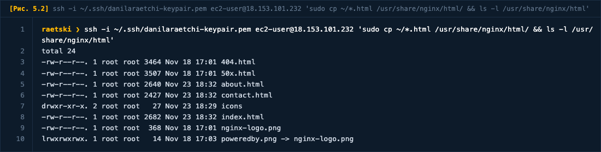

Рис. 5.2. Копирование в `/usr/share/nginx/html` и `ls -l`: видны три новых файла.

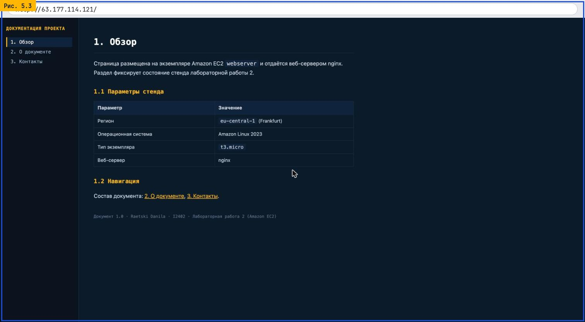

Рис. 5.3. Страница `index.html` по публичному IP.

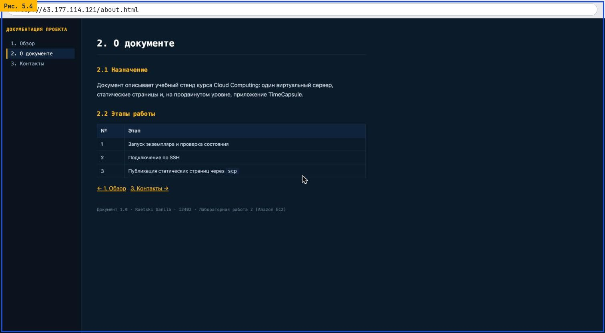

Рис. 5.4. Страница `about.html`.

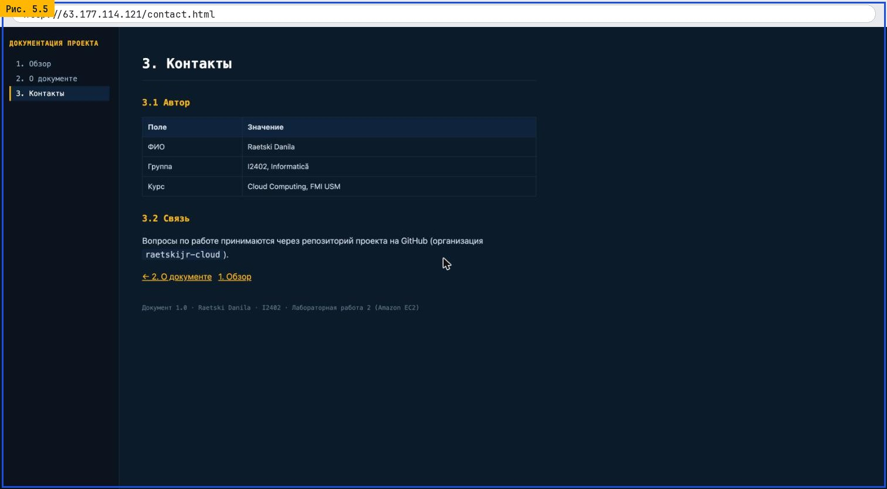

Рис. 5.5. Страница `contact.html`.

**Вопросы и ответы.** См. раздел 5, Q06.

### 2.6 Задание 6. Остановка экземпляра через AWS CLI

**Цель.** Остановить экземпляр командой AWS CLI.

**Выполненные действия.** Команда `aws ec2 stop-instances --instance-ids i-0b1ccc04e749e0f13 --region eu-central-1` выполнена дважды: на ноутбуке (первая остановка, перед Частью 2, для получения нового публичного IP при запуске) и в CloudShell (завершающая остановка по окончании работы, она же выполняет требование задания "Завершение работы").

**Результат.** Состояние экземпляра `stopping` → `stopped`; экземпляр не удалён.

**Доказательство.**

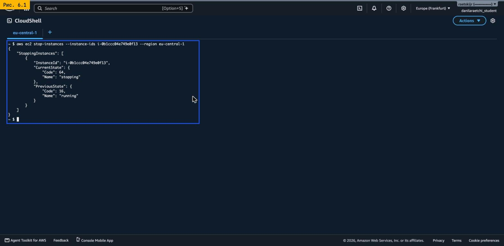

Рис. 6.1. CloudShell: команда `stop-instances` и её вывод.

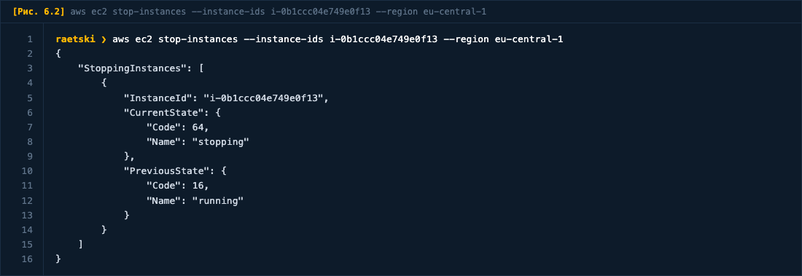

Рис. 6.2. Ноутбук: `stop-instances`, `PreviousState: running`, `CurrentState: stopping`.

**Вопросы и ответы.** См. раздел 5, Q07.

## 3. Часть 2. Продвинутый уровень

### 3.1 Задание 7. Организация и репозиторий на GitHub

**Цель.** Разместить код приложения в публичном репозитории организации.

**Выполненные действия.** Использована организация `raetskijr-cloud`; репозиторий `timecapsule` публичный, без README, `.gitignore` и лицензии от GitHub. Код `open_capsules_php_functional` лежит в корне (`composer.json`, `public`, `src`, `views`). Первый коммит: `[LR2] Initial import of TimeCapsule`. Коммиты выполняются от имени `Raetski Danila`.

**Результат.** Структура репозитория соответствует заданию.

**Доказательство.**

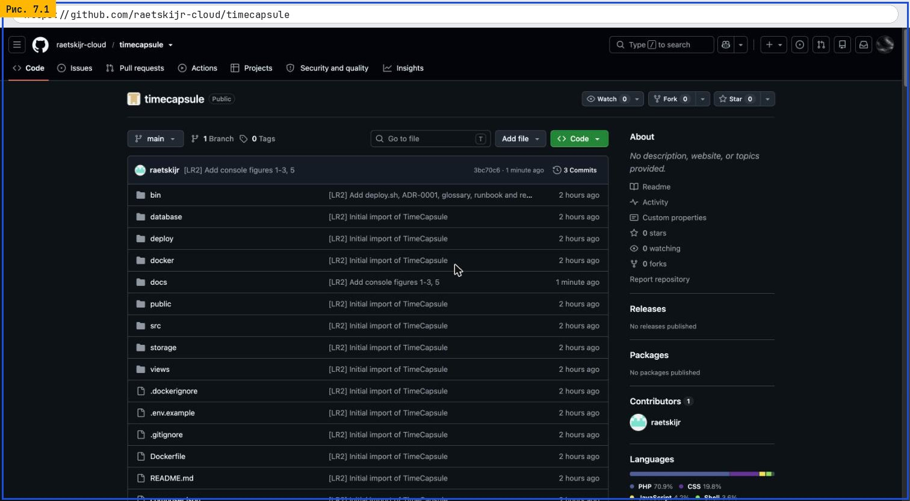

Рис. 7.1. Корень репозитория `raetskijr-cloud/timecapsule`: видны `public`, `src`, `views`, `composer.json`.

**Вопросы и ответы.** См. раздел 5, Q08.

### 3.2 Задание 8. Подготовка сервера

**Цель.** Установить пакеты для приложения.

**Выполненные действия.** Экземпляр запущен после остановки (публичный IP изменился: `18.153.101.232` → `3.123.232.228`). Установлены `git composer postgresql16-server php8.4-fpm php8.4-cli php8.4-pgsql php8.4-mbstring php8.4-xml`; nginx установлен User data ранее. Проверены `php -v` и `php -m | grep pdo_pgsql`.

**Результат.** PHP 8.4.28, расширение `pdo_pgsql` загружено.

**Доказательство.**

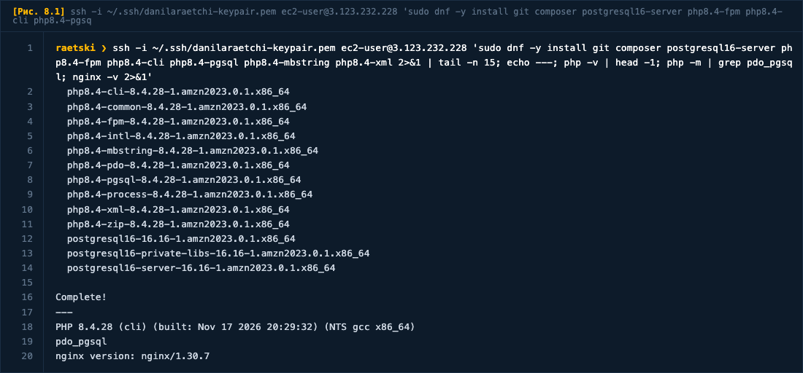

Рис. 8.1. Установка пакетов (конец вывода), `php -v`, `pdo_pgsql`, версия nginx.

**Вопросы и ответы.** См. раздел 5, Q09.

### 3.3 Задание 9. База данных PostgreSQL

**Цель.** Подготовить PostgreSQL 16 с отдельным пользователем и базой.

**Выполненные действия.** `postgresql-setup --initdb`; в `pg_hba.conf` метод `ident` заменён на `scram-sha-256` через `sed`; служба включена `systemctl enable --now postgresql`; создан пользователь `timecapsule` и база `timecapsule` (владелец `timecapsule`) с собственным паролем, который в отчёт не включён. Проверено подключение по паролю.

**Результат.** Подключение к `localhost` по паролю успешно.

**Доказательство.**

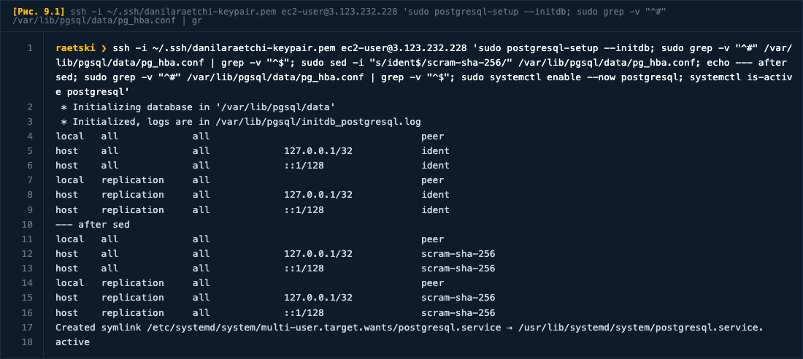

Рис. 9.1. `pg_hba.conf` до и после замены `ident` на `scram-sha-256`.

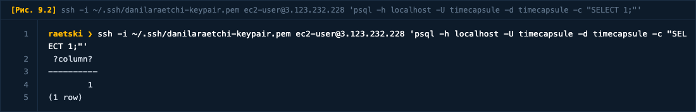

Рис. 9.2. `psql -h localhost -U timecapsule -d timecapsule -c "SELECT 1;"`: результат `1`.

### 3.4 Задание 10. Развёртывание кода на сервере

**Цель.** Получить код из репозитория по HTTPS и настроить окружение.

**Выполненные действия.** `/var/www/timecapsule` (владелец `ec2-user`), `git clone` по HTTPS без ключей; `.env` по шаблону задания (пароль не публикуется); `chmod 640 .env`, `chgrp apache .env`, `chown -R apache:apache storage`; `composer install --no-dev --optimize-autoloader`; `php bin/init-db.php`.

**Результат.** Скрипт сообщает `Database is ready`.

**Доказательство.**

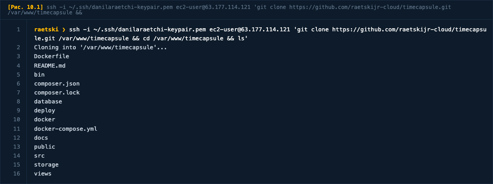

Рис. 10.1. `git clone` и содержимое каталога.

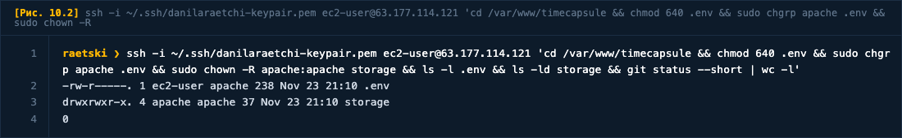

Рис. 10.2. Права на `.env` и `storage`.

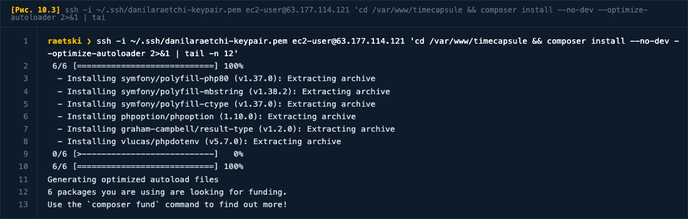

Рис. 10.3. `composer install` (конец вывода).

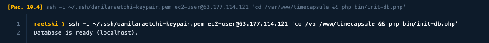

Рис. 10.4. `php bin/init-db.php`: `Database is ready`.

**Вопросы и ответы.** См. раздел 5, Q10.

### 3.5 Задание 11. PHP-FPM и nginx

**Цель.** Подключить PHP-FPM к nginx и открыть приложение.

**Выполненные действия.** В `/etc/php.ini` задано `upload_max_filesize = 6M`; создан `/etc/nginx/conf.d/timecapsule.conf` по заданию (корень `public`, сокет `/run/php-fpm/www.sock`, `client_max_body_size 8M`, запрет скрытых файлов); `nginx -t`, `systemctl enable --now php-fpm`, `systemctl restart nginx`.

**Результат.** Открывается страница входа; `/health` отвечает `{"status":"ok","db":"ok",...}`.

**Доказательство.**

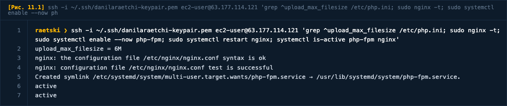

Рис. 11.1. `sudo nginx -t` и запуск служб.

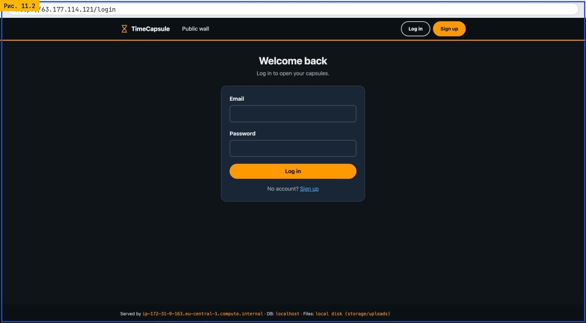

Рис. 11.2. Страница входа TimeCapsule по публичному IP.

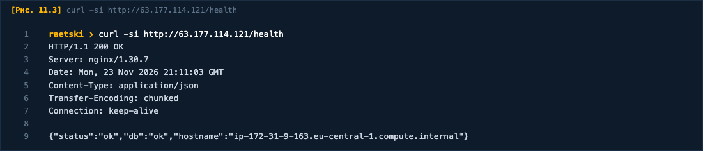

Рис. 11.3. `curl -si /health`: статус 200 и тело `ok`.

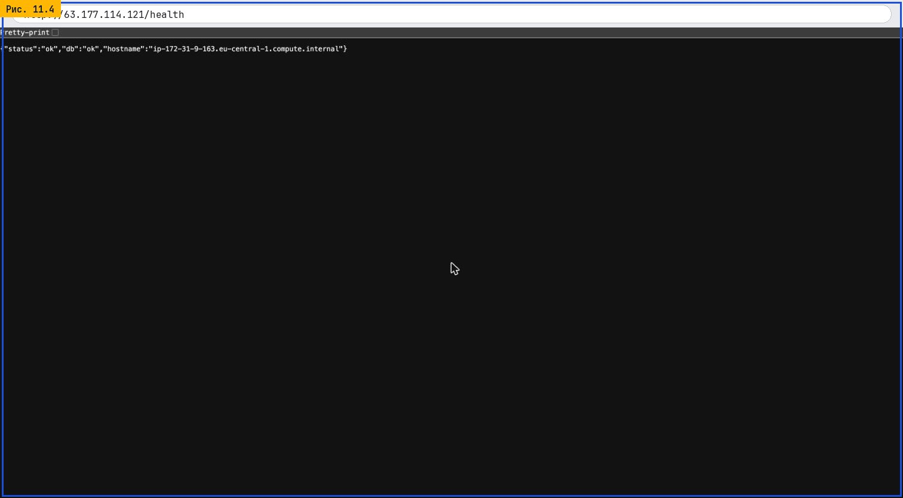

Рис. 11.4. Адрес `/health` в браузере.

### 3.6 Задание 12. Обновление приложения (вариант B)

**Цель.** Выпускать версии одной командой.

**Выполненные действия.** Скрипт `bin/deploy.sh` лежит в репозитории, на сервере `~/deploy.sh` является ссылкой на него (`chmod +x`). Шаги нумеруются `[1/5]...[5/5]`; предусмотрены ключ `--dry-run` и журнал `~/deploy.log`. Запуски: пробный (`--dry-run`), на сервере (`Already up to date`), с ноутбука через `ssh`.

**Результат.** Деплой выполняется одной командой, в конце выводится текущий коммит.

**Доказательство.**

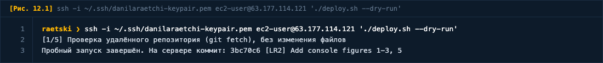

Рис. 12.1. `./deploy.sh --dry-run`.

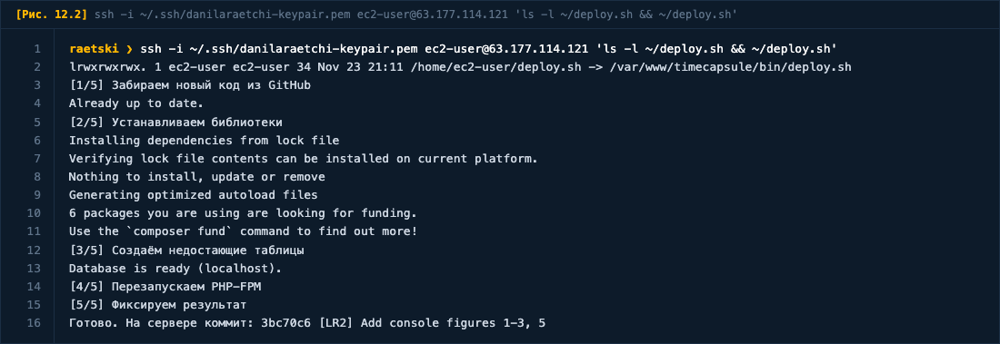

Рис. 12.2. `~/deploy.sh` на сервере: `Already up to date`.

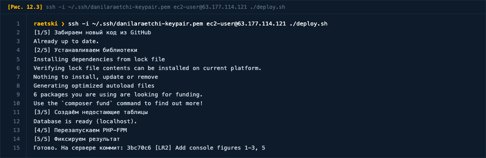

Рис. 12.3. `ssh ... ./deploy.sh` с ноутбука.

**Вопросы и ответы.** См. раздел 5, Q11.

### 3.7 Задание 13. Новая версия, поломка и откат

**Цель.** Пройти полный цикл выпуска, поломки и отката через репозиторий.

**Выполненные действия.** Пользователь зарегистрировался в приложении и создал капсулу с файлом (выполнено пользователем, пароль в отчёт не входит). Далее: (1) `[LR2] Show author in footer`, push, деплой; (2) `[LR2] Break layout (syntax error)`: в конец `views/layout.php` добавлена незакрытая конструкция `<?php if ($x) {`, push, деплой; (3) `git revert --no-edit HEAD`, push, деплой. Отметки времени: `docs/lab2/logs/13-timeline.txt`, опрос `/`, `/health` и `/login` каждые 2 с: `docs/lab2/logs/13-watch.txt`.

**Результат.** После шага 1 в подвале видна новая строка, капсула сохранена. После шага 2 страницы, которые рисуют шаблон (`/login` и все страницы после входа), отвечают `500`, а `/health` отвечает `ok`; главная без сессии отдаёт `302` на `/login`, поэтому для проверки использовался `/login`. После шага 3 сайт восстановлен. Время простоя: 24 с (по отметкам `13-timeline.txt`).

**Доказательство.**

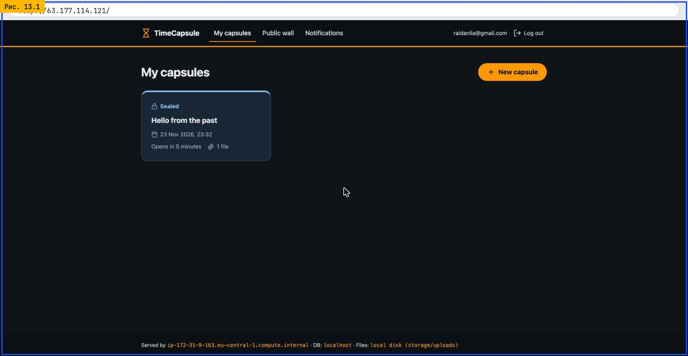

Рис. 13.1. Капсула с вложенным файлом до выпуска версии 2.

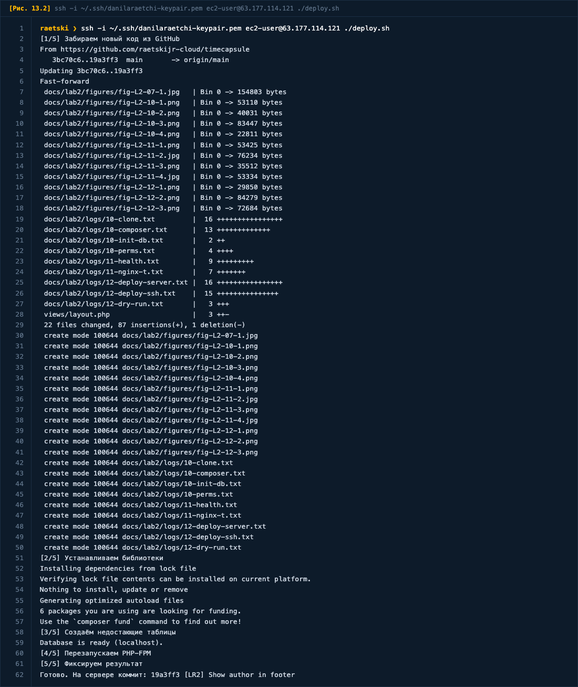

Рис. 13.2. Деплой версии 2.

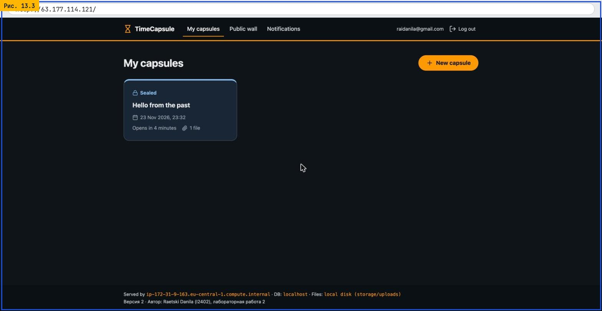

Рис. 13.3. Подвал с именем автора; капсула на месте.

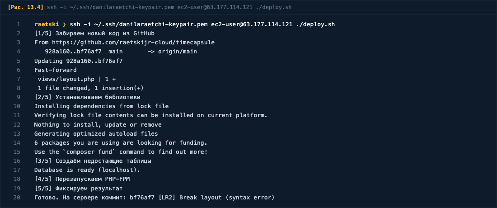

Рис. 13.4. Деплой сломанной версии.

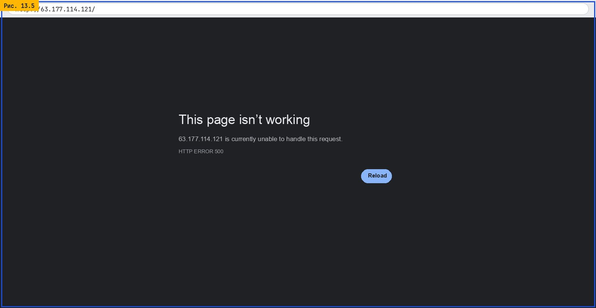

Рис. 13.5. Страница сайта при сломанном шаблоне: ошибка `500` (рисунок воспроизводит страницу ошибки браузера, обычный снимок такой страницы инструмент съёмки не делает).

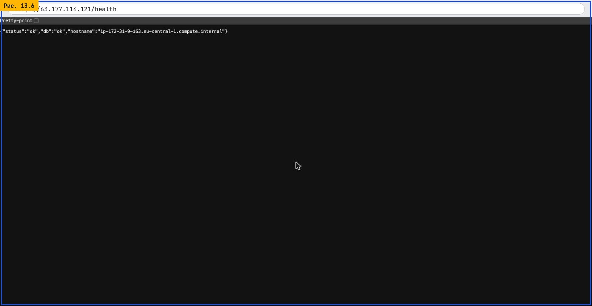

Рис. 13.6. `/health` отвечает `ok` при сломанной главной.

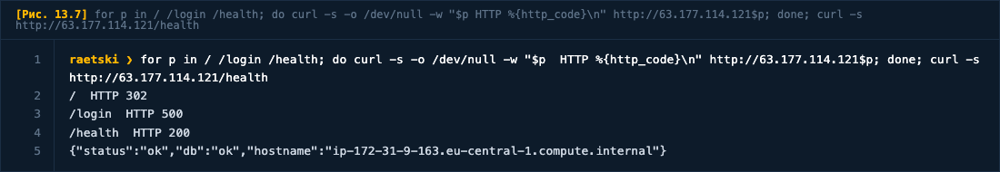

Рис. 13.7. `curl`: коды ответа `/`, `/login` и `/health` во время поломки.

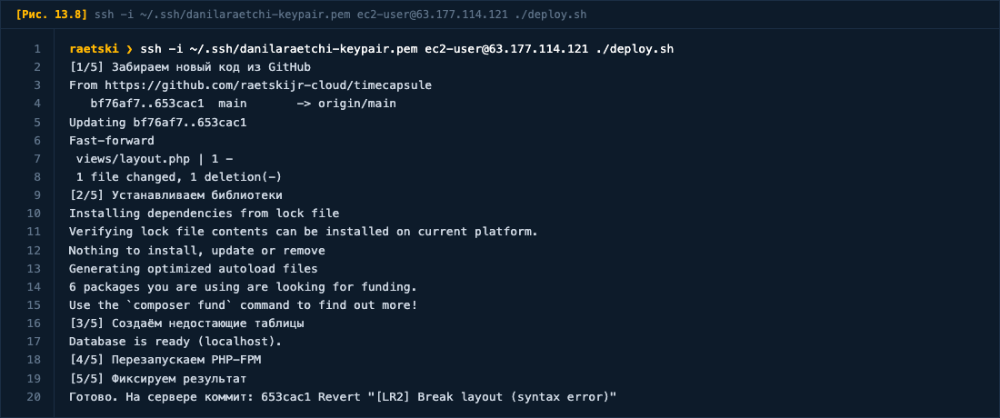

Рис. 13.8. Деплой после `git revert`.


Рис. 13.9. Сайт после отката работает, капсула сохранена.

**Вопросы и ответы.** См. раздел 5, Q12, Q13.

## 4. Архитектура и ADR

### 4.1 Схема (Задание 14)

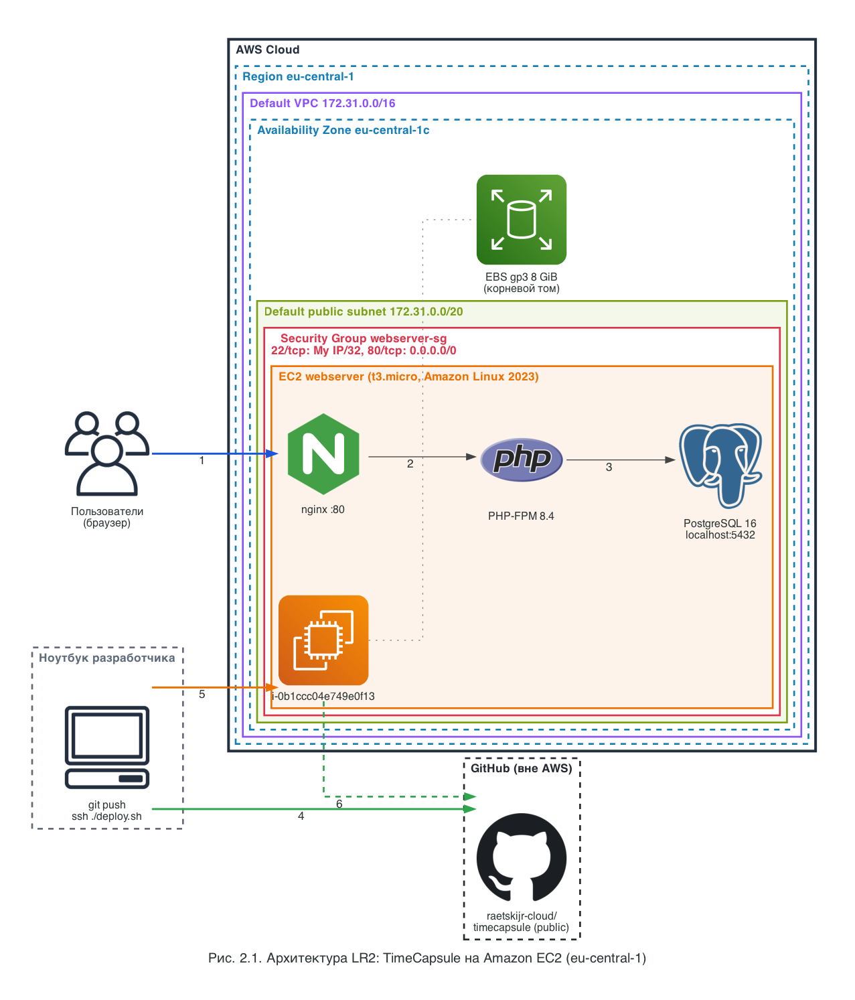

Рис. 14.1. Развёртывание LR2: один экземпляр EC2 в default VPC, зона `eu-central-1c`; код забирается с GitHub по HTTPS.

Легенда стрелок:

| № | Стрелка | Смысл |
| --- | --- | --- |
| 1 | синяя, сплошная | HTTP, порт 80: браузер пользователя - nginx |
| 2 | серая | nginx - PHP-FPM через unix-сокет `/run/php-fpm/www.sock` |
| 3 | серая | PHP-FPM - PostgreSQL, SQL на `localhost:5432` |
| 4 | зелёная, сплошная | `git push` с ноутбука в GitHub |
| 5 | оранжевая, сплошная | SSH, порт 22: запуск `deploy.sh` с ноутбука |
| 6 | зелёная, пунктир | `git pull` по HTTPS с сервера (только чтение) |

Соответствие подписей на схеме и ресурсов:

| Подпись | Ресурс |
| --- | --- |
| Region eu-central-1 | Europe (Frankfurt) |
| Default VPC | `vpc-056abbeb28f86dee0`, `172.31.0.0/16` |
| Availability Zone eu-central-1c | зона подсети `subnet-061afaf4c34569a04` |
| Default public subnet | `172.31.0.0/20` |
| Security Group webserver-sg | `sg-07eebee57e9c9055d` |
| EC2 webserver | `i-0b1ccc04e749e0f13` |
| EBS gp3 8 GiB | `vol-0a07c63d5caf89f6f` |

Internet Gateway на схеме не показан: по заданию рисуются только пройденные элементы.

### 4.2 ADR

Решение о способе доставки кода: [`docs/adr/0001-deploy-method.md`](docs/adr/0001-deploy-method.md).

## 5. Ответы на контрольные вопросы

**Q01. Что разрешает `AdministratorAccess`? Почему нельзя использовать root?** Политика разрешает любые действия над любыми ресурсами аккаунта, кроме операций, доступных только root. Root имеет неограниченные права и не может быть урезан политиками, поэтому утечка его пароля означает потерю аккаунта. Пользователь IAM отзывается, получает MFA и отдельный журнал действий в CloudTrail.

**Q02. Что такое User data и выполнится ли он после перезагрузки?** User data - сценарий, который `cloud-init` выполняет при первом запуске экземпляра от имени root. После обычной перезагрузки или остановки и запуска он не выполняется повторно: модуль `scripts-user` по умолчанию срабатывает один раз на экземпляр. Поэтому nginx после перезагрузки запускается своей службой systemd, а не User data.

**Q03. Какая проверка указывает на проблему на вашей стороне, какая на стороне AWS?** `System status check` относится к инфраструктуре AWS (хост, сеть, питание); при сбое решение - остановить и запустить экземпляр, чтобы он переехал на другой хост. `Instance status check` относится к самой ОС: ошибка файловой системы, неверная настройка сети, зависшее ядро; её исправляет владелец. Проверка `Attached EBS` показывает доступность томов.

**Q04. Когда включать детальный мониторинг?** Когда пятиминутного разрешения мало: для автоматического масштабирования, быстрых аварийных сигналов и разбора кратковременных пиков нагрузки. Он платный (метрики раз в минуту), поэтому для учебного стенда и редко меняющейся нагрузки не нужен.

**Q05. Почему вход по ключу, а не по паролю?** Пароль можно подобрать перебором, а в интернете такие попытки идут непрерывно. Приватный ключ ED25519 не передаётся по сети и не подбирается; на сервере хранится только публичная часть. Кроме того, ключ можно закрыть парольной фразой и отозвать, удалив строку из `authorized_keys`.

**Q06. Что делает `scp` и чем похож на `ssh`?** `scp` копирует файлы между компьютерами по защищённому каналу. Он использует тот же протокол, те же ключи и тот же порт 22, что и `ssh`, поэтому аутентификация и шифрование совпадают. Выполняется на ноутбуке, а не на сервере.

**Q07. Чем `Stop` отличается от `Terminate`? За что платим при остановке?** `Stop` выключает экземпляр, диск EBS и данные на нём сохраняются, экземпляр можно запустить снова. `Terminate` удаляет экземпляр безвозвратно вместе с корневым томом (по умолчанию). При остановке перестаёт начисляться плата за вычисления, но продолжают оплачиваться тома EBS и неиспользуемые Elastic IP.

**Q08. Почему `vendor/` и `.env` не в репозитории?** В `.gitignore` указаны `/vendor/` и `/.env`. `vendor/` воспроизводится командой `composer install` по `composer.lock`, поэтому хранить сторонний код в репозитории незачем. `.env` содержит пароль к базе и адрес сервера: секреты не должны попадать в историю git, особенно публичного репозитория.

**Q09. Почему пакеты установлены вручную, а не в User data?** User data выполняется один раз, не показывает результат в интерактивном виде, а при ошибке пакета скрипт тихо продолжается или обрывается. При ручной установке видны сообщения, версии и ошибки, их можно исправить сразу. Кроме того, образ с User data пришлось бы пересоздавать при каждом изменении состава пакетов.

**Q10. Почему пароль БД лежит в `.env` на сервере, а не в репозитории? Почему публичный репозиторий безопасен?** Репозиторий видит любой, а `.env` на сервере защищён правами `640` (владелец `ec2-user`, группа `apache`) и закрыт в nginx правилом `deny` для скрытых файлов. В публичном репозитории только код без секретов; PostgreSQL слушает `localhost` и снаружи недоступен, а порт 5432 в Security Group закрыт. Знание кода не даёт доступа к данным.

**Q11. Что увидит посетитель во время `git pull`? Что будет без `composer install`?** `git pull` заменяет файлы по одному, и в течение нескольких секунд сервер может исполнять смесь старых и новых файлов, например новый шаблон со старой функцией; возможны ошибки 500. Если после `git pull` не выполнится `composer install`, а список библиотек изменился, приложение не найдёт нужные классы в `vendor/` и вернёт ошибку. Скрипт с `set -e` останавливается на сбое и не перезагружает PHP-FPM.

**Q12. Почему `/health` отвечает `ok` при сломанной главной? Что он проверяет, чего не хватает?** Обработчик `/health` выполняет запрос `SELECT COUNT(*) FROM users` и не подключает `views/layout.php`, где находится ошибка, поэтому проверка проходит. Она подтверждает только связь PHP с базой. Не хватает проверки отрисовки страницы: например, запроса главной страницы и проверки кода ответа и ключевой строки.

**Q13. Сколько времени сайт был сломан, из каких шагов, как сократить?** Время простоя: 24 с; по отметкам `docs/lab2/logs/13-timeline.txt`: от `push` сломанного коммита (21:29:37 UTC) до восстановления страницы входа после отката (21:30:01 UTC; ответы `500` в опросе с 21:29:39 по 21:29:56). Время складывается из обнаружения поломки человеком, создания `git revert`, `git push` и выполнения `deploy.sh` (его шаги с `composer install` занимают основное время). Сократить можно автоматической проверкой главной страницы после деплоя с автооткатом, проверкой кода в CI до попадания на сервер и расширенным `/health`.

**Q14 (устный 1). Путь запроса от браузера до БД.** Браузер отправляет HTTP-запрос на публичный IP, порт 80; Security Group пропускает его на экземпляр. nginx отдаёт статические файлы из `public/` сам, а запрос к PHP передаёт через unix-сокет в PHP-FPM. PHP-FPM исполняет `public/index.php`, приложение по паролю из `.env` обращается к PostgreSQL на `localhost:5432`, а готовый HTML возвращается по той же цепочке.

**Q15 (устный 2). Почему сервер читает, но не пишет в репозиторий?** Репозиторий публичный, поэтому читать его по HTTPS можно без учётных данных, а запись требует входа в GitHub, которого на сервере нет. Если сервер взломают, злоумышленник не сможет подменить код в репозитории и распространить его на другие развёртывания. Единственный источник кода остаётся под контролем разработчика.

**Q16 (устный 3). Что с файлами при удалении EC2?** Загруженные файлы лежат в `storage/uploads` на корневом томе EBS. При `Terminate` корневой том по умолчанию удаляется вместе с экземпляром (`DeleteOnTermination`), поэтому файлы и база данных пропадут; при `Stop` они сохранятся. Поэтому хранилище файлов и БД в следующих лабораторных выносятся в отдельные сервисы.

**Q17 (устный 4). Что общего у `deploy.sh` и CI/CD, чего не хватает?** Общее: код берётся из репозитория, шаги выполняются в фиксированном порядке и останавливаются при ошибке, итоговая версия определяется коммитом. Не хватает автоматического запуска по `push`, тестов и проверки сборки до выкладки, проверки работоспособности после выпуска, автоматического отката и журнала с привязкой к автору коммита.

## Приложение A. Журнал команд

| Файл | Содержимое |
| --- | --- |
| `docs/lab2/logs/03-system-log.txt` | Журнал консоли экземпляра (`get-console-output`), номер аккаунта скрыт |
| `docs/lab2/logs/03-instance-status.json` | `describe-instance-status`: оба статуса `ok` |
| `docs/lab2/logs/04-ssh-nginx.txt` | SSH и `systemctl status nginx` |
| `docs/lab2/logs/05-scp.txt`, `docs/lab2/logs/05-ls.txt` | Копирование сайта и `ls -l` |
| `docs/lab2/logs/06-stop-laptop.txt` | `stop-instances` на ноутбуке |
| `docs/lab2/logs/08-install.txt` | Установка пакетов, версии |
| `docs/lab2/logs/09-initdb.txt`, `docs/lab2/logs/09-psql.txt` | Инициализация PostgreSQL, `SELECT 1` |

Журналы заданий 10-13 лежат в `docs/lab2/logs/` (`10-*`, `11-*`, `12-*`, `13-*`). Первая попытка задания 13 (`13-timeline-attempt1.txt`) опрашивала только главную без сессии (она отвечает `302` и при поломке), поэтому цикл поломки и отката выполнен повторно с проверкой `/login`; рисунок 13.6 снят во время первой попытки.

Скрипты ноутбука (вне репозитория приложения): `tools/rtshot.py` (рендер терминала), `tools/cap.sh` (команда + журнал + снимок), `tools/site-mode.sh`, `tools/phase-app.sh`, `tools/phase13.sh`.

## Приложение B. Термины

| Термин | Определение |
| --- | --- |
| User data | Сценарий первого запуска, выполняемый `cloud-init` |
| Security Group | Сетевой фильтр экземпляра, правила только разрешающие |
| `ident` / `scram-sha-256` | Методы проверки подключения в `pg_hba.conf`: по имени ОС и по паролю |
| `deploy.sh` | Скрипт выпуска версии: `git pull`, `composer install`, `init-db`, перезагрузка PHP-FPM |
| ADR | Запись архитектурного решения |

Полный список: [`docs/glossary.md`](docs/glossary.md).

## Приложение C. Остановка и запуск (runbook)

Краткий порядок: запуск `aws ec2 start-instances`; после запуска взять новый публичный IP и обновить `APP_URL` в `.env`; проверка `/health`; остановка `aws ec2 stop-instances`. Подробности: [`docs/runbook.md`](docs/runbook.md).
