# Отчёт по лабораторной работе №3. Облачные сети. Amazon VPC

| Поле | Значение |
| --- | --- |
| Версия отчёта | 1.0 (черновик: места `<!-- TODO-FIG -->` ждут снимков консоли) |
| Дата | 2026-11-23 |
| ФИО | Raetski Danila |
| Группа | I2402 |
| Специальность | Informatică (вариант B: `nat-up.sh` и `nat-down.sh`) |
| Номер `k` | 14 (`X = 14 % 30 = 14`, диапазон `10.14.0.0/16`) |
| Уровень | продвинутый (Часть 1 и Часть 2, задания 1-14) |
| Репозиторий | https://github.com/raetskijr-cloud/timecapsule |
| Регион | `eu-central-1` (Frankfurt) |
| Отчёт ЛР2 | [`README.md`](../../README.md) в корне, `docs/lab2/README.md` |

## Оглавление

0. Сводка
1. Матрица трассируемости и таблица рисунков
2. Часть 1. Базовый уровень (задания 1-7)
3. Часть 2. Продвинутый уровень (задания 8-13)
4. Архитектура и ADR (задание 14)
5. Итог: состояние на конец работы
6. Ответы на контрольные вопросы
- Приложение A. Журнал команд
- Приложение B. Термины
- Приложение C. Остановка и запуск (runbook)
- Приложение D. Текстовая карта сети

## 0. Сводка

| Показатель | Значение |
| --- | --- |
| Построено | `timecapsule-dev-vpc` с 4 подсетями в 2 зонах, Internet Gateway, 2 таблицы маршрутов, 3 Security Group, серверы `bastion`, `app`, `db`, приватная зона `timecapsule.internal` |
| VPC | `vpc-0e546b4458d635288`, `10.14.0.0/16`, DNS resolution и DNS hostnames включены |
| Серверы | `timecapsule-dev-bastion` `i-00b98df1a7e3c039b` (`public-b`, `10.14.1.17`); `timecapsule-dev-app` `i-030783e43288ed6cb` (`public-a`, `10.14.0.11`, Elastic IP `63.182.78.191`); `timecapsule-dev-db` `i-07e6ce6c6612196ea` (`private-a`, `10.14.10.165`) |
| Теги | `Name`, `Project=timecapsule`, `Environment=dev`, `Owner=danilaraetchi`, `Lab=lab3`, `Purpose=coursework` на всех ресурсах, включая диски, AMI и снимок, Elastic IP, зону |
| Переезд приложения | AMI `timecapsule-dev-app-lab2` из `webserver` ЛР2, `app` из образа, база перенесена `pg_dump` -> `psql` на `db`, образ и снимок удалены |
| Деплой | `ssh app ./deploy.sh` (через bastion), коммит `873c329`; `deploy.sh` не менялся |
| NAT | временный: Часть 1 вручную (команды CLI), задание 13 скриптами `scripts/nat-up.sh`, `scripts/nat-down.sh` |
| Решение | [ADR-0002](../adr/0002-database-placement.md): база на отдельном сервере в приватной подсети |
| Состояние на конец работы | `bastion`, `app`, `db` остановлены; `webserver` ЛР2 и `web` завершены; NAT нет; Elastic IP только `timecapsule-dev-app-eip` |

## 1. Матрица трассируемости и таблица рисунков

### 1.1 Матрица "требование - доказательство"

| Требование задания | Задание | Рисунок | Раздел |
| --- | --- | --- | --- |
| Таблица адресов подсетей, `X = k % 30` | 1 | таблица 2.1 | 2.1 |
| VPC и четыре подсети, DNS, auto-assign IP | 2 | Рис. 2.1, 2.2 | 2.2 |
| IGW, `public-rt`, `private-rt`, связи | 3 | Рис. 3.1, 3.2, 3.3 | 2.3 |
| Правила трёх Security Group | 4 | Рис. 4.1, 4.2 | 2.4 |
| Три сервера, страница `web`, SSH через bastion, зависший `dnf` на `db` | 5 | Рис. 5.1-5.4 | 2.5 |
| Временный NAT, `checkip`, PostgreSQL, удаление NAT, `Blackhole`, `Deleted` | 6 | Рис. 6.1-6.9 | 2.6 |
| `psql` с `web`, порт 5432, изоляция, NACL, Tag Editor | 7 | Рис. 7.1-7.9 | 2.7 |
| AMI и `app` из образа, `web` завершён | 8 | Рис. 8.1 | 3.1 |
| Elastic IP, `APP_URL`, приложение в браузере | 9 | Рис. 9.1, 9.2 | 3.2 |
| Пользователь `timecapsule`, `pg_hba.conf` | 10 | Рис. 10.1 | 3.3 |
| Приватная зона, запись `db`, `dig` | 11 | Рис. 11.1-11.3 | 3.4 |
| Перенос данных, переключение, `/health`, удаление AMI | 12 | Рис. 12.1-12.5 | 3.5 |
| Версия "LR3", отказ базы, `dnf update` через NAT-скрипты | 13 | Рис. 13.1-13.8 | 3.6 |
| Схема и ADR-0002 | 14 | Рис. 14.1 | 4 |
| `Elastic IPs` и `NAT gateways` после завершения | Завершение | Рис. 15.1, 15.2 | 5 |

### 1.2 Таблица рисунков

Источник: "терминал" (команды выполнены на ноутбуке с профилем `danilaraetchi_student`, вывод отрисован из журнала `logs/`),
"консоль" и "браузер" (снимки из Chrome; номер аккаунта и домашний IP скрыты).

| Рис. | Что показано | Файл | Источник |
| --- | --- | --- | --- |
| 2.1 | VPC, DNS-атрибуты, четыре подсети | `figures/fig-L3-02-1.png` | терминал |
| 2.2 | Список подсетей в консоли | `figures/fig-L3-02-2.jpg` | консоль |
| 3.1 | Маршруты и связи `public-rt`, `private-rt` | `figures/fig-L3-03-1.png` | терминал |
| 3.2, 3.3 | `public-rt` и `private-rt` в консоли: `Routes`, `Subnet associations` | `figures/fig-L3-03-2.jpg`, `03-3.jpg` | консоль |
| 4.1 | Правила трёх Security Group | `figures/fig-L3-04-1.png` | терминал |
| 4.2 | Входящие правила трёх Security Group в консоли | `figures/fig-L3-04-2.jpg` | консоль |
| 5.1 | Страница `web` (`curl`) | `figures/fig-L3-05-1.png` | терминал |
| 5.2 | `ssh bastion`, `ssh web`, `ssh db` через `ProxyJump` | `figures/fig-L3-05-2.png` | терминал |
| 5.3 | Зависшая установка `postgresql16-server` на `db` (прервана) | `figures/fig-L3-05-3.png` | терминал |
| 5.4 | Страница `web-server` в браузере | `figures/fig-L3-05-4.jpg` | браузер |
| 6.1 | Создание NAT Gateway, Elastic IP, маршрута | `figures/fig-L3-06-1.png` | терминал |
| 6.2 | `curl https://checkip.amazonaws.com` на `db` и адрес Elastic IP шлюза | `figures/fig-L3-06-2.png` | терминал |
| 6.3, 6.4 | `dnf -y update`, `dnf -y install postgresql16-server` | `figures/fig-L3-06-3.png`, `06-4.png` | терминал |
| 6.5, 6.6 | Настройка PostgreSQL, проверка `listen_addresses`, `pg_hba.conf` | `figures/fig-L3-06-5.png`, `06-6.png` | терминал |
| 6.7 | Удаление NAT, маршрут `blackhole`, освобождение Elastic IP | `figures/fig-L3-06-7.png` | терминал |
| 6.8 | Маршрут `Blackhole` в `private-rt` | `figures/fig-L3-06-8.jpg` | консоль |
| 6.9 | `NAT gateways`: шлюз `Deleted` | `figures/fig-L3-06-9.jpg` | консоль |
| 7.1 | `psql` с `web`: `SELECT version();` | `figures/fig-L3-07-1.png` | терминал |
| 7.2 | Порт 5432: `open` с `web`, `closed` с `bastion` | `figures/fig-L3-07-2.png` | терминал |
| 7.3 | `curl -m 5 https://github.com` на `db` | `figures/fig-L3-07-3.png` | терминал |
| 7.4-7.6 | NACL: до, правило 90 включено, правило удалено | `figures/fig-L3-07-4.png` ... `07-6.png` | терминал |
| 7.7 | Ресурсы с тегом `Project=timecapsule` (Resource Groups Tagging API) | `figures/fig-L3-07-7.png` | терминал |
| 7.8 | Источник CloudShell во время правила 90: сайт открывается | `figures/fig-L3-07-8.jpg` | консоль |
| 7.9 | `Tag Editor`: `Project=timecapsule` | `figures/fig-L3-07-9.jpg` | консоль |
| 8.1 | `app` из образа: приложение, службы, капсула ЛР2 | `figures/fig-L3-08-1.png` | терминал |
| 9.1 | Elastic IP `app-eip`, `APP_URL`, `/health` | `figures/fig-L3-09-1.png` | терминал |
| 9.2 | Приложение в браузере по Elastic IP, вход под пользователем ЛР2 | `figures/fig-L3-09-2.jpg` | браузер |
| 10.1 | Пользователь `timecapsule`, `pg_hba.conf`, проверка доступа | `figures/fig-L3-10-1.png` | терминал |
| 11.1 | Создание приватной зоны и записи `db` | `figures/fig-L3-11-1.png` | терминал |
| 11.2 | Запись `db`, `dig` с `app`, `dig` и `nslookup` с ноутбука | `figures/fig-L3-11-2.png` | терминал |
| 11.3 | Запись `db` в зоне `timecapsule.internal` | `figures/fig-L3-11-3.jpg` | консоль |
| 12.1 | `pg_dump` и `psql -f` | `figures/fig-L3-12-1.png` | терминал |
| 12.2, 12.3 | Переключение `DB_HOST`; сбой из-за прав `.env` и исправление | `figures/fig-L3-12-2.png`, `12-3.png` | терминал |
| 12.4 | Удаление AMI и снимка | `figures/fig-L3-12-4.png` | терминал |
| 12.5 | `/health` и капсулы ЛР2 на странице | `figures/fig-L3-12-5.jpg` | браузер |
| 13.1 | `ssh app ./deploy.sh` | `figures/fig-L3-13-1.png` | терминал |
| 13.2, 13.3 | Отказ базы: `/health` и главная; запуск базы, восстановление | `figures/fig-L3-13-2.png`, `13-3.png` | терминал |
| 13.4-13.6 | `nat-up.sh`, `dnf -y update` на `db`, `nat-down.sh` | `figures/fig-L3-13-4.png` ... `13-6.png` | терминал |
| 13.7 | Подвал "LR3" на странице | `figures/fig-L3-13-7.jpg` | браузер |
| 13.8 | `/health` при остановленной базе в браузере | `figures/fig-L3-13-8.jpg` | браузер |
| 14.1 | Схема архитектуры | `figures/fig-L3-14-1.png` | diagrams |
| 15.1, 15.2 | `Elastic IPs` и `NAT gateways` после завершения | `figures/fig-L3-15-1.jpg`, `15-2.jpg` | консоль |
| 15.3 | Состояния экземпляров, NAT и Elastic IP (CLI) | `figures/fig-L3-15-3.png` | терминал |

## 2. Часть 1. Базовый уровень (задания 1-7)

Сеть, группы и серверы созданы одним скриптом `tools/build-part1.sh` (AWS CLI, `--tag-specifications` на каждом ресурсе,
вывод в `logs/00-build-part1.txt`); последующие задания выполнены отдельными командами.

### 2.1 Задание 1. План адресов

**Цель.** Рассчитать диапазоны по `k = 14`. **Результат.** `X = 14 % 30 = 14`.

| Подсеть | AZ | CIDR | Первый адрес для экземпляров | Последний адрес | Адресов для экземпляров |
| --- | --- | --- | --- | --- | --- |
| `timecapsule-dev-public-a` | `eu-central-1a` | `10.14.0.0/24` | `10.14.0.4` | `10.14.0.254` | 251 |
| `timecapsule-dev-public-b` | `eu-central-1b` | `10.14.1.0/24` | `10.14.1.4` | `10.14.1.254` | 251 |
| `timecapsule-dev-private-a` | `eu-central-1a` | `10.14.10.0/24` | `10.14.10.4` | `10.14.10.254` | 251 |
| `timecapsule-dev-private-b` | `eu-central-1b` | `10.14.11.0/24` | `10.14.11.4` | `10.14.11.254` | 251 |

VPC: `10.14.0.0/16`. Ответ на вопрос: раздел 6, Q01.

### 2.2 Задание 2. VPC и подсети

**Выполнено.** VPC `timecapsule-dev-vpc` (`VPC only`, без IPv6, DNS resolution и DNS hostnames включены), четыре подсети по таблице 2.1,
на `public-a` и `public-b` включён `Auto-assign public IPv4`. Автоматически созданные main route table, default NACL и default
security group получили имена `timecapsule-dev-main-rt`, `-default-nacl`, `-default-sg` и теги (их видно в `Tag Editor`).

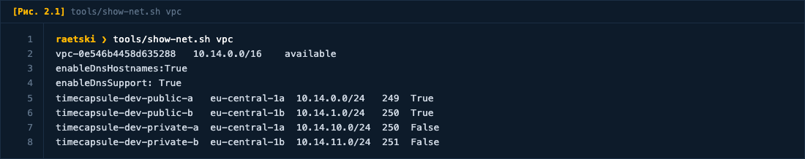

_Рис. 2.1. VPC `10.14.0.0/16` в состоянии `available`, DNS-атрибуты `True`, четыре подсети с зонами и CIDR; `True` в последней колонке у `public-a` и `public-b` (auto-assign IP)._

<!-- TODO-FIG L3 2.2 -->
_Рис. 2.2. (консоль) Список подсетей VPC `timecapsule-dev-vpc`: имена, зоны, CIDR._

### 2.3 Задание 3. Internet Gateway и таблицы маршрутов

**Выполнено.** `timecapsule-dev-igw` присоединён к VPC. `timecapsule-dev-public-rt`: `0.0.0.0/0` -> IGW, связи `public-a`, `public-b`.
`timecapsule-dev-private-rt`: только локальный маршрут, связи `private-a`, `private-b`.

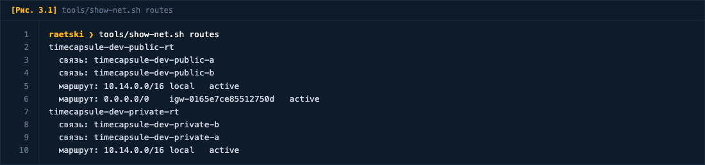

_Рис. 3.1. `public-rt` содержит маршрут в `igw-0165e7ce85512750d`, `private-rt` только `10.14.0.0/16 local`; связи с подсетями._

<!-- TODO-FIG L3 3.2, 3.3 -->
_Рис. 3.2, 3.3. (консоль) Вкладки `Routes` и `Subnet associations` у `public-rt` и `private-rt`._

### 2.4 Задание 4. Security Group

**Выполнено.** Три группы в `timecapsule-dev-vpc`, описания заполнены, тег `Name` задан отдельно от имени группы. Правила и источники: см. рисунок;
в `bastion-sg` источник `My IP` (домашний адрес скрыт).

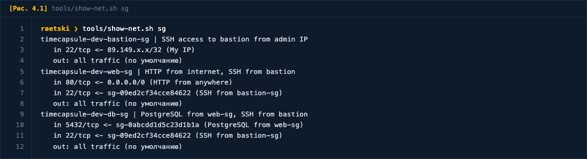

_Рис. 4.1. `bastion-sg`: SSH с `My IP/32`; `web-sg`: HTTP с `0.0.0.0/0`, SSH от `bastion-sg`; `db-sg`: 5432 от `web-sg`, SSH от `bastion-sg`; исходящие по умолчанию._

<!-- TODO-FIG L3 4.2 -->
_Рис. 4.2. (консоль) `Inbound rules` трёх групп._

### 2.5 Задание 5. Экземпляры и подключение через bastion

**Выполнено.** `bastion` (`public-b`, публичный IP), `web` (`public-a`, публичный IP, User data из задания), `db` (`private-a`, без IP):
Amazon Linux 2023, `t3.micro`, ключ `danilaraetchi-keypair`, теги на экземплярах и дисках. SSH настроен в файле `ssh_config`
(содержимое соответствует `~/.ssh/config`): `Host bastion`, `Host web`, `Host db` с `ProxyJump bastion`, приватный ключ остаётся на ноутбуке.
Файл отдельный (`ssh -F`), потому что общий `~/.ssh/config` занят другими работами; в журналах команда выглядит как `ssh db`.
`HostName` bastion обновляется после каждого запуска скриптом `tools/update-ssh.sh`.

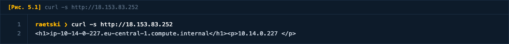

_Рис. 5.1. Ответ `web` по публичному IP: имя сервера и приватный адрес `10.14.0.227` из `10.14.0.0/24`._

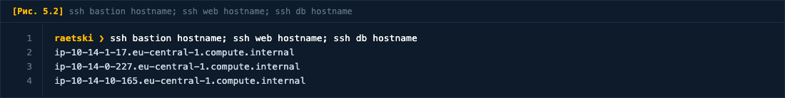

_Рис. 5.2. `ssh bastion`, `ssh web`, `ssh db` выводят имена `ip-10-14-1-17`, `ip-10-14-0-227`, `ip-10-14-10-165`._

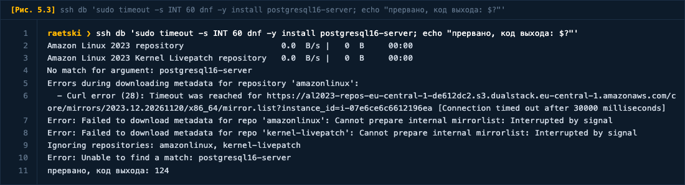

_Рис. 5.3. `dnf -y install postgresql16-server` на `db` без NAT: таймаут загрузки метаданных, команда прервана сигналом INT (код 124)._

<!-- TODO-FIG L3 5.4 -->
_Рис. 5.4. (браузер) Страница `web-server` по публичному IP._

### 2.6 Задание 6. Временный NAT Gateway

**Выполнено** командами CLI, повторяющими консольные шаги (`tools/part1-nat-up.sh`, `tools/part1-nat-down.sh`): Elastic IP без тегов
(как из формы NAT), NAT `timecapsule-dev-nat-a` в `public-a`, затем теги Elastic IP (`timecapsule-dev-nat-a-eip`), маршрут в `private-rt`.
Время жизни шлюза 22:31-22:35 UTC 2026-11-23. PostgreSQL 16.16 установлен и настроен: `listen_addresses = '*'`, строка
`host all all 10.14.0.0/24 scram-sha-256`, пользователь `student`, база `lab3` (пароль сгенерирован локально, в отчёт не попадает).

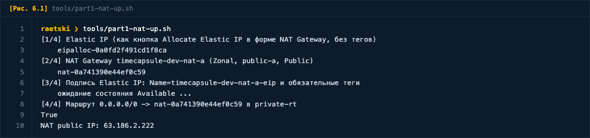

_Рис. 6.1. Elastic IP, NAT `nat-0a741390e44ef0c59`, маршрут `True`, внешний адрес шлюза `63.186.2.222`._

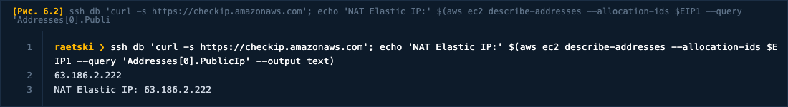

_Рис. 6.2. `checkip` на `db` возвращает `63.186.2.222`, равный Elastic IP шлюза._

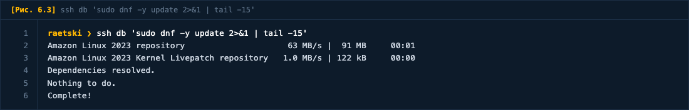

_Рис. 6.3. `dnf -y update` на `db` через NAT: метаданные получены, обновлений нет._

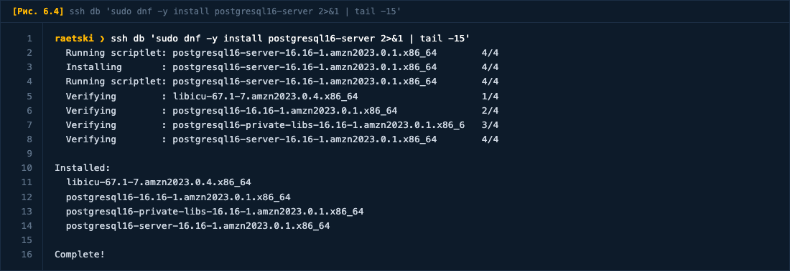

_Рис. 6.4. Установлены `postgresql16-server` 16.16 и зависимости._

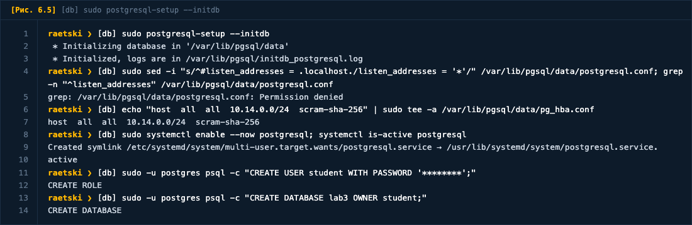

_Рис. 6.5. `initdb`, `sed` для `listen_addresses`, строка в `pg_hba.conf`, запуск службы, `CREATE USER`, `CREATE DATABASE` (первая проверка `grep` без `sudo` дала `Permission denied`, повтор на рис. 6.6)._

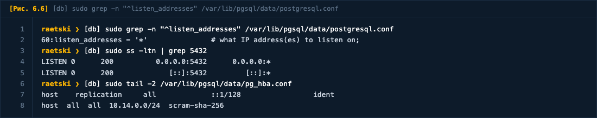

_Рис. 6.6. `listen_addresses = '*'`, порт 5432 слушает `0.0.0.0`, последняя строка `pg_hba.conf`._

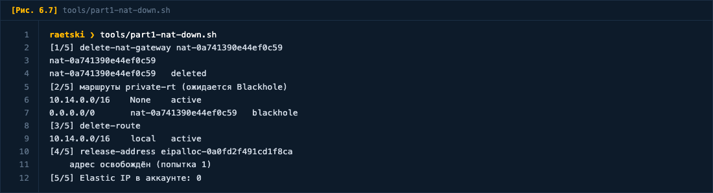

_Рис. 6.7. NAT `deleted`; маршрут `0.0.0.0/0` перешёл в `blackhole`, затем удалён; Elastic IP освобождён; в аккаунте 0 Elastic IP._

<!-- TODO-FIG L3 6.8, 6.9 -->
_Рис. 6.8. (консоль) `private-rt`: маршрут `0.0.0.0/0` в состоянии `Blackhole`._
_Рис. 6.9. (консоль) `NAT gateways`: `timecapsule-dev-nat-a` в состоянии `Deleted`._

### 2.7 Задание 7. Проверки

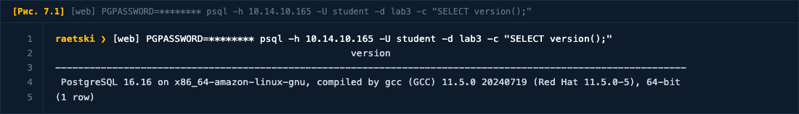

_Рис. 7.1. С `web` клиент `postgresql16` подключается к `db`, `SELECT version();` показывает PostgreSQL 16.16._

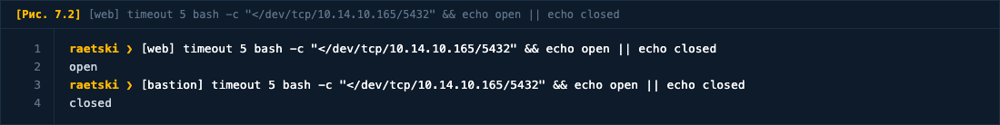

_Рис. 7.2. Проверка `/dev/tcp/10.14.10.165/5432`: с `web` `open`, с `bastion` `closed`._

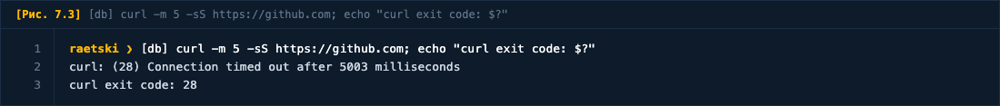

_Рис. 7.3. `curl -m 5 https://github.com` на `db`: таймаут, код 28._

**NACL.** В default NACL добавлено входящее правило 90 (`All traffic`, `<мой IP>/32`, `Deny`). Результаты (рис. 7.4-7.6): до правила сайт `web`
отвечает HTTP 200 и `ssh bastion` проходит; при правиле 90 сайт не отвечает (код curl 28), `ssh bastion` завершается таймаутом;
после удаления правила оба снова работают. Второй источник: экземпляр `webserver` из ЛР2 в default VPC (другой публичный адрес)
получает от `web` HTTP 200 при активном правиле. Телефона у исполнителя нет, поэтому второй источник в консоли
(AWS CloudShell, рис. 7.8) снимается отдельно; снимок `webserver` с терминала служит дополнительным доказательством.

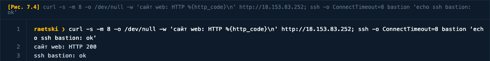
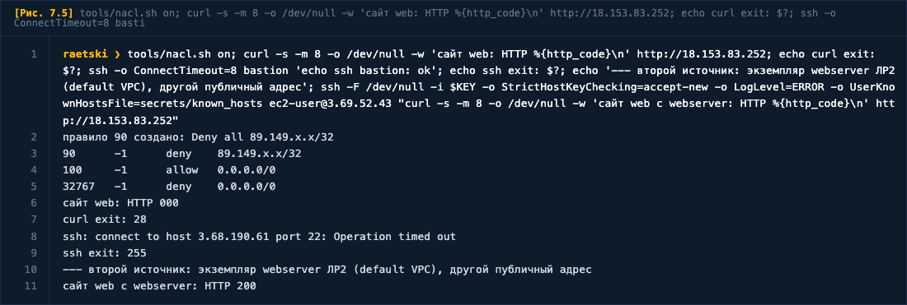
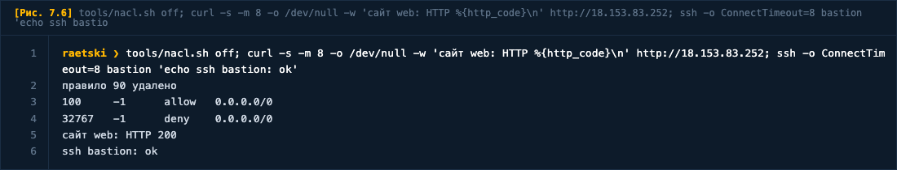

_Рис. 7.4. Правило 90 отсутствует: сайт HTTP 200, `ssh bastion` проходит. Рис. 7.5. Правило 90 включено: сайт и SSH недоступны с ноутбука, с `webserver` ЛР2 сайт отвечает HTTP 200. Рис. 7.6. Правило удалено: доступ восстановлен._

<!-- TODO-FIG L3 7.8 -->
_Рис. 7.8. (консоль) CloudShell при активном правиле 90: `curl` сайта возвращает ответ._

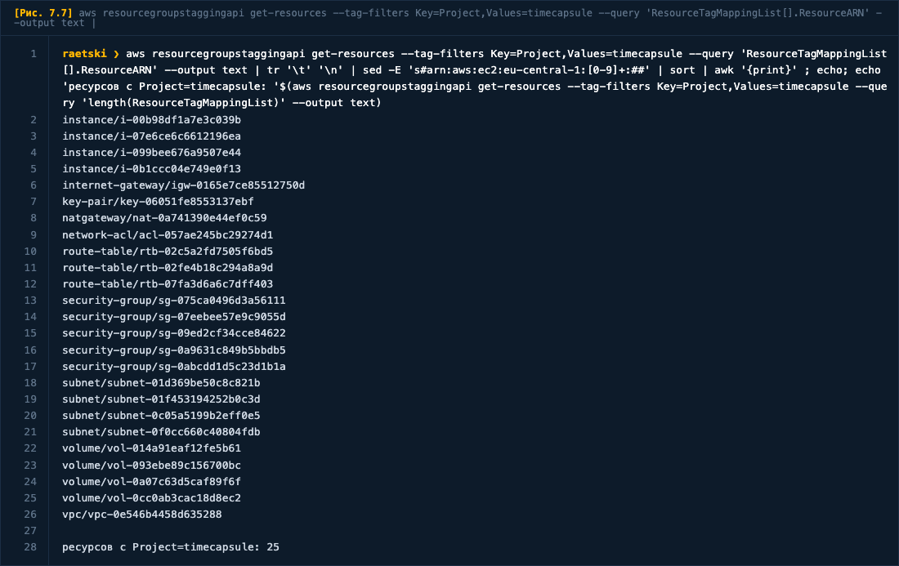

_Рис. 7.7. Resource Groups Tagging API: 25 ресурсов с `Project=timecapsule` (VPC, подсети, IGW, таблицы, SG, NACL, экземпляры, диски, ключ)._

<!-- TODO-FIG L3 7.9 -->
_Рис. 7.9. (консоль) `Tag Editor`: `eu-central-1`, `All supported resource types`, `Project=timecapsule`._

Итоговое состояние экземпляров (`web` завершён в задании 8, остальные остановлены): раздел 5.

## 3. Часть 2. Продвинутый уровень (задания 8-13)

### 3.1 Задание 8. Перенос сервера ЛР2

**Выполнено.** `webserver` ЛР2 (`i-0b1ccc04e749e0f13`) запущен, приложение отвечало (`/health` `"db":"ok"`). Создан образ
`timecapsule-dev-app-lab2` (`Tag image and snapshots together`, теги на образе и снимке). Из образа запущен `timecapsule-dev-app` (`t3.micro`,
`public-a`, `web-sg`, без User data), добавлен `Host app` в `ssh_config`. `web` из Части 1 завершён.

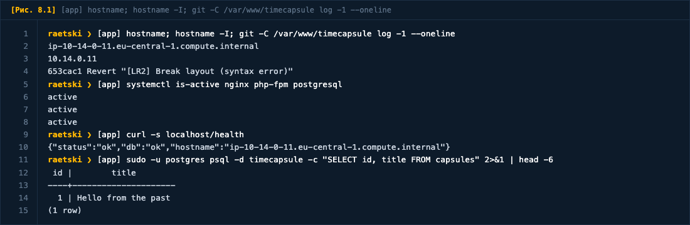

_Рис. 8.1. `app` (`10.14.0.11`) на коммите `653cac1` из ЛР2: nginx, PHP-FPM, PostgreSQL активны, `/health` `ok`, капсула "Hello from the past" в локальной базе._

### 3.2 Задание 9. Elastic IP

**Выполнено.** Elastic IP `timecapsule-dev-app-eip` (`63.182.78.191`) с обязательными тегами привязан к `app`, `APP_URL` в `.env` заменён, PHP-FPM перезагружен.

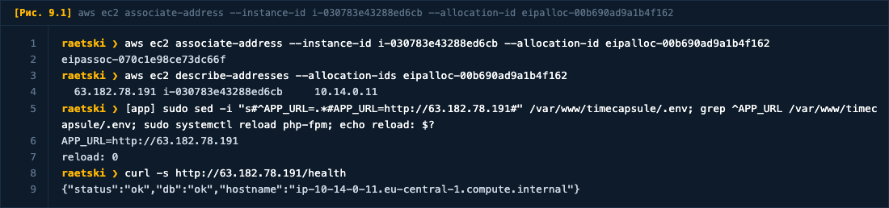

_Рис. 9.1. `associate-address`, адрес связан с `i-030783e43288ed6cb` и `10.14.0.11`; `APP_URL=http://63.182.78.191`; `/health` отвечает._

<!-- TODO-FIG L3 9.2 -->
_Рис. 9.2. (браузер) Приложение по `http://63.182.78.191`, вход под пользователем ЛР2._

### 3.3 Задание 10. База на `db-server`

**Выполнено.** На `db` созданы пользователь и база `timecapsule` с новым паролем (сгенерирован локально, хранится вне репозитория).
Строка `pg_hba.conf` заменена на `host timecapsule timecapsule 10.14.0.0/24 scram-sha-256`, PostgreSQL перезапущен.

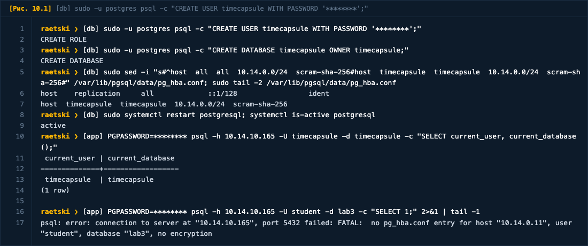

_Рис. 10.1. С `app` подключение под `timecapsule` к базе `timecapsule` проходит; под `student` к `lab3` отклоняется: `no pg_hba.conf entry`._

### 3.4 Задание 11. Приватная зона Route 53

**Выполнено.** Зона `timecapsule.internal` (Private, VPC `timecapsule-dev-vpc`, теги), запись `db` A `10.14.10.165`, TTL 60 (`tools/zone.sh`).

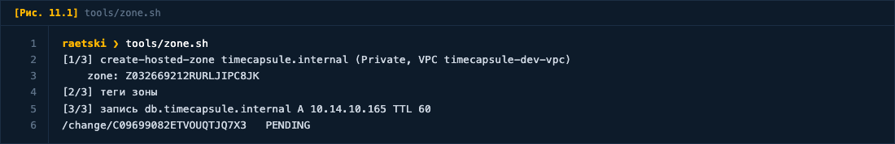

_Рис. 11.1. Зона `Z032669212RURLJIPC8JK` создана, теги заданы, запись `db.timecapsule.internal` создана (статус `PENDING`)._

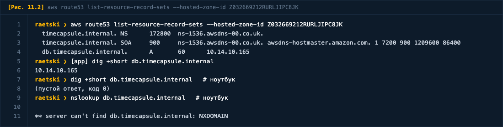

_Рис. 11.2. Запись в зоне; `dig +short` на `app` возвращает `10.14.10.165`; на ноутбуке `dig` пуст, `nslookup` отвечает `NXDOMAIN`._

<!-- TODO-FIG L3 11.3 -->
_Рис. 11.3. (консоль) Запись `db` в зоне `timecapsule.internal`._

### 3.5 Задание 12. Перенос данных и переключение

**Выполнено.** `pg_dump` локальной базы на `app`, загрузка `psql -f` в `db.timecapsule.internal`, переключение `DB_HOST` и `DB_PASSWORD` в `.env`,
`reload php-fpm`, локальный PostgreSQL остановлен и отключён, образ снят с регистрации, снимок удалён.

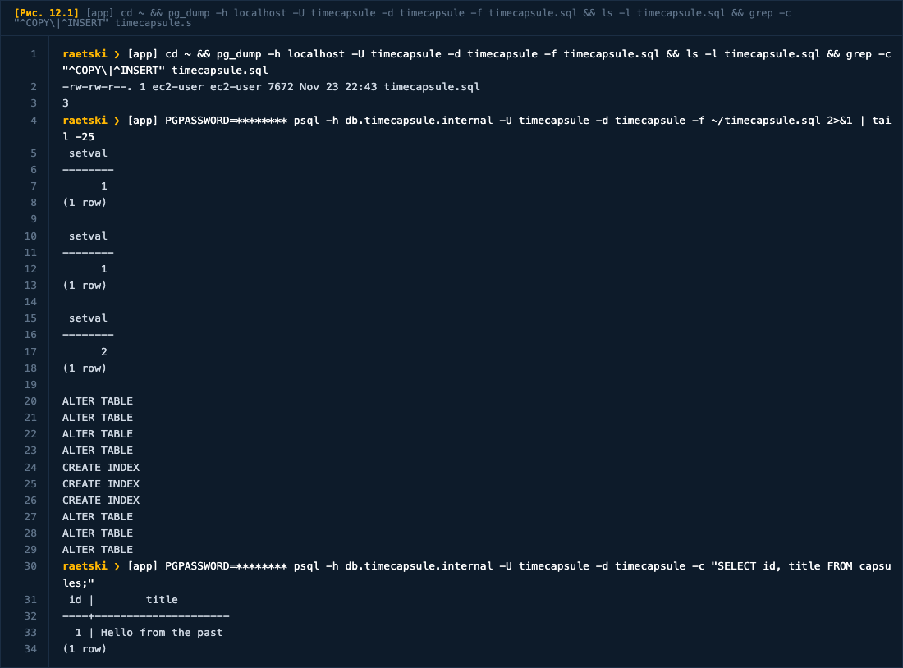

_Рис. 12.1. Дамп 7672 байта, загрузка в `db` без ошибок (`setval`, `CREATE INDEX`, `ALTER TABLE`), в таблице `capsules` строка "Hello from the past"._

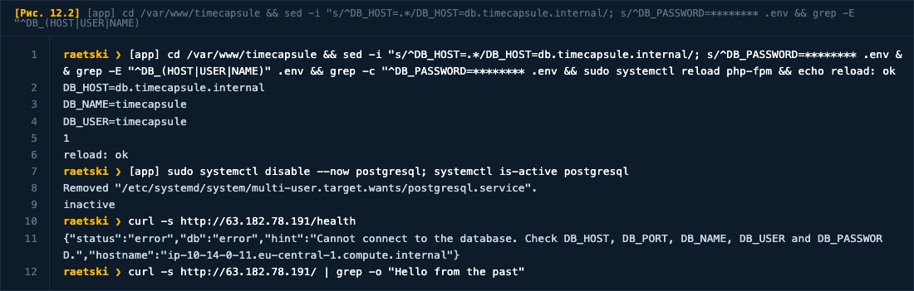

_Рис. 12.2. `.env` изменён, локальный PostgreSQL `inactive`; `/health` сообщает `"db":"error"`._

Причина сбоя: `sed -i` пересоздал `.env` с владельцем `ec2-user:ec2-user` и правами 640, PHP-FPM (пользователь `apache`) перестал читать файл
и применил значения по умолчанию (`localhost`). Исправление: `chgrp apache`.

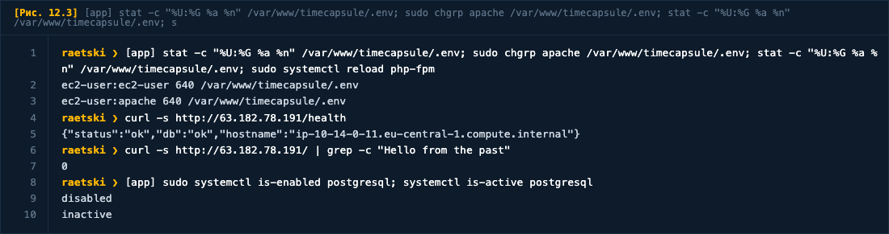

_Рис. 12.3. Группа `.env` возвращена в `apache`, `/health` показывает `"db":"ok"`, локальный PostgreSQL выключен и отключён из автозапуска._

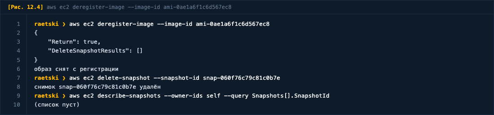

_Рис. 12.4. `deregister-image`, `delete-snapshot`, список снимков пуст._

<!-- TODO-FIG L3 12.5 -->
_Рис. 12.5. (браузер) `/health` с `"db":"ok"` и капсулы ЛР2 на странице._

### 3.6 Задание 13. Деплой и обслуживание

**Новая версия.** В подвал добавлена строка "лабораторная работа 3 (LR3)", коммит `873c329`, пуш, `ssh app ./deploy.sh` через bastion;
шаг 3 деплоя (`init-db.php`) отработал уже против `db.timecapsule.internal`.

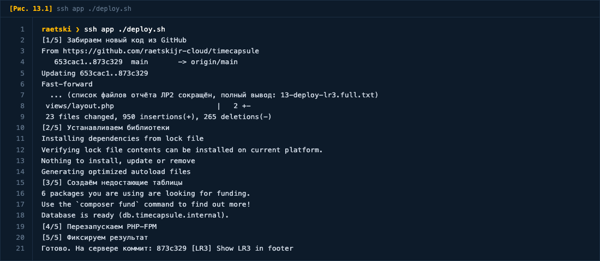

_Рис. 13.1. `[1/5]...[5/5]`, в конце `873c329 [LR3] Show LR3 in footer`; список файлов отчёта ЛР2 в выводе сокращён (полный: `logs/13-deploy-lr3.full.txt`)._

<!-- TODO-FIG L3 13.7 -->
_Рис. 13.7. (браузер) Подвал с "LR3" на странице._

**Отказ базы.** `db` остановлен: `/health` и главная отвечают HTTP 500 через 5,1 с (таймаут PDO 5 с), поле `"db":"error"`. После запуска `db` приложение
восстановилось без действий на `app`, приватный адрес `10.14.10.165` не изменился.

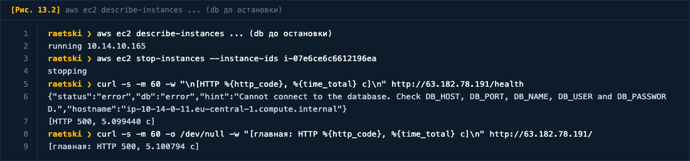
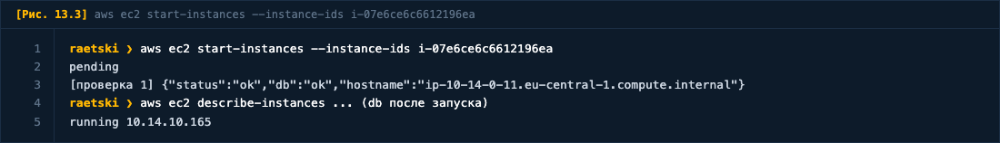

_Рис. 13.2. `db` остановлен: ответы 500 за 5,1 с. Рис. 13.3. `db` запущен: уже первая проверка `/health` даёт `"db":"ok"`, адрес прежний._

<!-- TODO-FIG L3 13.8 -->
_Рис. 13.8. (браузер, при остановленной базе) `/health` с `"db":"error"`._

**Обновление пакетов через NAT-скрипты.** `scripts/nat-up.sh` и `scripts/nat-down.sh` (AWS CLI, `jq`, состояние в `scripts/nat-state.json`, входит в `.gitignore`;
`set -euo pipefail`, линейные шаги `step N`, идентификаторы подсети и таблицы маршрутов переменными, теги через `--tag-specifications`,
освобождение Elastic IP повторами с паузой 5/10/20/40 с, до 6 попыток).

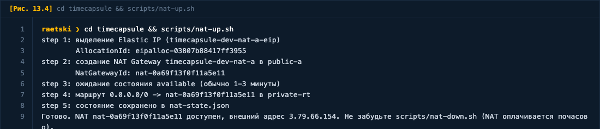
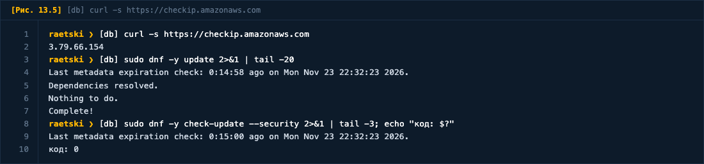
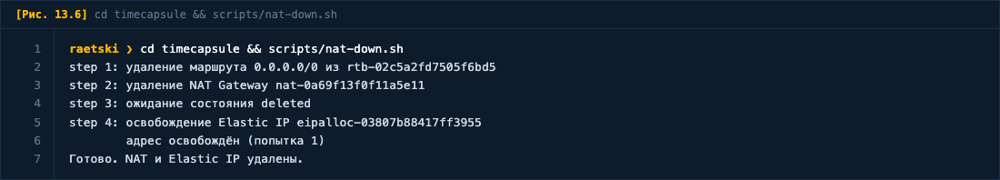

_Рис. 13.4. `nat-up.sh`: пять шагов, внешний адрес `3.79.66.154`. Рис. 13.5. На `db` `checkip` возвращает `3.79.66.154`, `dnf -y update` выполнен (обновлений нет). Рис. 13.6. `nat-down.sh`: маршрут, NAT, ожидание `deleted`, Elastic IP освобождён с первой попытки (повторы не потребовались)._

## 4. Архитектура и ADR (задание 14)

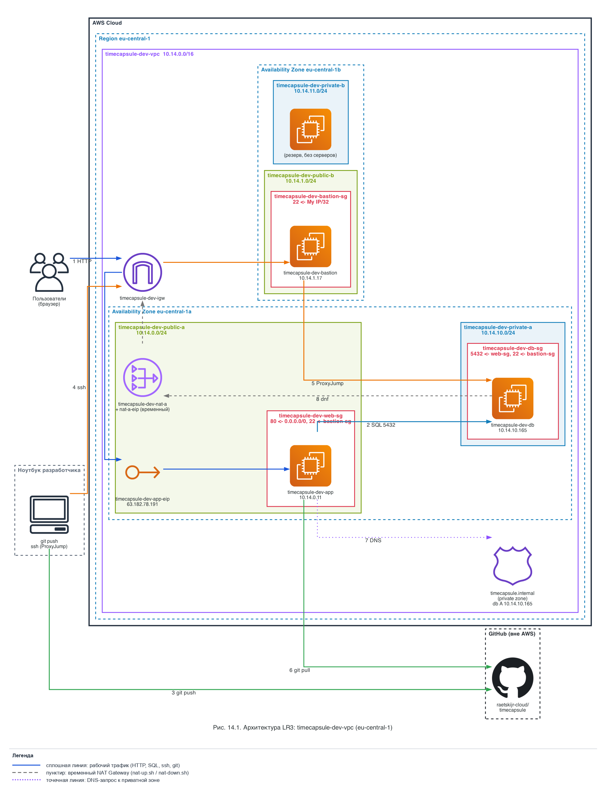

_Рис. 14.1. Пользователи, ноутбук и GitHub вне AWS; AWS Cloud, регион, VPC, две зоны, четыре подсети, IGW, три сервера с Security Group, приватная зона, временный NAT пунктиром._

Соответствие подписей на схеме ресурсам:

| Подпись на схеме | Ресурс | Идентификатор |
| --- | --- | --- |
| `timecapsule-dev-vpc  10.14.0.0/16` | VPC | `vpc-0e546b4458d635288` |
| `timecapsule-dev-public-a` / `-public-b` | подсети | `subnet-0f0cc660c40804fdb` / `subnet-0c05a5199b2eff0e5` |
| `timecapsule-dev-private-a` / `-private-b` | подсети | `subnet-01f453194252b0c3d` / `subnet-01d369be50c8c821b` |
| `timecapsule-dev-igw` | Internet Gateway | `igw-0165e7ce85512750d` |
| `timecapsule-dev-bastion-sg` / `-web-sg` / `-db-sg` | Security Group | `sg-09ed2cf34cce84622` / `sg-0abcdd1d5c23d1b1a` / `sg-0a9631c849b5bbdb5` |
| `timecapsule-dev-bastion` / `-app` / `-db` | экземпляры | `i-00b98df1a7e3c039b` / `i-030783e43288ed6cb` / `i-07e6ce6c6612196ea` |
| `timecapsule-dev-app-eip` | Elastic IP | `eipalloc-00b690ad9a1b4f162` |
| `timecapsule-dev-nat-a` + `-nat-a-eip` | временный NAT Gateway и его Elastic IP | создаются и удаляются `nat-up.sh`, `nat-down.sh` |
| `timecapsule.internal` | приватная зона Route 53 | `Z032669212RURLJIPC8JK` |

Решение о размещении базы: [ADR-0002](../adr/0002-database-placement.md).

## 5. Итог: состояние на конец работы

| Проверка | Ожидание | Факт |
| --- | --- | --- |
| `webserver` ЛР2 | завершён | `terminated` |
| `bastion`, `app`, `db` | остановлены | `stopped` |
| NAT Gateway в состоянии `Available` | нет | нет |
| Elastic IP | только `timecapsule-dev-app-eip` | только он |
| VPC, подсети, Security Group, зона | сохранены | сохранены |

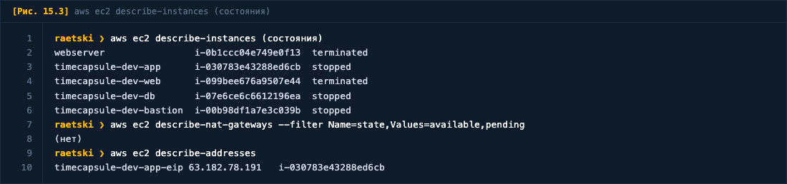

_Рис. 15.3. `webserver` и `web` `terminated`, `bastion`, `app`, `db` `stopped`; шлюзов NAT нет; единственный Elastic IP привязан к `app`._

<!-- TODO-FIG L3 15.1, 15.2 -->
_Рис. 15.1. (консоль) `Elastic IPs`: единственный адрес `timecapsule-dev-app-eip`._
_Рис. 15.2. (консоль) `NAT gateways`: нет шлюзов `Available`._

## 6. Ответы на контрольные вопросы

**Q01 (задание 1).** Из 256 адресов подсети /24 пять занимает AWS: `.0` адрес сети, `.1` маршрутизатор VPC, `.2` DNS-резолвер, `.3` резерв, `.255` широковещательный. Остаётся 251. В /16 помещается 256 подсетей /24; занято 4, свободно 252.

**Q02.** Нет. Подсеть становится публичной только после того, как в её таблицу маршрутов добавлен маршрут `0.0.0.0/0` в Internet Gateway (и серверы получают публичный адрес). До этого `public-a` связана с main route table без такого маршрута.

**Q03.** В обеих таблицах есть локальный маршрут `10.14.0.0/16 local`. Пакет на `8.8.8.8` из `private-a` не подходит ни под один маршрут, кроме локального, и отбрасывается: выхода в интернет у подсети нет.

**Q04.** Источник-группа привязывает правило к роли, а не к адресу: новые серверы в `web-sg` получают доступ автоматически, а при смене IP правило не меняется. Диапазон `10.14.0.0/16` открыл бы базу всем, включая `bastion` и любой будущий сервер сети.

**Q05.** У `db` нет ни публичного адреса, ни маршрута в интернет, поэтому репозиторий пакетов недостижим (`Connection timed out`). Нужен NAT Gateway в публичной подсети и маршрут `0.0.0.0/0` -> NAT в `private-rt`: исходящий трафик идёт, входящих соединений снаружи нет.

**Q06.** `checkip` вернул `63.186.2.222`, это Elastic IP NAT Gateway. Адрес `db` приватный (`10.14.10.165`): NAT подменяет источник пакета своим публичным адресом, наружу приватные адреса не выходят.

**Q07.** Отсутствие публичного IP и маршрута в IGW делает базу недостижимой из интернета на уровне сети; `db-sg` на уровне экземпляра пускает 5432 только от `web-sg`; `pg_hba.conf` на уровне СУБД пускает только указанных пользователей из указанных адресов. Ошибка в одном слое компенсируется остальными, но каждый должен быть настроен верно: ошибка единственного слоя оставляет базу на одном рубеже.

**Q08.** NAT нужен только для скачивания пакетов; установленный и запущенный PostgreSQL от интернета не зависит. Для обновлений безопасности NAT поднимается временно (скриптами), затем удаляется.

**Q09.** Правило 5432 в `db-sg` ссылается на `web-sg`. Сервер из `web-sg` проходит, `bastion` в этой группе не состоит, и его пакеты отбрасываются, хотя маршрут между ними есть: маршрутизация разрешает путь, Security Group решает, пропустить ли соединение.

**Q10.** Нет маршрута в интернет (в `private-rt` нет `0.0.0.0/0`) и нет публичного адреса. Из интернета на 5432 подключиться нельзя по той же цепочке: пакету не найти адрес (приватный), нет входа (IGW не связан с подсетью) и фильтры (`db-sg`, `pg_hba.conf`) закрыты.

**Q11.** NACL работает на границе подсети и фильтрует весь трафик с адреса ноутбука раньше Security Group, поэтому блокируются и SSH на bastion, и HTTP на `web`. Другой источник не попадает под правило с `/32` моего адреса, поэтому сайт для него открыт. Правила NACL проверяются по возрастанию номера до первого совпадения; правило 100 разрешает всё, поэтому запрет должен быть меньше 100.

**Q12.** Фильтр `Project=timecapsule` в `Tag Editor` показывает всё, что нужно удалить после проекта (или фильтр по `Lab`). `Owner` показывает ответственного: в общем аккаунте или после передачи работы он отвечает на вопрос "чей ресурс и кого спросить"; в личном аккаунте он помогает отличить свои ресурсы от созданных другими людьми или сервисами.

**Q13.** Образ содержит диск `webserver`: систему, nginx, PHP-FPM, PostgreSQL, код приложения, `.env`, загруженные файлы и локальную базу. На `app` без установки оказались приложение, пользователь и капсула ЛР2. База на момент создания `app` находилась на самом `app` (локально).

**Q14.** У `app` нужен постоянный адрес для пользователей и `APP_URL`, bastion достаточно любого адреса: администратор узнаёт его после запуска. Остановленный Elastic IP стоит $0,005 в час: AWS берёт плату за публичный IPv4 даже без использования. С Application Load Balancer пользователи обращаются к его DNS-имени, и Elastic IP у `app` не нужен.

**Q15.** Закрытый порт и `pg_hba.conf` защищают сеть, но пароль последний рубеж при сбое остальных слоёв (например, ошибке в правиле SG). Старый пароль ЛР2 использовался на публичном сервере и мог быть показан; новый уникальный пароль исключает его повторное использование.

**Q16.** Приватная зона доступна только из ассоциированной VPC: резолвер VPC (`10.14.0.2`) отвечает на запросы серверов, а публичный DNS зоны `timecapsule.internal` не знает. При новом IP `db` изменяется одна запись A в зоне; `.env` и приложение не трогаются (клиенты обновят ответ после TTL 60 с).

**Q17.** Загруженные файлы лежат на диске `app` в `/var/www/timecapsule/storage/uploads`. Они переехали вместе с образом, а не с базой. При удалении `app` вместе с томом файлы будут потеряны; на S3 их переносят в ЛР4.

**Q18.** `deploy.sh` обращается к серверу по тому же пути и делает те же четыре действия; изменились только сеть и способ входа по SSH, а он скрыт в `ssh_config` (`Host app`, `ProxyJump`). Адрес базы берётся из `.env`.

**Q19.** `/health` вернул `"db":"error"` и HTTP 500 через 5 с: приложение не смогло соединиться с базой и сообщило об этом. Приватный IP `db` не изменился (`10.14.10.165`), поэтому после запуска приложение заработало без правок.

**Q20.** Пока NAT использует Elastic IP, адрес привязан и AWS не позволит его освободить. Освобождение до удаления шлюза даёт ошибку, а лишние повторы стоят времени; поэтому порядок: маршрут, шлюз, ожидание `deleted`, затем адрес с повторами.

**Q21 (путь запроса).** Браузер -> Elastic IP -> Internet Gateway (маршрут `0.0.0.0/0` в `public-rt`, NACL подсети `public-a`) -> `web-sg` (80) -> nginx и PHP-FPM на `app` -> имя `db.timecapsule.internal` (резолвер VPC, приватная зона) -> локальный маршрут VPC -> `db-sg` (5432 от `web-sg`) -> `pg_hba.conf` (`timecapsule`/`timecapsule`, `10.14.0.0/24`).

**Q22.** Знание приватного IP ничего не даёт: нужен доступ внутрь VPC (сначала `bastion` через ключ и SSH с разрешённого адреса, либо компрометация `web`/`app`), затем пароль пользователя `timecapsule`, и соединение только от адреса из `10.14.0.0/24`.

**Q23.** Плюсы временного NAT: нет почасовой оплаты в простое (постоянный около $1,25 в сутки), нет постоянного исходящего канала с базы. Минусы: перед обновлением нужны шаги создания и удаления, возможен забытый шлюз, обновления выходят только по расписанию оператора.

**Q24.** Для переживания отказа `eu-central-1a` не хватает: второго сервера приложения в зоне `b`, балансировщика нагрузки, реплики базы в `private-b` (или Amazon RDS Multi-AZ), NAT в зоне `b` для обновлений и общего хранилища файлов (S3 вместо локального диска).

## Приложение A. Журнал команд

Полные журналы с первой строкой-командой лежат в [`logs/`](logs/): `00-build-part1.txt` (создание сети и серверов), `06-*` (NAT и PostgreSQL Части 1),
`07-*` (проверки, NACL, теги), `08-*`...`12-*` (перенос), `13-*` (деплой, отказ базы, NAT-скрипты). Инструменты: `ssh_config`, скрипты в `tools/` рабочей папки
(`build-part1.sh`, `update-ssh.sh`, `zone.sh`, `nacl.sh`) и `scripts/nat-up.sh`, `scripts/nat-down.sh` в репозитории. Значения паролей и домашний адрес в журналах заменены.

## Приложение B. Термины

VPC, подсеть, Internet Gateway, NAT Gateway, Network ACL, bastion, Elastic IP, приватная зона Route 53, `pg_hba.conf`: см. [`docs/glossary.md`](../glossary.md), раздел LR3.

## Приложение C. Остановка и запуск

См. [`docs/runbook.md`](../runbook.md), раздел LR3. Кратко: запуск `db` -> `app` -> `bastion`, затем `HostName` bastion; остановка всех трёх; NAT и Elastic IP шлюза не оставлять.

## Приложение D. Текстовая карта сети

```text
Интернет
   |
[timecapsule-dev-igw]
   |                           timecapsule-dev-vpc 10.14.0.0/16
   |   AZ eu-central-1a                           AZ eu-central-1b
   |   public-a 10.14.0.0/24 (public-rt)          public-b 10.14.1.0/24 (public-rt)
   +-- [app 10.14.0.11 + EIP]  web-sg             [bastion 10.14.1.17]  bastion-sg
   |   [nat-a]  (временный)
   |   private-a 10.14.10.0/24 (private-rt)       private-b 10.14.11.0/24 (private-rt)
   |   [db 10.14.10.165]  db-sg                   (резерв)
   |
Route 53 private zone timecapsule.internal:  db A 10.14.10.165 (TTL 60)
```
