# Отчёт по лабораторной работе №4. Облачные хранилища. Amazon S3

| Поле | Значение |
| --- | --- |
| Версия отчёта | 1.0 (все рисунки вставлены) |
| Дата | 2026-11-24 |
| ФИО | Raetski Danila |
| Группа | I2402 |
| Специальность | Informatică |
| Уровень | продвинутый (Часть 1 и Часть 2, задания 1-14) |
| Репозиторий | https://github.com/raetskijr-cloud/timecapsule |
| Регион | `eu-central-1` (Frankfurt) |
| Отчёты предыдущих работ | [`README.md`](../../README.md) (LR2), [`docs/lab3/README.md`](../lab3/README.md) |

## Оглавление

0. Сводка
1. Матрица трассируемости
2. Часть 1. Базовый уровень (задания 1-6)
3. Часть 2. Продвинутый уровень (задания 7-13)
4. Архитектура и ADR (задание 14)
5. Итог: состояние на конец работы
6. Ответы на контрольные вопросы
- Приложение A. Журнал команд
- Приложение B. Термины

## 0. Сводка

| Показатель | Значение |
| --- | --- |
| Бакет | `timecapsule-dev-uploads-danilaraetchi` (General purpose, ACL отключены, Block Public Access, SSE-S3, теги `Lab=lab4`, `Purpose=coursework`) |
| Версионирование | включено после заданий 2-3 (объекты, загруженные раньше, имеют версию `null`) |
| Правило жизненного цикла | `timecapsule-dev-noncurrent` (префикс `uploads/`, Standard-IA через 30 дней, удаление через 90 дней с сохранением двух, multipart 7 дней) |
| Политика бакета | `DenyInsecureTransport`: запрет любых действий без HTTPS |
| Политика приложения | `timecapsule-dev-app-s3`: версия v1 (с `s3:ListBucket` по префиксу), версия v2 по умолчанию (без `ListBucket`) |
| Роли | `timecapsule-dev-s3-tester` (доверие: этот аккаунт), `timecapsule-dev-app-role` (доверие: EC2), профиль экземпляра привязан к `timecapsule-dev-app` |
| Код | модуль `src/storage.php` переписан на AWS SDK for PHP; изменены также `views/layout.php`, `.env.example`, `composer.json`, `composer.lock`; коммиты с тегом `[LR4]` |
| Деплой | `~/deploy.sh` на `app` (путь `/var/www/timecapsule`, без `current/`) |
| Решение | [ADR-0003](../adr/0003-attachment-storage.md) |
| Состояние на конец работы | `bastion`, `app`, `db` остановлены; Elastic IP `app-eip` остаётся; NAT нет |

Условное обозначение: рисунки вида `[Рис. N.k]` с тёмным терминалом сняты на ноутбуке с профилем студента (номер аккаунта и подписи в ссылках скрыты);
рисунки консоли AWS и браузера сняты в реальной консоли (номер аккаунта скрыт); страницы ошибок S3 браузер не снимает, там показан ответ из журнала.

## 1. Матрица трассируемости

| Требование задания | Задание | Рисунок | Раздел |
| --- | --- | --- | --- |
| Бакет с настройками, папки `uploads` и `backups`, свойства картинки, `Object URL` не открывается | 1 | Рис. 1.1-1.4 | 2.1 |
| `cp`, `sync`, три варианта `ls`, `head-object`, скачивание и удаление | 2 | Рис. 2.1-2.4 | 2.2 |
| Политика бакета только HTTPS и две проверки | 3 | Рис. 3.1, 3.2 | 2.3 |
| Версионирование, `notes.txt` v1/v2, маркер удаления, откат | 4 | Рис. 4.1-4.5 | 2.4 |
| Правило жизненного цикла | 5 | Рис. 5.1, 5.2 | 2.5 |
| Подписанные URL, подмена ключа, просрочка | 6 | Рис. 6.1-6.4 | 2.6 |
| Политика `timecapsule-dev-app-s3` | 7 | Рис. 7.1, листинг 3.1 | 3.1 |
| Тестовая роль и таблица прав | 8 | Рис. 8.1, таблица 3.2 | 3.2 |
| Роль сервера, проверка на `app` | 9 | Рис. 9.1 | 3.3 |
| `sync` существующих файлов | 10 | Рис. 10.1 | 3.4 |
| Модуль хранения, SDK, `.env.example` | 11 | коммит, Рис. 11.1 | 3.5 |
| Деплой, новые капсулы, ссылки, удаление | 12 | Рис. 12.1-12.8 | 3.6 |
| Сервер без состояния, понижение прав, 403 и 404 | 13 | Рис. 13.1-13.4 | 3.7 |
| Схема и ADR-0003 | 14 | Рис. 14.1, ADR-0003 | 4 |

## 2. Часть 1. Базовый уровень

Команды Части 1 выполнены на ноутбуке с профилем студента (AWS CLI 2, bash), а не в CloudShell; переменная `BUCKET` задана в `tools/env.sh`.
Время в выводе `aws s3 ls` показано в локальной зоне ноутбука (UTC+2), а `LastModified` в `head-object` в UTC.

### 2.1 Задание 1. Бакет и объекты

**Цель.** Создать закрытый бакет и загрузить в него файлы.
**Выполнено.** Бакет создан командой `s3api create-bucket` с `--object-ownership BucketOwnerEnforced` (ACL отключены), включены все четыре параметра
Block Public Access, шифрование по умолчанию SSE-S3, шесть тегов. Версионирование не включалось. Папки созданы как пустые объекты `uploads/` и `backups/`,
как это делает кнопка `Create folder`. В `uploads/` загружены `lab4-cover.png` (800x600) и `lab4-spec.pdf`, в `backups/` файл `backup.txt`.
**Результат.** Ключ картинки `uploads/lab4-cover.png`, `Content-Type: image/png`, ETag `64359b1ba63aa15c550a28f0bf8bcedb`. Запрос `Object URL` без подписи возвращает `403 AccessDenied`.

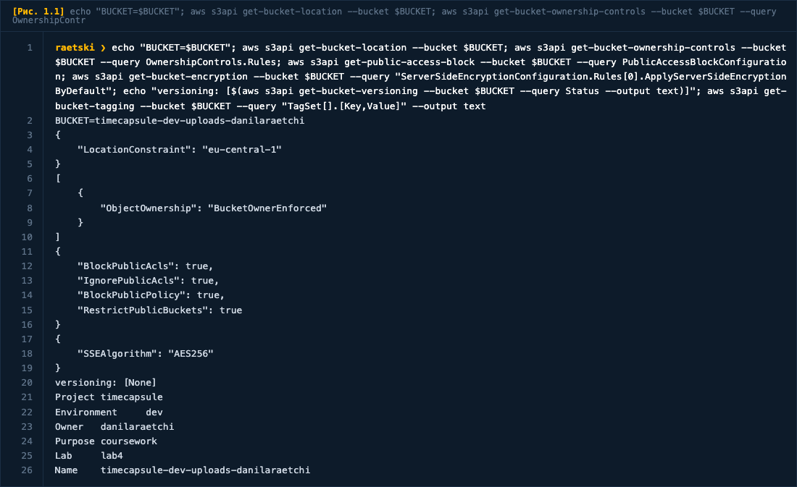

_Рис. 1.1. Настройки бакета: владение, Block Public Access, шифрование, версионирование (пусто), теги._

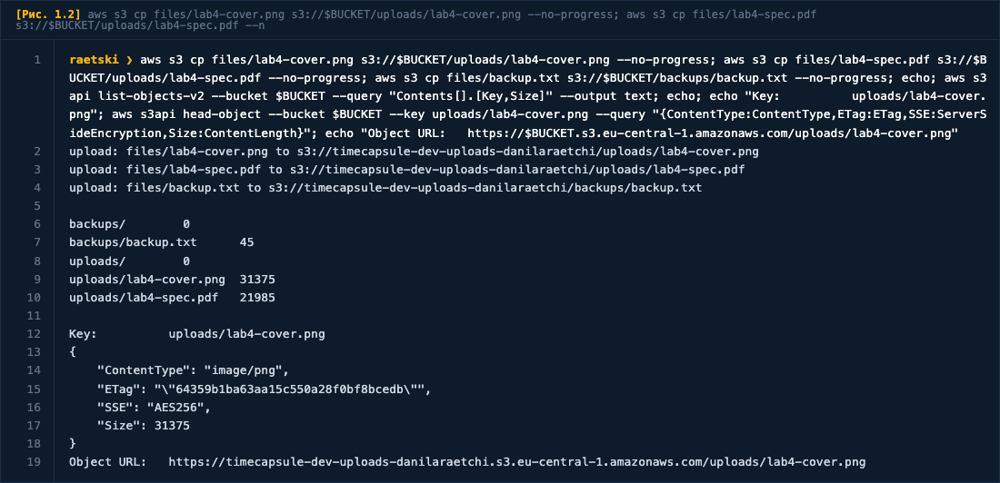

_Рис. 1.2. Три загруженных объекта, две папки, ключ, `Content-Type`, ETag и `Object URL` картинки._

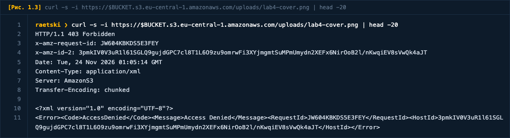

_Рис. 1.3. Ответ S3 на `Object URL` без подписи: `403 AccessDenied`._

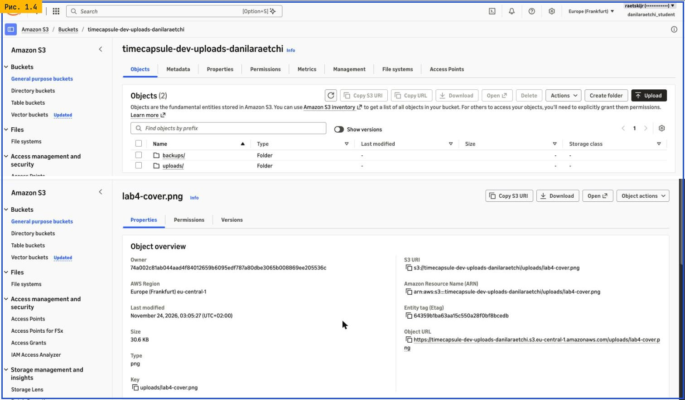

_Рис. 1.4. Бакет с папками `uploads/` и `backups/`, свойства `uploads/lab4-cover.png`._

**Q01. Ключ, `Object URL`, `Create folder`.** Ключ картинки `uploads/lab4-cover.png`: слэши входят в имя ключа, каталогов в S3 нет. `Object URL` не открывается,
потому что у объекта нет публичного доступа, а запрос без подписи приходит от анонимного участника, и Block Public Access его всё равно запретил бы; владелец
получает доступ только подписанными запросами. Кнопка `Create folder` создаёт пустой объект с ключом `uploads/` (размер 0), который консоль показывает как папку.

### 2.2 Задание 2. Объекты из командной строки

**Выполнено.** `aws s3 cp photo.txt`, `aws s3 sync 2026` (рис. 2.1), три варианта `ls` (рис. 2.2), `head-object` картинки и `report.txt` (рис. 2.3),
скачивание `photo.txt` и удаление `report-2.txt` (рис. 2.4).

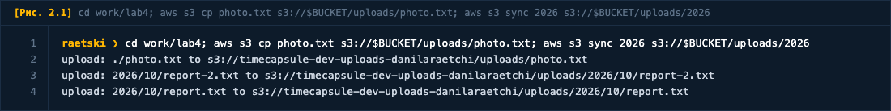

_Рис. 2.1. `aws s3 cp` и `aws s3 sync` загрузили `photo.txt` и два файла из `2026/10`._

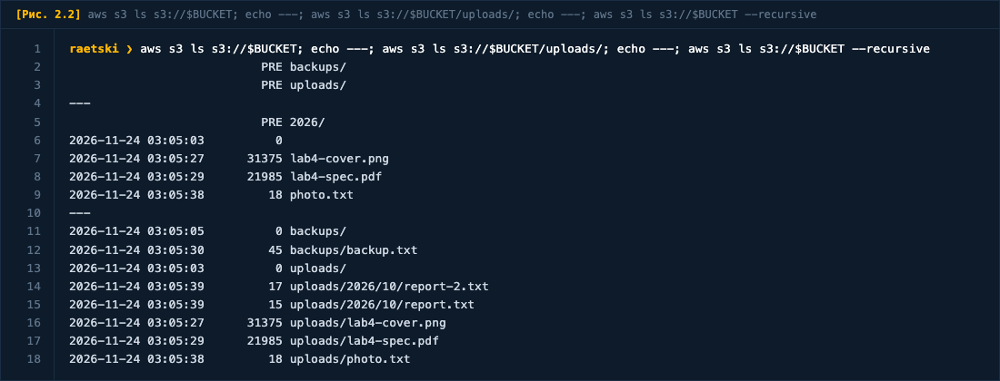

_Рис. 2.2. `ls` бакета, `ls uploads/`, `ls --recursive`._

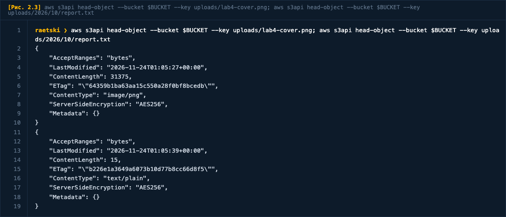

_Рис. 2.3. `head-object`: у картинки `image/png`, у `report.txt` `text/plain`, оба с `ServerSideEncryption: AES256`._

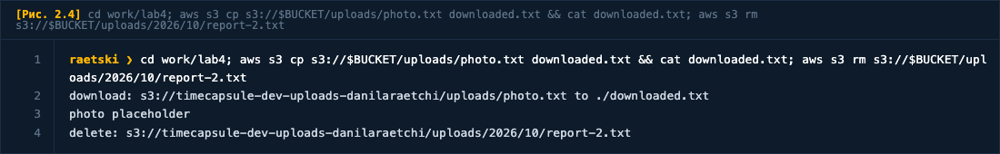

_Рис. 2.4. Скачанный `photo.txt` содержит `photo placeholder`; `report-2.txt` удалён._

**Q02.** Объекты в S3 лежат плоским списком ключей. `ls` без `--recursive` группирует ключи по разделителю `/`, поэтому показывает общие префиксы `PRE uploads/`
и `PRE backups/`; рекурсивный вывод отключает группировку и печатает полные ключи. `report.txt` получил `text/plain`: CLI определил тип по расширению `.txt`
и передал его при загрузке.

### 2.3 Задание 3. Политика бакета: только HTTPS

**Выполнено.** Политика `DenyInsecureTransport` (`Deny`, `Principal: *`, `s3:*`, ресурсы бакет и `/*`, условие `aws:SecureTransport = false`),
файл [`bucket-policy.json`](bucket-policy.json). Проверка: по HTTPS список отдаётся, через `--endpoint-url http://...` получен `AccessDenied` с пометкой
`explicit deny in a resource-based policy`.

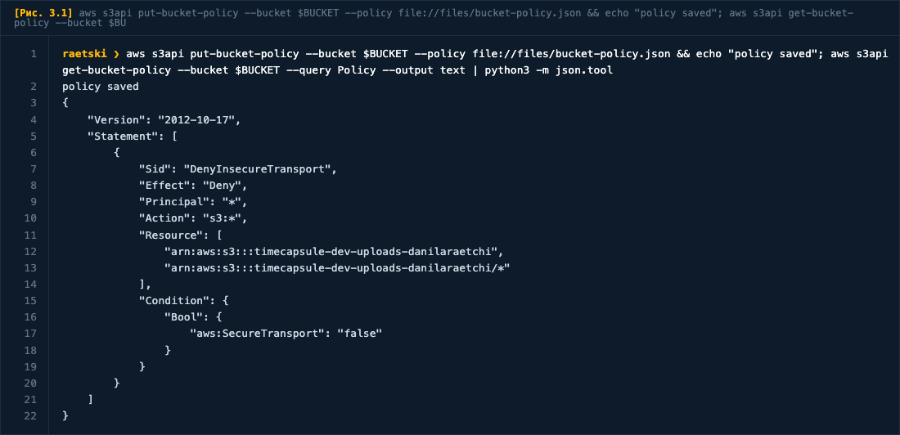

_Рис. 3.1. Политика бакета, как она сохранена в S3._

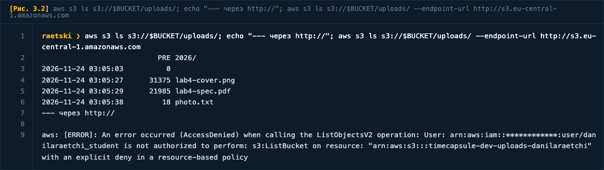

_Рис. 3.2. `ls` по HTTPS работает, по HTTP возвращает `AccessDenied`._

**Q03.** Явный запрет в политике бакета сильнее любого разрешения, а права администратора это разрешение. Запрос по HTTP подпадает под условие
`aws:SecureTransport = false`, поэтому отклоняется даже у администратора. Block Public Access блокирует политики, которые открывают бакет публично (разрешают
доступ анонимам); политика с `Deny` и `Principal: *` ничего не открывает, а только ограничивает, поэтому сохранилась.

### 2.4 Задание 4. Версионирование и защита от удаления

**Выполнено.** Версионирование включено командой (рис. 4.1): у `uploads/photo.txt`, загруженного раньше, версия `null`. Загружены `notes.txt` `v1`, затем `v2`
(рис. 4.2). Шаги 3-5 (удаление при выключенном `Show versions`, удаление маркера, удаление версии `v2`) выполняются в консоли.

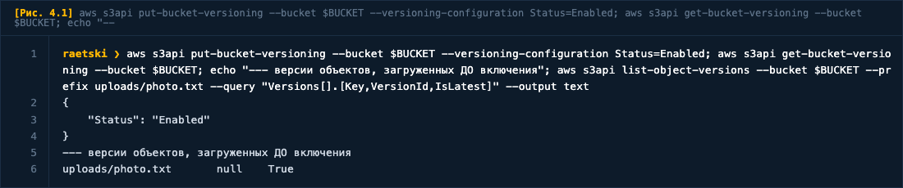

_Рис. 4.1. `Status: Enabled`; версия `photo.txt` равна `null`._

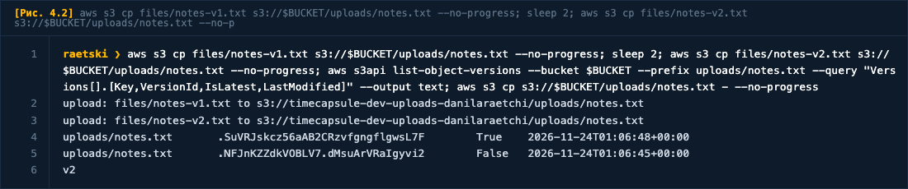

_Рис. 4.2. Две версии `uploads/notes.txt`, текущая со значением `v2`._

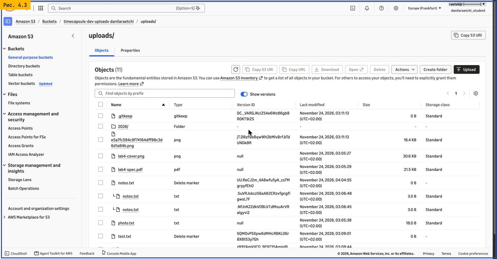

_Рис. 4.3. `Show versions`: у `notes.txt` маркер удаления над двумя версиями._
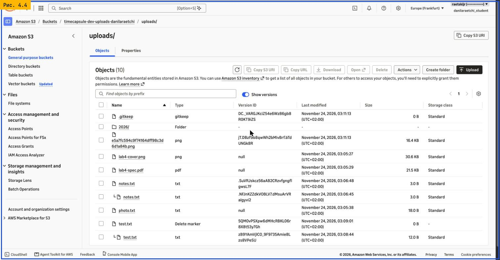

_Рис. 4.4. Маркер удалён: `notes.txt` вернулся, текущая версия `v2`._
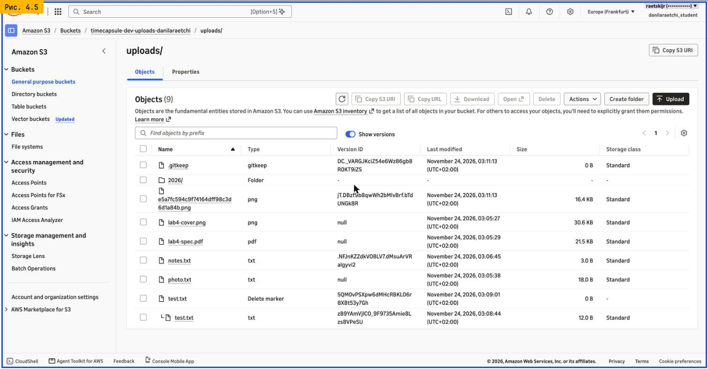

_Рис. 4.5. Версия `v2` удалена навсегда: текущая версия `v1`._

**Q04.** В шаге 3 при выключенном `Show versions` объект не удаляется: S3 добавляет маркер удаления, версии остаются, и это можно отменить, удалив маркер.
В шаге 5 удаляется конкретная версия (консоль просит ввести `permanently delete`), её нельзя вернуть. От случайного удаления защищает первый способ,
второй нужно запретить приложению (в политике нет `s3:DeleteObjectVersion`).

### 2.5 Задание 5. Правило жизненного цикла

**Выполнено.** Правило `timecapsule-dev-noncurrent` создано через `put-bucket-lifecycle-configuration` ([`lifecycle.json`](lifecycle.json)).

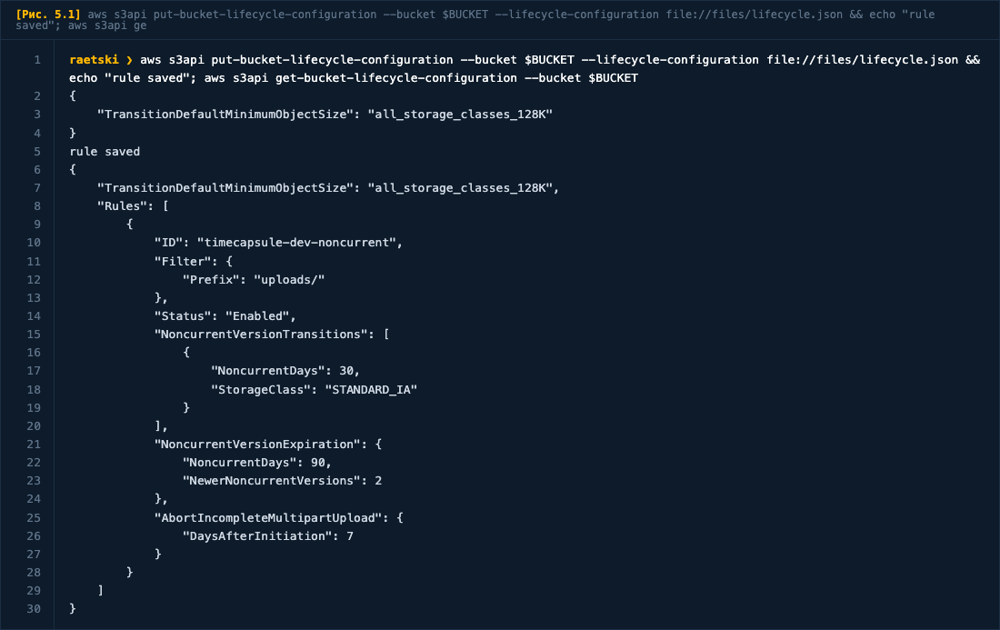

_Рис. 5.1. Правило как его хранит S3: префикс `uploads/`, неактуальные версии в `STANDARD_IA` через 30 дней, удаление через 90 дней при `NewerNoncurrentVersions: 2`, multipart 7 дней._

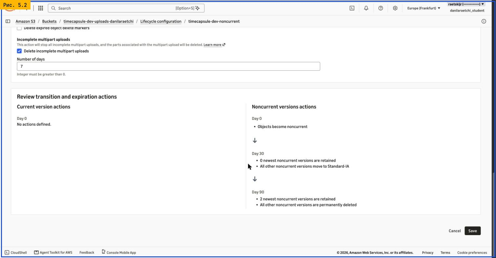

_Рис. 5.2. Правило `timecapsule-dev-noncurrent`, блок `Review transition and expiration actions`._

**Q05.** Файл, перезаписанный 10 раз за неделю, имеет одну текущую и девять неактуальных версий. Через 30 дней после того, как каждая версия стала неактуальной,
она уходит в Standard-IA; через 90 дней удаляются неактуальные версии, кроме двух самых новых. Маленькие файлы в Standard-IA не попадают: по умолчанию
действует минимальный размер 128 КБ (в выводе `all_storage_classes_128K`), а переход экономически бессмысленен. Незавершённая multipart-загрузка хранит
уже загруженные части, которые нигде не видны как объект, но оплачиваются как данные, пока загрузку не завершат или не отменят.

### 2.6 Задание 6. Подписанные URL

**Выполнено.** Ссылка на 120 с: сразу 200 и содержимое `photo placeholder`; при замене `photo.txt` на `notes.txt` ответ `SignatureDoesNotMatch`; через 126 с
исходная ссылка получила `AccessDenied: Request has expired` (рис. 6.2). Подписи в выводе обрезаны.

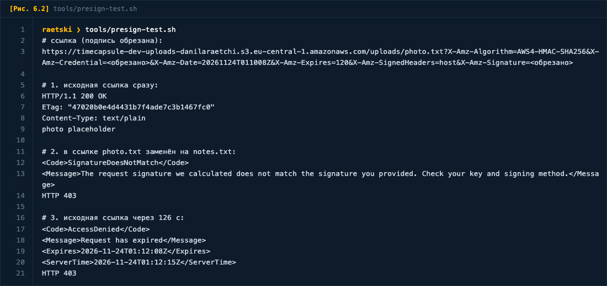

_Рис. 6.2. Исходная ссылка, подмена ключа и просроченная ссылка._

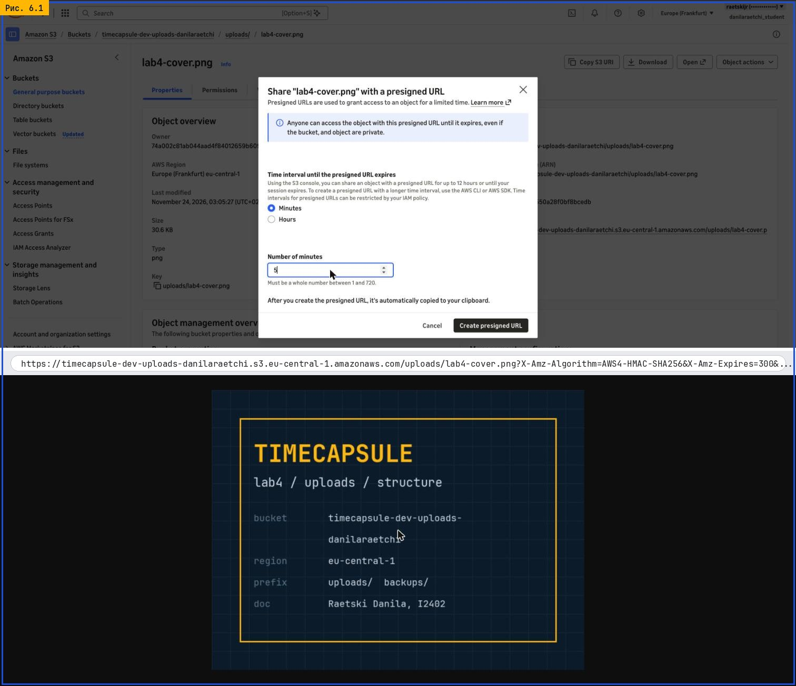

_Рис. 6.1. Диалог `Share with a presigned URL` на 5 минут и картинка по ссылке в браузере._
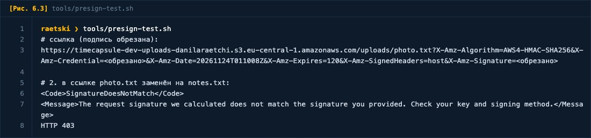

_Рис. 6.3. Ответ S3 на ссылку с заменённым ключом: `SignatureDoesNotMatch` (страницу ошибки браузер не снимает, показан ответ из журнала)._
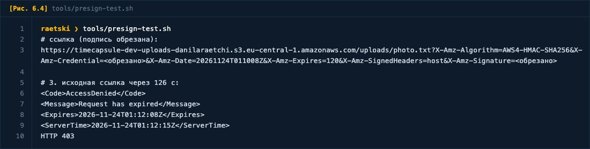

_Рис. 6.4. Ответ S3 на просроченную ссылку: `Request has expired` (показан ответ из журнала)._

**Q06.** В шаге 3 S3 вернул `SignatureDoesNotMatch` (адрес изменён после подписи), в шаге 4 `AccessDenied` с текстом `Request has expired`. Ключ нельзя сменить:
подпись вычисляется от метода, адреса (включая ключ), параметров и времени, и при изменении любого элемента не совпадает. Команда `aws s3 presign` в S3 не
обращалась: она подписывает адрес локально секретным ключом профиля, сеть не нужна.

Временные файлы `work/lab4` на ноутбуке удалены командой `rm -rf` по окончании части (рабочая папка, не CloudShell).

## 3. Часть 2. Продвинутый уровень

### 3.1 Задание 7. Политика приложения

Политика [`app-policy.json`](app-policy.json) (Sid `ListUploadsPrefixOnly` и `UploadsObjectRW`) создана командой `aws iam create-policy` с тегами `Name`, `Project`, `Environment`,
`Owner`, `Lab=lab4`, `Purpose` (рис. 7.1). Знаков `*` в `Action` и целиком в `Resource` нет.

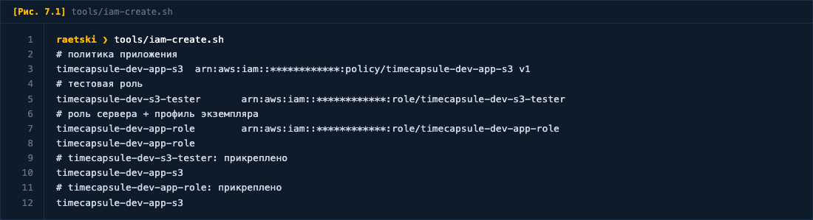

_Рис. 7.1. Политика и две роли созданы, к ролям прикреплена только `timecapsule-dev-app-s3`._

```json
{ "Sid": "ListUploadsPrefixOnly", "Effect": "Allow", "Action": "s3:ListBucket",
  "Resource": "arn:aws:s3:::timecapsule-dev-uploads-danilaraetchi",
  "Condition": { "StringLike": { "s3:prefix": ["uploads/*"] } } },
{ "Sid": "UploadsObjectRW", "Effect": "Allow", "Action": ["s3:GetObject", "s3:PutObject", "s3:DeleteObject"],
  "Resource": "arn:aws:s3:::timecapsule-dev-uploads-danilaraetchi/uploads/*" }
```

**Q07.** `ListBucket` относится к самому бакету (список его ключей), поэтому ресурс в ARN без `/*`; `GetObject` относится к отдельному объекту, поэтому ARN
заканчивается на `/uploads/*`. Если перепутать ARN, список с ARN объектов не сработает (запрос идёт к бакету) и `GetObject` с ARN бакета не совпадёт ни с одним
объектом: в обоих случаях `AccessDenied`.

### 3.2 Задание 8. Проверка прав через тестовую роль

Роль `timecapsule-dev-s3-tester` (политика доверия: аккаунт, политика прав: только `timecapsule-dev-app-s3`). Роль взята командой `assume-role` в одной оболочке с проверками,
`get-caller-identity` показал `assumed-role/timecapsule-dev-s3-tester/lab4` (рис. 8.1). Колонка "Ожидаю" записана до запуска ([`logs/08-expectations.txt`](logs/08-expectations.txt)).

| № | Команда | Ожидаю | Получил | Какое правило сработало |
| --- | --- | --- | --- | --- |
| 1 | `aws s3 cp test.txt s3://$BUCKET/uploads/test.txt` | разрешено | разрешено | разрешение в политике приложения (`PutObject`) |
| 2 | `aws s3 ls s3://$BUCKET/uploads/` | разрешено | разрешено | разрешение (`ListBucket`, `s3:prefix` = `uploads/`) |
| 3 | `aws s3 ls s3://$BUCKET` | AccessDenied | AccessDenied | неявный запрет (пустой prefix не проходит условие) |
| 4 | `aws s3 cp s3://$BUCKET/uploads/photo.txt -` | разрешено | разрешено | разрешение (`GetObject`) |
| 5 | `aws s3 ls s3://$BUCKET/backups/` | AccessDenied | AccessDenied | неявный запрет |
| 6 | `aws s3 cp test.txt s3://$BUCKET/backups/test.txt` | AccessDenied | AccessDenied | неявный запрет (`PutObject` только под `uploads/*`) |
| 7 | `aws s3api list-object-versions ... --prefix uploads/` | AccessDenied | AccessDenied | неявный запрет (нужен `s3:ListBucketVersions`) |
| 8 | `aws s3api delete-object ... --version-id <VersionId>` | AccessDenied | AccessDenied | неявный запрет (нужен `s3:DeleteObjectVersion`) |
| 9 | `aws s3 rm s3://$BUCKET/uploads/test.txt` | разрешено | разрешено | разрешение (`DeleteObject`); создан маркер удаления |
| 10 | `aws s3 ls ... --endpoint-url http://...` | AccessDenied | AccessDenied | явный запрет в политике бакета |

Несовпадений ожиданий нет. `VersionId` для команды 8 найден до её выполнения списком версий администратором (в задании это `Show versions`).

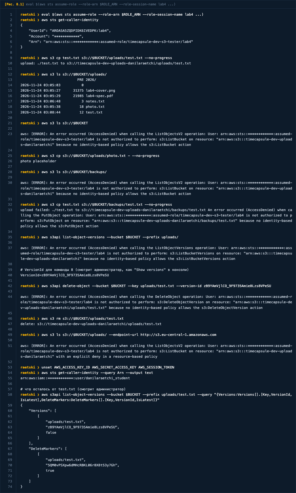

_Рис. 8.1. `get-caller-identity` от роли, десять команд, после них `unset` переменных и возврат к пользователю._

**Q08.** Политика доверия говорит, кто может взять роль (`sts:AssumeRole`), политика прав говорит, что роль может делать. После команды 9 `test.txt` не исчез:
добавлен маркер удаления, версия `zB9Y...` осталась (последний вывод рис. 8.1), и её можно восстановить, удалив маркер. Злоумышленник с учётными данными приложения не
может уничтожить файлы безвозвратно: удаление версий (`DeleteObjectVersion`) запрещено, он способен только добавить маркеры (и перезаписать объекты, создав новые версии).
Если бы в политике было `s3:*`, он удалил бы версии и маркеры, а также мог бы изменить политику бакета и версионирование: восстановить данные было бы нельзя.

### 3.3 Задание 9. Роль сервера

Роль `timecapsule-dev-app-role` (доверие: `ec2.amazonaws.com`), та же политика прав. Через CLI создан профиль экземпляра и привязан к `timecapsule-dev-app`
(`associate-iam-instance-profile`, перезапуск не нужен). На `app` переменная `BUCKET` добавлена в `~/.bashrc`.

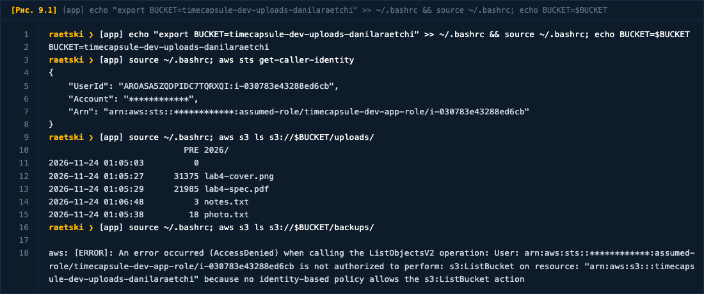

_Рис. 9.1. На `app` вызывающий: `assumed-role/timecapsule-dev-app-role/i-030783e43288ed6cb`; `ls uploads/` работает, `ls backups/` даёт `AccessDenied`._

**Q09.** CLI взял временные учётные данные из сервиса метаданных экземпляра (IMDS): роль, привязанная через профиль, выдаёт короткоживущие ключи, которые
обновляются автоматически. Политика доверия роли сервера допускает принять роль сервису EC2, а тестовой роли допускает пользователей этого аккаунта. Такие ключи
безопаснее файла `.env`: их не нужно хранить, они живут часы, не попадают в репозиторий и не копируются вместе с кодом.

### 3.4 Задание 10. Перенос существующих файлов

Вложение капсулы LR2 (`e5a7...png`) лежало в `storage/uploads`. `sync --dryrun`, затем `sudo aws s3 sync` (файл принадлежит `apache`), повторный `--dryrun` пуст.
Побочный эффект: вместе с файлом в бакет попал пустой `uploads/.gitkeep` (он есть в папке репозитория).

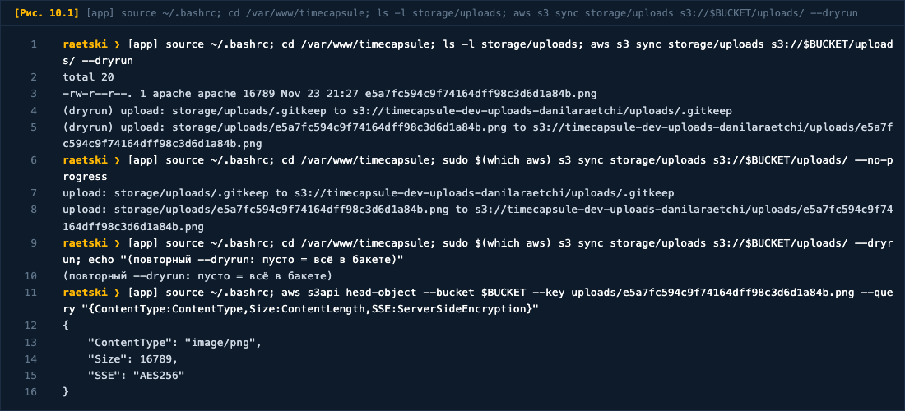

_Рис. 10.1. `--dryrun`, настоящий `sync`, пустой повторный `--dryrun`, `Content-Type: image/png` у перенесённого объекта._

**Q10.** Прав хватило. Использованы `s3:ListBucket` (сравнение списка бакета с локальной папкой; он разрешён для префикса `uploads/`, а команда передаёт этот префикс) и
`s3:PutObject` для загрузки. `GetObject` и `DeleteObject` команда `sync` без `--delete` не использует.

### 3.5 Задание 11. Модуль хранения на S3

Коммит [`b09d1a1`](https://github.com/raetskijr-cloud/timecapsule/commit/b09d1a1): `composer require aws/aws-sdk-php` (на `app` во временной копии; на ноутбуке Composer нет, затем `composer.json`
и `composer.lock` возвращены `scp`), `src/storage.php`, подвал `views/layout.php`, `.env.example` (`S3_BUCKET`, `AWS_REGION`, `PRESIGN_TTL_SECONDS`). Ключей доступа в `.env` нет.
Модуль: `storage_save()` (`putObject` с `SourceFile`, ключ `uploads/<hex32>.<ext>`, `ContentType` из `mime_content_type`), `storage_delete()` (`deleteObject`),
`storage_stream()` (302 на подписанный URL на `PRESIGN_TTL_SECONDS`, по умолчанию 300 с, с `ResponseContentType` и `ResponseContentDisposition`), а также `storage_client()`
(клиент создаётся один раз через `static`), `storage_new_name()`, `storage_url()`. Проверка прав на капсулу осталась в контроллере до `storage_stream()`.
Скрипт [`scripts/storage-smoke.php`](../../scripts/storage-smoke.php) проверяет модуль без входа в приложение.

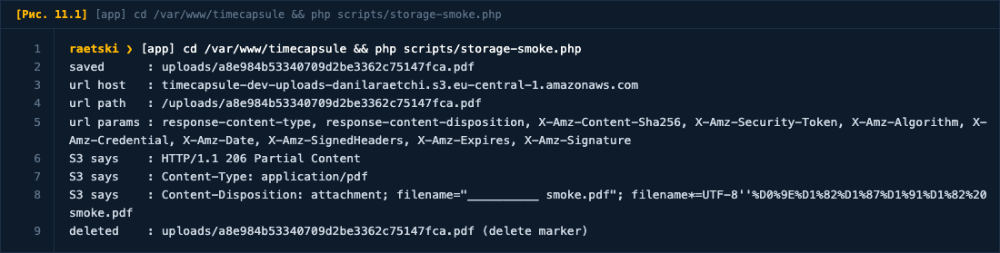

_Рис. 11.1. Загрузка, адрес с параметрами `X-Amz-*`, ответ S3 с `Content-Type` и `Content-Disposition` (имя файла в `filename*`), удаление._

### 3.6 Задание 12. Деплой и проверка

В `/var/www/timecapsule/.env` добавлены `S3_BUCKET` и `AWS_REGION` (дописаны в конец: владелец и группа `apache` сохранены). `~/deploy.sh`: `git pull`, `composer install`,
перезапуск PHP-FPM. Подвал: `Files: s3://timecapsule-dev-uploads-danilaraetchi/uploads/`.

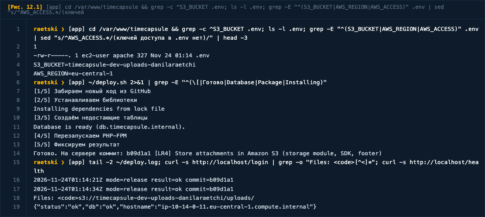

_Рис. 12.1. Деплой коммита `b09d1a1`, подвал с именем бакета, `/health` отвечает `ok`._

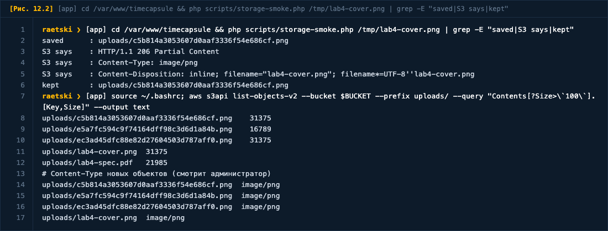

_Рис. 12.2. Загрузка картинки модулем (`Content-Type: image/png` в объекте и в ответе по ссылке), список объектов._

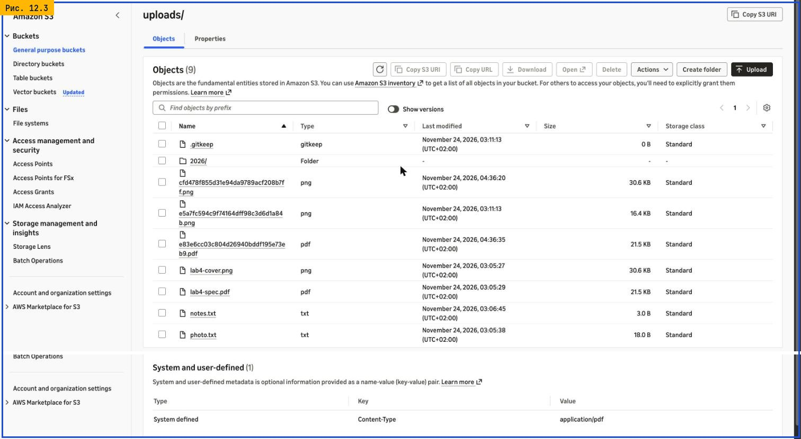

_Рис. 12.3. Новые объекты под `uploads/` (картинка и PDF) и `Content-Type: application/pdf` у PDF._
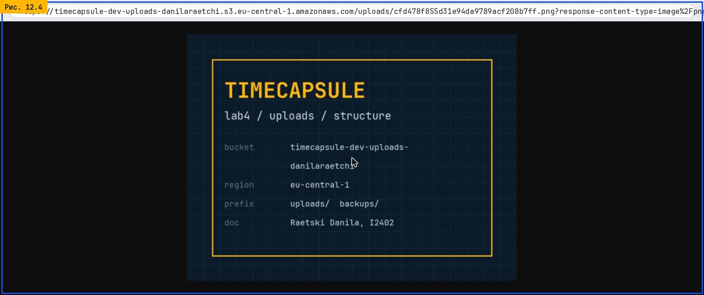

_Рис. 12.4. Картинка капсулы по ссылке S3 с параметрами `X-Amz-*` (подпись обрезана)._
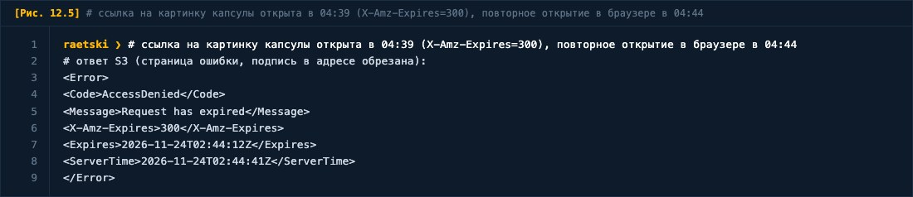

_Рис. 12.5. Ссылка из рис. 12.4 через 5 минут: `AccessDenied`, `Request has expired` (страницу ошибки браузер не снимает, показан ответ S3)._
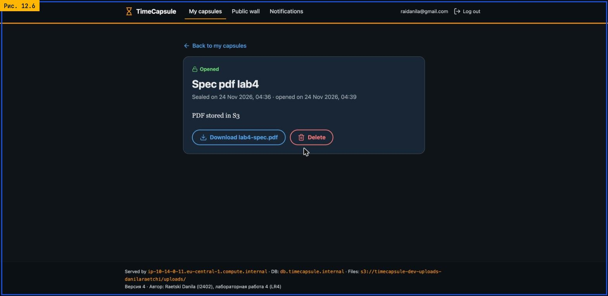

_Рис. 12.6. Кнопка скачивания PDF носит исходное имя `lab4-spec.pdf`, а не hex-имя объекта._
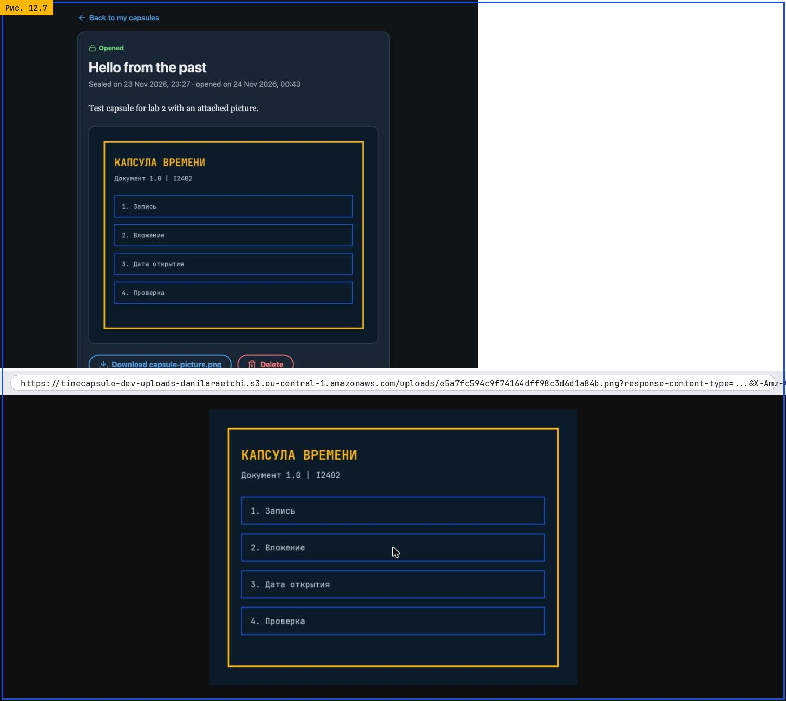

_Рис. 12.7. Капсула ЛР2: вложение приходит из S3 (адрес `s3...`)._
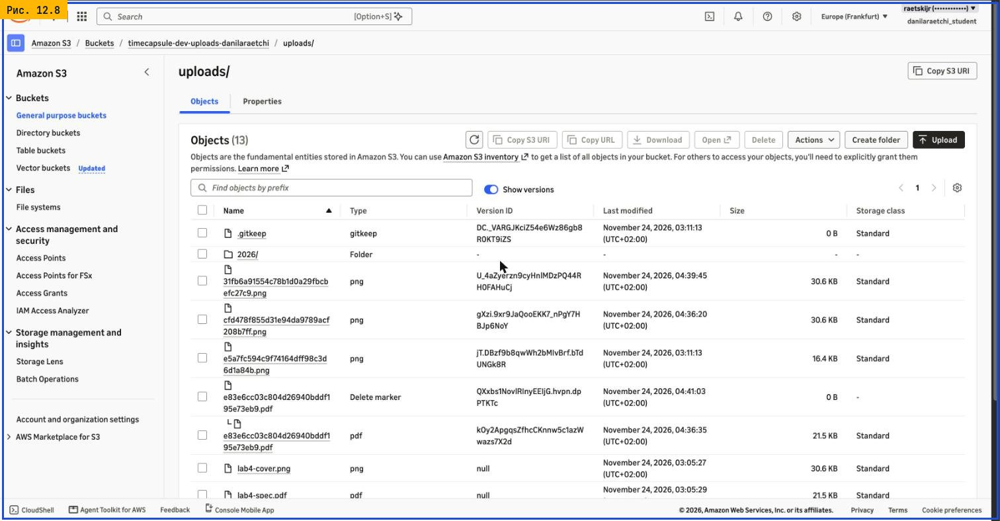

_Рис. 12.8. Удалённая капсула: у объекта PDF маркер удаления, версия осталась._

**Q11.** Ссылку не нужно отзывать: она сама перестаёт работать через 5 минут, а доступ ограничен одним объектом. После удаления капсулы в бакете остаётся
версия объекта (с маркером удаления); прежняя версия станет неактуальной и исчезнет по правилу жизненного цикла через 90 дней (если новее не более двух неактуальных версий).

### 3.7 Задание 13. Сервер без состояния

`storage/uploads` перенесён в `~/uploads-backup`; модуль сохраняет и удаляет объекты, `/health` отвечает `ok` (рис. 13.1). Создана версия v2 политики без `ListBucket`
(`create-policy-version --set-as-default`): приложение работает, `aws s3 ls uploads/` на сервере получает `AccessDenied` (рис. 13.2). Несуществующий объект:
`403 Forbidden` на сервере, `404 Not Found` у администратора (рис. 13.3).

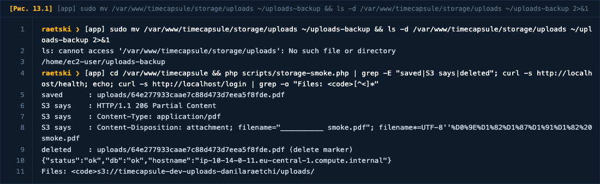

_Рис. 13.1. Папки нет, модуль работает, подвал показывает бакет._

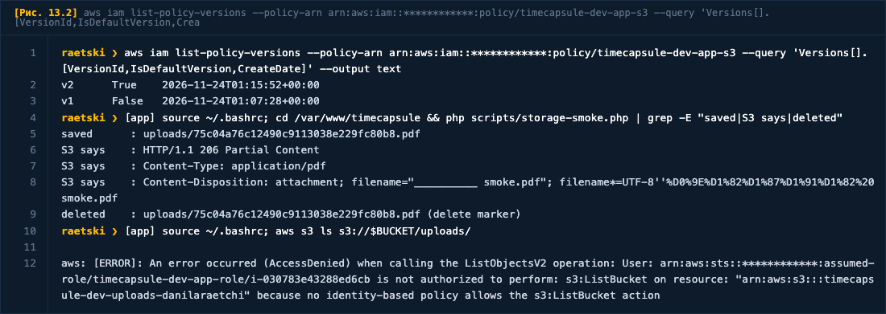

_Рис. 13.2. Версии политики, проверка модуля после v2 и `AccessDenied` на `ls`._

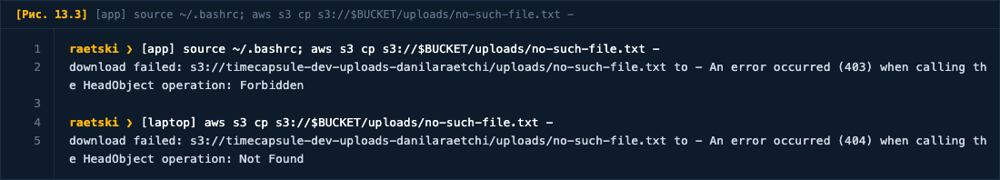

_Рис. 13.3. Ответы на запрос несуществующего объекта на сервере и на ноутбуке._

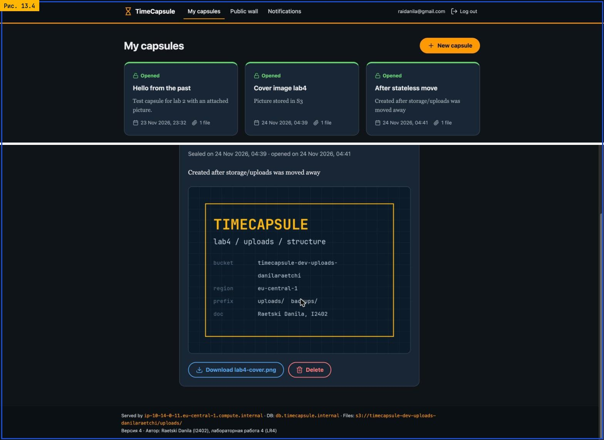

_Рис. 13.4. Старая и новая капсулы с вложениями после переноса `storage/uploads`, подвал `Files: s3://...`._

Копия `~/uploads-backup` удалена после проверки в браузере (рис. 13.4).

**Q12.** Без права `ListBucket` S3 не раскрывает, есть ли в бакете объект: для отсутствующего ключа он отвечает `403`, чтобы нельзя было перебором выяснять имена
чужих файлов; у администратора есть `ListBucket`, и тот же запрос получает честное `404`. Чтобы заменить `app` новым сервером без потери данных, достаточно
поднять его из того же кода, привязать роль `timecapsule-dev-app-role` и положить `.env` с `S3_BUCKET` и `AWS_REGION`: вложений на сервере нет.

## 4. Архитектура и ADR (задание 14)

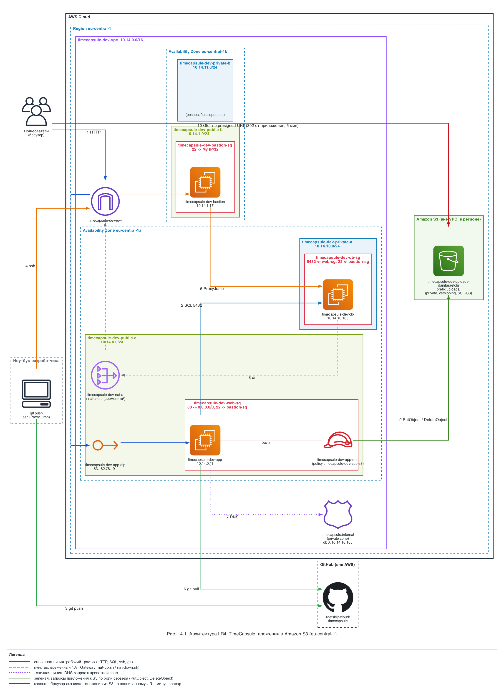

_Рис. 14.1. Схема LR3 с бакетом S3 в регионе вне VPC (подпись имени и `uploads/`), ролью `timecapsule-dev-app-role` у `app`, зелёная стрелка `PutObject`/`DeleteObject` и красная стрелка скачивания по подписанному URL._

Решение записано в [ADR-0003](../adr/0003-attachment-storage.md).

## 5. Итог: состояние на конец работы

| Ресурс | Состояние |
| --- | --- |
| Бакет, политика бакета, правило жизненного цикла | остаются (бесплатны или почти бесплатны) |
| Политика `timecapsule-dev-app-s3` (v2 по умолчанию), роли, профиль экземпляра | остаются |
| `bastion`, `app`, `db` | остановлены |
| Elastic IP `app-eip` | остаётся (0,005 USD/ч), привязан к `app` |
| NAT Gateway, ALB | нет |

## 6. Ответы на контрольные вопросы

Вопросы Q01-Q12 отвечены в соответствующих разделах. Устные вопросы продвинутого уровня:

**У1. Путь скачивания.** Пользователь нажимает ссылку на `/capsules/{id}/file`; приложение проверяет вход и права на капсулу (владелец, капсула открыта),
затем отвечает 302 на подписанный URL; браузер идёт в S3, S3 проверяет подпись и срок и отдаёт файл с заданными заголовками. Права пользователя приложения проверяются
в приложении до выдачи ссылки; права роли проверяются при подписании: S3 принимает запрос от имени роли, чьими ключами подписана ссылка.

**У2. Что мешает открыть файл по прямому адресу.** Block Public Access и отсутствие публичных политик и ACL, поэтому адрес без подписи даёт `AccessDenied`;
подписанный URL привязан к одному ключу подписью, действует `X-Amz-Expires` секунд, а политика бакета разрешает только HTTPS.

**У3. Почему не открыть бакет для чтения всем.** Тогда права на капсулу (владелец, время открытия) нельзя проверить: любой, кто узнал ключ, получил бы файл навсегда
и без записи об обращениях. Подписанный URL выдаётся только после проверки в приложении и скоро истекает.

**У4. Переживание отказа региона.** Нужна репликация бакета в другой регион (Cross-Region Replication, требует версионирование, оно уже включено), второй бакет с
такой же политикой и приложение во втором регионе, которое читает из реплики (при отказе переключаются имя бакета и регион в `.env`).

## Приложение A. Журнал команд

Журналы в [`logs/`](logs/): `01-*` ... `13-*` (номер соответствует заданию), `08-expectations.txt` (ожидания, записанные до запуска). Подписи, номер аккаунта и домашний адрес заменены.
Инструменты рабочей папки: `tools/lab.sh` (запись журнала и рендер), `tools/mask.sh`, `tools/tester-check.sh`, `tools/presign-test.sh`, `tools/iam-create.sh`.

## Приложение B. Термины

| Термин | Значение |
| --- | --- |
| Бакет | контейнер объектов S3, имя уникально во всём мире |
| Ключ | полное имя объекта, например `uploads/lab4-cover.png` |
| Маркер удаления | специальная версия, которую добавляет удаление в версионированном бакете |
| Подписанный URL | адрес с параметрами `X-Amz-*`, подписанный ключами и действующий ограниченное время |
| Профиль экземпляра | контейнер роли IAM, который привязывается к экземпляру EC2 |
| Политика доверия | документ роли: кто может её взять |
