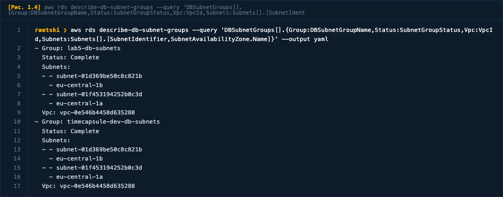
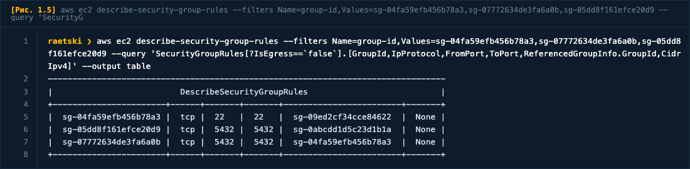
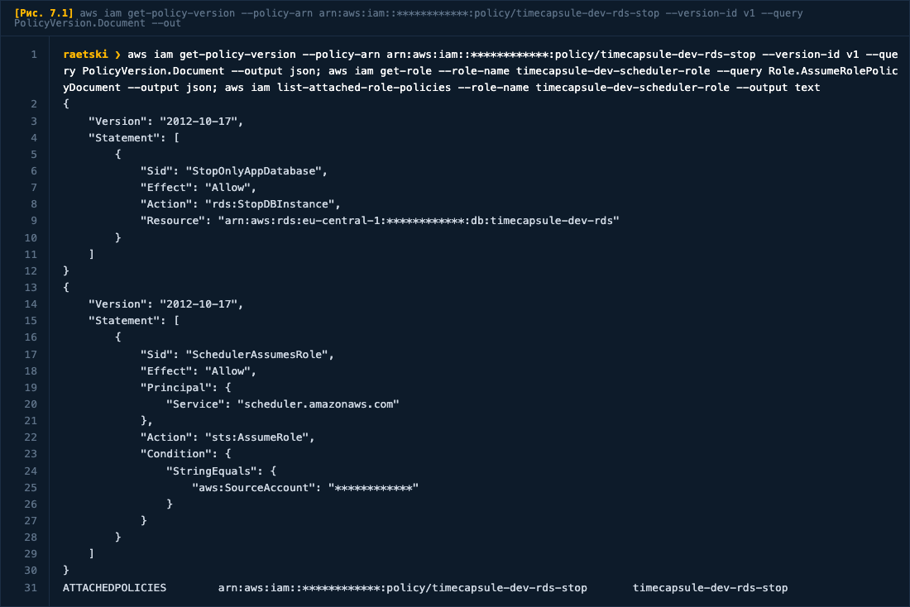
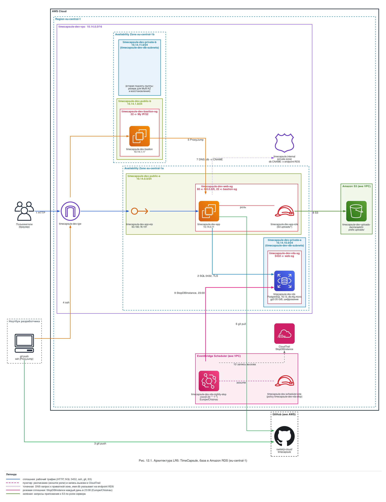

# Отчёт по лабораторной работе №5. Облачные базы данных. Amazon RDS

| Поле | Значение |
| --- | --- |
| Версия отчёта | 0.5 (черновик: рисунки консоли и результаты Части 1-2 не вставлены) |
| Дата | 2026-11-24 |
| ФИО | Raetski Danila |
| Группа | I2402 |
| Специальность | Informatică |
| Уровень | продвинутый (Часть 1 и Часть 2, задания 1-12) |
| Репозиторий | https://github.com/raetskijr-cloud/timecapsule |
| Регион | `eu-central-1` (Frankfurt) |
| Решение | [ADR-0004](../adr/0004-database-hosting.md) |
| Отчёты предыдущих работ | [`README.md`](../../README.md) (LR2), [`docs/lab3/README.md`](../lab3/README.md), [`docs/lab4/README.md`](../lab4/README.md) |

## Оглавление

0. Сводка
1. Матрица трассируемости
2. Часть 1. Базовый уровень (задания 1-5)
3. Часть 2. Продвинутый уровень (задания 6-11)
4. Архитектура и ADR (задание 12)
5. Итог: состояние на конец работы
6. Ответы на контрольные вопросы
- Приложение A. Журнал команд
- Приложение B. Термины
- Приложение C. Остановка и запуск (runbook)

Пометки `<<T..>>` в тексте: значения, которые подставляются после выполнения шага в консоли (время, endpoint, счётчики). Пометки `TODO-FIG`: места рисунков.

## 0. Сводка

| Показатель | Значение |
| --- | --- |
| Учебная база | `lab5-db`: PostgreSQL <<T версия, 18.x>>, `db.t4g.micro`, gp3 20 ГиБ, `eu-central-1a`, шифрование и защита от удаления, копии <<T 1 день / 7 дней>> |
| Учебные производные | реплика `lab5-db-replica` (1b), восстановленная копия `lab5-db-restore`; все удалены в конце Части 1 |
| Сервер Части 1 | `lab5-web01` (t3.micro, AL2023, `public-a`, `lab5-sg-web`, клиент `psql` 16.16); удалён в конце Части 1 |
| База приложения | `timecapsule-dev-rds`: PostgreSQL 16.13, `db.t4g.micro`, gp3 20 ГиБ, `eu-central-1a`, группа подсетей `timecapsule-dev-db-subnets`, `timecapsule-dev-rds-sg`; endpoint <<T endpoint>> |
| Ночная остановка | расписание `timecapsule-dev-rds-nightly-stop`, `cron(0 23 * * ? *)`, `Europe/Chisinau`; политика `timecapsule-dev-rds-stop`, роль `timecapsule-dev-scheduler-role` |
| DNS | `db.timecapsule.internal`: запись A (10.14.10.165) заменена CNAME на endpoint одной пачкой, TTL 60 |
| Ограничения Free plan | только шаблон `Free tier` (соответствует `Sandbox`), не более 2 экземпляров RDS, копии <<T срок>>: зафиксировано в разделе 2.2 |
| Теги | `Name`, `Project=timecapsule`, `Environment=dev`, `Owner=danilaraetchi`, `Lab=lab5`, `Purpose=coursework` |
| Скрипты | [`scripts/lab5/`](../../scripts/lab5/): `app-user.sh`, `migrate.sh`, `notes.sql`, `dns-cname.json`, `health-poll.sh`, политики IAM |
| Состояние на конец работы | <<T: база приложения остановлена; bastion, app остановлены; db-server удалён; ресурсов `lab5-*` нет>> |

Условное обозначение: рисунки вида `[Рис. N.k]` с тёмным терминалом сняты на ноутбуке (`psql` и `dig` выполнялись на `lab5web` или `app` через `ProxyJump`, номер аккаунта и пароли скрыты);
рисунки консоли AWS сняты в реальной консоли под IAM-пользователем `danilaraetchi_student` (номер аккаунта скрыт). Пароль `dbadmin` создан RDS (`Auto generate password`), сохранён локально
(права `600`) и в `~/.pgpass` серверов; в отчёт и репозиторий не попадает. Пароль пользователя `timecapsule` берётся скриптом из `DB_PASSWORD` в `.env` и нигде не печатается.

## 1. Матрица трассируемости

| Требование задания | Задание | Рисунок | Раздел |
| --- | --- | --- | --- |
| Группа подсетей `lab5-db-subnets` (private-a, private-b), SG веб-сервера, SG базы только от SG веб-сервера | 1 | Рис. 1.1-1.5 | 2.1 |
| `lab5-db`: параметры, шифрование, защита от удаления, ограничения Free plan | 2 | Рис. 2.1-2.7 | 2.2 |
| Подключение, `version()`, `\conninfo`, таблица `notes`, IP endpoint, проверка закрытого доступа | 3 | Рис. 3.1-3.4 | 2.3 |
| Реплика: `pg_is_in_recovery`, ошибка `INSERT`, `fourth`, `ReplicaLag` | 4 | Рис. 4.1-4.4 | 2.4 |
| PITR: время, `DELETE`, реплика пуста, `Latest restore time`, форма восстановления, строки вернулись | 5 | Рис. 5.1-5.6 | 2.5 |
| База приложения, `Connectivity & security` | 6 | Рис. 6.1, 6.2 | 3.1 |
| Политика, роль, расписание, тест остановки, `0 23 * * ? *` | 7 | Рис. 7.1-7.5 | 3.2 |
| Пользователь и база `timecapsule` | 8 | Рис. 8.1 | 3.3 |
| Перенос данных, счётчики, удаление выгрузки | 9 | Рис. 9.1 | 3.4 |
| CNAME, `/health`, новая капсула, `db-server` удалён | 10 | Рис. 10.1-10.3 | 3.5 |
| Перезагрузка, остановка, события, `StopDBInstance` в CloudTrail | 11 | Рис. 11.1-11.4 | 3.6 |
| Схема и ADR-0004 | 12 | Рис. 12.1 | 4 |

Таблица рисунков:

| Рисунок | Содержание | Тип | Статус |
| --- | --- | --- | --- |
| 1.1-1.3 | Группа подсетей, правила `lab5-sg-web` и `lab5-rds-sg` | консоль | TODO |
| 1.4, 1.5 | Группы подсетей и правила SG (CLI) | терминал | готово |
| 2.1-2.7 | Форма создания `lab5-db`, ошибка Free plan, `Available` | консоль | TODO |
| 3.1-3.4 | `version()`, `\conninfo`, `notes`, `dig`, отказ постороннему | терминал | TODO |
| 4.1, 4.4 | Реплика `Available`, `ReplicaLag` | консоль | TODO |
| 4.2, 4.3 | Реплика: `t`, ошибка `INSERT`, `fourth` | терминал | TODO |
| 5.1, 5.2, 5.5 | Время, `DELETE`, пустая реплика, строки после восстановления | терминал | TODO |
| 5.3, 5.4, 5.6 | `Latest restore time`, форма восстановления, список баз | консоль | TODO |
| 6.1, 6.2 | База приложения | консоль | TODO |
| 7.1 | Политика и роль (CLI) | терминал | готово |
| 7.2-7.5 | Расписание, остановка, событие | консоль | TODO |
| 8.1, 9.1, 10.1, 10.2 | Пользователь, перенос, CNAME, `/health`, капсула | терминал | TODO |
| 10.3, 11.2, 11.4 | Список серверов, события базы, CloudTrail | консоль | TODO |
| 11.1, 11.3 | `/health` при перезагрузке и остановке | терминал | TODO |
| 12.1 | Схема архитектуры | диаграмма | готово |

## 2. Часть 1. Базовый уровень (задания 1-5)

Учебные ресурсы называются с префиксом `lab5-` (тег `Lab=lab5`, `Purpose=coursework`) и удаляются в конце части.

### 2.1 Задание 1. Размещение и доступ к базе

**Цель.** База в приватной подсети; подключаться к ней может только сервер, у которого есть нужная Security Group.

**Выполненные действия.**
1. Группа подсетей `lab5-db-subnets`: `timecapsule-dev-private-a` (`10.14.10.0/24`, `eu-central-1a`) и `timecapsule-dev-private-b` (`10.14.11.0/24`, `eu-central-1b`) из `timecapsule-dev-vpc`.
2. Security Group веб-сервера `lab5-sg-web`: входящий SSH только от `timecapsule-dev-bastion-sg`.
3. Security Group базы `lab5-rds-sg`: входящий TCP 5432 только от `lab5-sg-web` (источник: группа, CIDR-правил нет).

**Результат.** Все три объекта созданы и проверены (рис. 1.4, 1.5).

**Доказательство.**

<!-- TODO-FIG L5 1.1: Группа подсетей lab5-db-subnets: VPC и две подсети с зонами -->
<!-- TODO-FIG L5 1.2: lab5-sg-web: входящие правила -->
<!-- TODO-FIG L5 1.3: lab5-rds-sg: единственное правило 5432 от lab5-sg-web -->

*Рис. 1.4. Группы подсетей БД по данным API*

*Рис. 1.5. Входящие правила трёх SG: источники только группы, CIDR нет*

**Вопрос.** Почему для ограничения доступа удобнее использовать Security Group источника, а не его IP-адрес? Зачем указывать две подсети, если учебная база будет работать в одной зоне?

**Ответ.** Правило с группой источника пускает любой сетевой интерфейс, которому назначена эта группа, и не зависит от адресов: сервер можно пересоздать, добавить второй (в LR6 их запускает Auto Scaling),
а правило базы менять не придётся. Правило по IP требует правки при каждом изменении, и любой ресурс, получивший этот адрес, получает доступ. Две подсети в разных зонах RDS требует для любой группы
подсетей: без них нельзя создать реплику в другой зоне (задание 4), включить Multi-AZ и восстановить базу в `1b` при отказе `1a`.

### 2.2 Задание 2. База RDS

**Цель.** Создать `lab5-db` с заданными параметрами.

**Выполненные действия.** Параметры: PostgreSQL <<T версия>> (последняя из доступных в регионе: 18.6 по данным `describe-db-engine-versions`), шаблон `Free tier` (на Free plan это единственный вариант, соответствует `Sandbox`),
`db.t4g.micro`, gp3 20 ГиБ без autoscaling, пользователь `dbadmin` с автоматически созданным паролем, группа `lab5-db-subnets`, зона `eu-central-1a`, публичный доступ выключен, `lab5-rds-sg`, начальная база `lab5`,
шифрование и защита от удаления включены. Срок хранения копий: 7 дней не принят <<T проверить: ошибка `exceeds the maximum available to free tier customers`>>, установлен 1 день.

**Результат.** `lab5-db` в состоянии `Available`, endpoint <<T>>.

**Доказательство.**

<!-- TODO-FIG L5 2.1: Шаблон Free tier, Single-AZ, версия PostgreSQL -->
<!-- TODO-FIG L5 2.2: Идентификатор, dbadmin, Auto generate password -->
<!-- TODO-FIG L5 2.3: Класс db.t4g.micro, gp3 20 ГиБ, autoscaling выключен -->
<!-- TODO-FIG L5 2.4: Подключение: группа подсетей, Public access No, lab5-rds-sg -->
<!-- TODO-FIG L5 2.5: Дополнительно: база lab5, копии, шифрование, защита от удаления -->
<!-- TODO-FIG L5 2.6: Ошибка Free plan при сроке копий 7 дней -->
<!-- TODO-FIG L5 2.7: Connectivity & security: endpoint, Available -->

**Вопрос.** Как убедиться, что база принимает подключения только с нужного сервера? Почему для неё выбрана зона `eu-central-1a`? От чего защищает и от чего не защищает `deletion protection`?

**Ответ.** Проверка: подключение с `lab5-web01` проходит, с `app` (другая SG) и с ноутбука завершается таймаутом, публичного адреса нет (рис. 3.3, 3.4). Зона `1a` выбрана потому, что в ней находятся
`app` и остальной стенд: трафик внутри одной зоны быстрее и не тарифицируется как межзонный; `1b` оставлена реплике и восстановлению. Защита от удаления блокирует `DeleteDBInstance` (в консоли и API), пока она включена, то есть
защищает от случайного удаления всей базы. От `DROP`, `DELETE FROM`, неверного `UPDATE`, потери зоны и от удаления через снятие защиты она не защищает.

### 2.3 Задание 3. Подключение к базе

**Выполненные действия.** `lab5-web01` (t3.micro, AL2023, `public-a`, `lab5-sg-web`, `psql` 16.16 из `postgresql16`, `bind-utils`; публичный адрес нужен только для установки пакетов, SSH разрешён лишь с bastion). Пароль
`dbadmin` записан в `~/.pgpass` скриптом `tools/pgpass.sh` (через stdin, права 600). Выполнены `SELECT version();`, `\conninfo`, `scripts/lab5/notes.sql` (таблица `notes`, строки `first`, `second`, `third`). Имя endpoint разрешено на сервере и на ноутбуке.

**Результат.** <<T: версия, `\conninfo` (SSL), три строки; на сервере endpoint даёт приватный адрес из `10.14.10.0/24`; результат с ноутбука: записать фактический>>.

**Доказательство.**

<!-- TODO-FIG L5 3.1: psql: version() и \conninfo -->
<!-- TODO-FIG L5 3.2: Таблица notes, три строки -->
<!-- TODO-FIG L5 3.3: dig endpoint: lab5web и ноутбук -->
<!-- TODO-FIG L5 3.4: Подключение с app (чужая SG): таймаут -->

### 2.4 Задание 4. Реплика для чтения

**Выполненные действия.** Реплика `lab5-db-replica`: `db.t4g.micro`, `eu-central-1b`, без публичного доступа, `lab5-rds-sg`, без защиты от удаления. На реплике: `pg_is_in_recovery()`, `SELECT * FROM notes`, `INSERT`. На основной: `pg_is_in_recovery()`, строка `fourth`; чтение на реплике; метрика `ReplicaLag`.

**Результат.** <<T: `t` на реплике, `f` на основной, текст ошибки `INSERT` (`cannot execute INSERT in a read-only transaction`), `fourth` на реплике, значения ReplicaLag>>.

**Доказательство.**

<!-- TODO-FIG L5 4.1: Реплика Available в eu-central-1b -->
<!-- TODO-FIG L5 4.2: Реплика: t, notes, ошибка INSERT -->
<!-- TODO-FIG L5 4.3: Основная: f, fourth; реплика видит fourth -->
<!-- TODO-FIG L5 4.4: ReplicaLag на вкладке Monitoring -->

**Вопрос.** Почему `INSERT` на реплике не выполнился? Чем реплика для чтения отличается от резервного экземпляра Multi-AZ?

**Ответ.** Реплика постоянно применяет журнал изменений основной базы (режим восстановления, `pg_is_in_recovery()` возвращает `t`), поэтому принимает только чтение: запись привела бы к расхождению с основной.
Реплика асинхронна, доступна для запросов и имеет собственный endpoint; её можно повысить до самостоятельной базы вручную, автоматически она не подхватывает работу. Резервный экземпляр Multi-AZ синхронен, для запросов недоступен,
не имеет отдельного endpoint и автоматически становится основным при отказе (endpoint остаётся прежним).

### 2.5 Задание 5. Восстановление после ошибки

**Выполненные действия.** Время `SELECT now() AT TIME ZONE 'UTC'` = <<T>>, через минуту `DELETE FROM notes;`. Реплика пуста (<<T>>). Реплика удалена. `Latest restore time` проверено после момента T. `Restore to point in time` на момент T
(консоль показывает местное время UTC+2: <<T пересчёт>>) в `lab5-db-restore` (`db.t4g.micro`, одна зона, `lab5-db-subnets`, без публичного доступа, `lab5-rds-sg`, без защиты от удаления). Строки возвращены, копия удалена без финального снимка.

**Результат.** <<T: четыре строки (`first`, `second`, `third`, `fourth`) в копии>>.

**Доказательство.**

<!-- TODO-FIG L5 5.1: Время T и DELETE на основной -->
<!-- TODO-FIG L5 5.2: Реплика после DELETE: таблица пуста -->
<!-- TODO-FIG L5 5.3: Latest restore time после момента T -->
<!-- TODO-FIG L5 5.4: Форма Restore to point in time -->
<!-- TODO-FIG L5 5.5: Копия lab5-db-restore: строки на месте -->
<!-- TODO-FIG L5 5.6: Список баз: lab5-db удалена, ресурсов lab5-* нет -->

**Вопрос.** Почему реплика не спасла данные? Почему восстановление создаёт новую базу, а не откатывает старую?

**Ответ.** Репликация передаёт и ошибочные изменения: `DELETE` на основной через секунды выполнился и на реплике (рис. 5.2); реплика защищает от отказа и нагрузки чтения, но не от ошибки пользователя.
Восстановление собирает базу из снимка и журнала изменений на момент T в новый экземпляр: текущая база остаётся нетронутой, в ней можно сравнить данные и выбрать, что переносить, а откат на месте уничтожил бы
всё, что записано после T.

### Завершение Части 1

Защита от удаления у `lab5-db` выключена (база запущена), `lab5-db` удалена без снимка и без копий, удалены `lab5-db-subnets`, `lab5-rds-sg`, затем `lab5-web01` и `lab5-sg-web`. Проверка: <<T: `aws rds describe-db-instances` пусто, EC2 без `lab5-*`>>.

## 3. Часть 2. Продвинутый уровень (задания 6-11)

### 3.1 Задание 6. База приложения

**Выполненные действия.** Группа подсетей `timecapsule-dev-db-subnets` (`private-a`, `private-b`), `timecapsule-dev-rds-sg` (5432 только от `timecapsule-dev-web-sg`), база `timecapsule-dev-rds` (PostgreSQL 16.13, ветка 16 совместима с `pg_dump` 16.16 на `app`;
параметры как у учебной; `Initial database name` пусто; теги `Lab=lab5`). Создана после удаления всех учебных баз (лимит двух экземпляров).

**Доказательство.**

<!-- TODO-FIG L5 6.1: timecapsule-dev-rds: Connectivity & security -->
<!-- TODO-FIG L5 6.2: Maintenance & backups: окна по умолчанию, копии -->

**Вопрос.** Какие параметры базы приложения вы выбрали бы иначе для рабочей системы с реальными пользователями? Почему?

**Ответ.** Multi-AZ (отказ зоны без ручного восстановления), срок копий не менее 7 дней и защищённые снимки, класс экземпляра не `t4g.micro` (нет кредитов CPU для постоянной нагрузки), Performance Insights и мониторинг,
отдельный пароль в Secrets Manager с ротацией, проверка сертификата сервера (`verify-full`), окно обслуживания вне рабочих часов, при росте нагрузки реплика для чтения.

### 3.2 Задание 7. Ночная остановка базы

**Выполненные действия.** Политика `timecapsule-dev-rds-stop`: единственное действие `rds:StopDBInstance`, ресурс `arn:aws:rds:eu-central-1:<ACCOUNT_ID>:db:timecapsule-dev-rds` (файл [`rds-stop-policy.json`](../../scripts/lab5/rds-stop-policy.json)).
Роль `timecapsule-dev-scheduler-role`: доверие `scheduler.amazonaws.com` с условием `aws:SourceAccount` ([`scheduler-trust.json`](../../scripts/lab5/scheduler-trust.json)). Расписание `timecapsule-dev-rds-nightly-stop`: `Cron-based`,
`Europe/Chisinau`, Flexible time window `Off`, цель `All APIs` -> `Amazon RDS` -> `StopDBInstance`, вход `{"DbInstanceIdentifier": "timecapsule-dev-rds"}`. Проверка: выражение на время через 6 минут (<<T cron>>),
база перешла в `Stopped` в <<T>>, событие `DB instance stopped` <<T>>. После этого выражение заменено на `0 23 * * ? *`, база запущена.

**Доказательство.**

*Рис. 7.1. Политика и роль расписания*

<!-- TODO-FIG L5 7.2: Расписание: cron, часовой пояс, Flexible window Off -->
<!-- TODO-FIG L5 7.3: Расписание: цель StopDBInstance, роль -->
<!-- TODO-FIG L5 7.4: База Stopped и событие остановки в Logs & events -->
<!-- TODO-FIG L5 7.5: Расписание после замены на 0 23 * * ? * -->

**Вопрос.** Зачем расписанию своя роль, если вы и сами можете остановить базу? Почему роль может остановить только одну базу?

**Ответ.** Расписание выполняется без пользователя и вызывает API от имени роли: ваши права ему не передаются, а у роли должно быть ровно то, что нужно. Доверительная политика разрешает взять роль только Scheduler (и только из этого аккаунта),
политика разрешает одно действие на ARN одной базы. Если расписание будет изменено или скомпрометировано, максимальный вред: остановка `timecapsule-dev-rds`; удалить базу, остановить чужую или прочитать данные оно не сможет.

### 3.3 Задание 8. Пользователь и база данных

**Выполненные действия.** Скрипт [`app-user.sh`](../../scripts/lab5/app-user.sh) на `app` от `dbadmin`: `CREATE USER timecapsule`, пароль из `DB_PASSWORD` в `.env` (подстановка внутри `psql`, в аргументах и выводе значения нет;
интерактивный `\password` по `ssh` без терминала не работает), `GRANT timecapsule TO dbadmin`, `CREATE DATABASE timecapsule OWNER timecapsule`. `.env` не менялся.

<!-- TODO-FIG L5 8.1: Пользователь и база timecapsule в RDS -->

**Вопрос.** Почему приложению нужен отдельный пользователь, а не `dbadmin`?

**Ответ.** `dbadmin` управляет экземпляром целиком (создаёт роли и базы, видит все базы). Приложению нужны только таблицы своей базы: при компрометации приложения (SQL-инъекция, утечка `.env`) отдельный пользователь
ограничивает ущерб одной базой, его можно ротировать и отключать, не трогая администрирование, а действия в журналах различимы.

### 3.4 Задание 9. Перенос данных

**Выполненные действия.** Приложение не открывалось с момента выгрузки до переключения DNS. Скрипт [`migrate.sh`](../../scripts/lab5/migrate.sh) на `app`: `pg_dump -h db.timecapsule.internal ... --no-owner --no-privileges`,
загрузка `psql --single-transaction` в endpoint RDS, `count(*)` по `users` и `capsules` в обеих базах, удаление выгрузки (в ней хеши паролей).

**Результат.** <<T: users = N, capsules = M в обеих базах; `timecapsule.sql` удалён>>.

<!-- TODO-FIG L5 9.1: Выгрузка, загрузка, совпадающие счётчики users и capsules, удаление дампа -->

### 3.5 Задание 10. Переключение приложения

**Выполненные действия.** Запись A `db` (10.14.10.165) удалена и CNAME `db` -> endpoint создана одним запросом `change-resource-record-sets` (пачка `DELETE` + `CREATE`, TTL 60; файл [`dns-cname.json`](../../scripts/lab5/dns-cname.json)),
окна без записи нет. Соединение шифруется: `pdo_pgsql` использует `sslmode=prefer`, у RDS for PostgreSQL 16 включён TLS (<<T `pg_stat_ssl`>>). `/health`, новая капсула найдена в `capsules` RDS. `db-server` остановлен, приложение работает, сервер удалён.

<!-- TODO-FIG L5 10.1: DELETE A + CREATE CNAME и dig db.timecapsule.internal -->
<!-- TODO-FIG L5 10.2: /health и новая капсула в таблице capsules RDS -->
<!-- TODO-FIG L5 10.3: Список серверов EC2 без db-server -->

**Вопрос.** Почему не пришлось менять `DB_HOST`? Какие обязанности из LR3 перешли к AWS, а какие остались за вами?

**Ответ.** `DB_HOST=db.timecapsule.internal` по-прежнему разрешается в приватной зоне, изменилась только запись за этим именем (A -> CNAME на endpoint): приложение не знает, где физически база. К AWS перешли обновления ОС и СУБД,
автоматические копии и восстановление на момент времени, мониторинг экземпляра и замена отказавшего оборудования. За мной остались схема и данные, пользователи и права, сетевые правила (SG), версия СУБД в рамках ветки,
расписание остановки, контроль расходов и проверка восстановления.

### 3.6 Задание 11. Обслуживание базы

**Выполненные действия.** Перезагрузка базы (`Reboot` без failover) при опросе `/health` каждую секунду ([`health-poll.sh`](../../scripts/lab5/health-poll.sh)); события на `Logs & events`; остановка и запуск базы;
сравнение endpoint; повторный `StopDBInstance` на остановленной базе; событие `StopDBInstance` от `assumed-role/timecapsule-dev-scheduler-role` в CloudTrail.

**Результат.** <<T: `/health` во время перезагрузки (код, длительность), endpoint до и после (совпал / нет), текст ошибки повторного Stop (`InvalidDBInstanceState`)>>.

<!-- TODO-FIG L5 11.1: /health раз в секунду во время Reboot -->
<!-- TODO-FIG L5 11.2: Logs & events: перезагрузка, остановка, запуск -->
<!-- TODO-FIG L5 11.3: Приложение при остановленной базе; endpoint; повторный Stop -->
<!-- TODO-FIG L5 11.4: CloudTrail: StopDBInstance от scheduler-role -->

**Вопрос.** Что показывал `/health` во время перезагрузки? Изменился ли endpoint после остановки и запуска? Какую ошибку получает расписание, если база уже остановлена?

**Ответ.** <<T: подставить фактическое наблюдение: код ответа и длительность недоступности>>. Endpoint не меняется (DNS-имя закреплено за экземпляром, меняться может только IP за ним). Вызов `StopDBInstance` на остановленной базе завершается
ошибкой `InvalidDBInstanceState` (база не в состоянии `available`), расписание фиксирует неудачный вызов, на состояние базы это не влияет.

## 4. Архитектура и ADR (задание 12)

*Рис. 12.1. Архитектура LR5: база в RDS, расписание, CNAME*

| Подпись на схеме | Полное имя в AWS |
| --- | --- |
| timecapsule-dev-rds | Amazon RDS for PostgreSQL 16.13, `timecapsule-dev-rds` |
| timecapsule-dev-rds-sg | Security Group, 5432 только от `timecapsule-dev-web-sg` |
| (timecapsule-dev-db-subnets) | Группа подсетей БД: `private-a`, `private-b` |
| timecapsule-dev-rds-nightly-stop | EventBridge Scheduler, `cron(0 23 * * ? *)`, `Europe/Chisinau` |
| timecapsule-dev-scheduler-role | Роль IAM с политикой `timecapsule-dev-rds-stop` |
| timecapsule.internal | Приватная зона Route 53, `db` -> CNAME на endpoint |

Решение: [ADR-0004. Хостинг базы данных: Amazon RDS Single-AZ](../adr/0004-database-hosting.md) (сравнение PostgreSQL на EC2, RDS Single-AZ, RDS Multi-AZ, Aurora; частота копий и потеря данных; цена, лимит и самозапуск через 7 дней;
как приложение находит базу и что меняется при отказе `1a`).

## 5. Итог: состояние на конец работы

<<T: заполнить: база приложения `stopped`; `bastion`, `app` остановлены; `db-server` удалён; Elastic IP `app-eip` остаётся; ресурсов `lab5-*` нет; расписание активно>>

## 6. Ответы на контрольные вопросы

Письменные ответы приведены в разделах 2-3 после соответствующих заданий. Устные вопросы продвинутого уровня:

1. **Путь запроса от браузера до базы.** Браузер -> Internet Gateway -> Elastic IP -> `app` (SG `web-sg` пропускает 80) -> nginx -> PHP-FPM -> DNS-запрос `db.timecapsule.internal` в приватной зоне (CNAME на endpoint, ответ: адрес из `10.14.10.0/24`) ->
   соединение 5432 к RDS: проходит маршрут VPC (local), SG `timecapsule-dev-rds-sg` (источник `web-sg`), TLS, проверка пользователя и пароля (`pg_hba` RDS), права пользователя `timecapsule` на базу.
2. **Репликация и резервная копия.** Репликация копирует текущее состояние (в том числе ошибки) почти мгновенно и даёт отказоустойчивость и чтение; копия (снимок плюс журнал) хранит историю и позволяет вернуться на момент до ошибки, но восстановление занимает время.
3. **Отказ зоны `1a`.** Восстановить базу из копии в `1b` (группа подсетей это позволяет) и переписать CNAME; для автоматического переключения нужен Multi-AZ: примерно двойная цена экземпляра и диска.
4. **Автозапуск через 7 дней.** Расписание останавливает базу каждую ночь в 23:00, поэтому 7-дневный лимит не достигается; если расписание отключено, остановленную базу нужно проверять и останавливать вручную.

## Приложение A. Журнал команд

Журналы лежат в [`logs/`](logs/): `01-subnet-groups.txt`, `01-sg-rules.txt`, `07-iam.txt`; после выполнения консольной части добавляются `rds-events.txt` (события `lab5-db` и `timecapsule-dev-rds`) и журналы заданий 3-11.

## Приложение B. Термины

Amazon RDS, группа подсетей БД, реплика для чтения, Multi-AZ, PITR, Deletion protection, EventBridge Scheduler, endpoint, CNAME: определения в [`docs/glossary.md`](../glossary.md), раздел LR5.

## Приложение C. Остановка и запуск (runbook)

Порядок запуска: база, затем `app`, затем `bastion`; остановка в обратном порядке. Подробнее: [`docs/runbook.md`](../runbook.md), раздел LR5.
